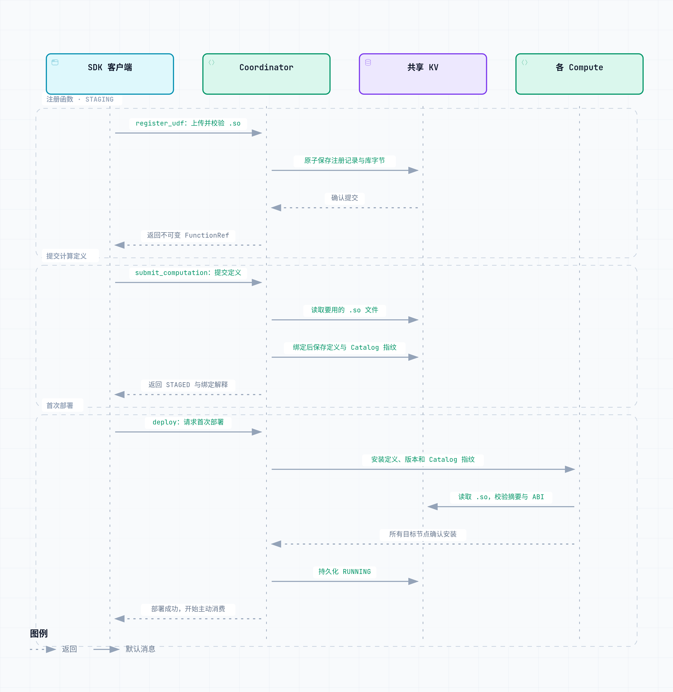
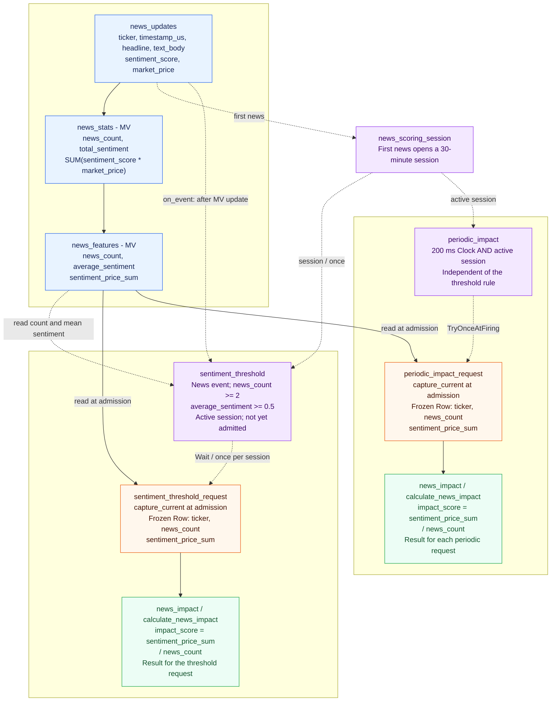

# EventFlow

EventFlow 是一个用 C++20 编写的**分布式特征计算流式数据库**。它接收持续到来的流式数据，用 SQL 物化视图更新特征；条件满足或定时器到期时，再按声明式 Trigger / Pattern 发起计算。保存的特征结果可以通过 SQL 查询。系统按业务 key 分配数据，多个 Compute 可以分别处理不同分片。

系统用两类依赖描述业务：**特征依赖决定先算什么后算什么，触发规则决定何时计算**。**前者通过级联物化视图表达计算图。后者组合事件条件、顺序和时钟，本质上是一个状态机，状态机本质上是由节点（状态）和有向边（转换条件）构成的有向图**。两者放在同一个系统内，便于管理计算定义、状态和结果。设计参考了 Flink 的CEP处理与 RisingWave 的持续物化视图维护机制。我的调研过程见[**调研文档**](docs/research.md)。

虽然说原始题面只是要求实现一个Framework，但是由于一个纯粹的FeatureTopo Framework是比较难做到对海量数据仍然可以通过扩展处理能力来处理的。一般来说要做到这种程度，只有分布式计算框架/数据库才可以做到。基于这点考虑，我将整个Take Home Project做成一个完整的特征计算解决方案，而不是局限于Framework。**假如这不是个TakeHome Project，是一个需要在生产环境运行的系统，那么我会选择Fork RisingWave做二次开发，在SQL中扩展支持一下CEP Trigger这个feature，然后使用RisingWave的原生MV维护能力来表达特征计算的依赖关系。**

对于这个TakeHome Project，后续我选择把这个Project做成数据库语义，因为我个人认为未来流式数据库取代流式计算框架是大势所趋，除此之外，做成数据库语义支持基于SQL对状态进行查询（这恰好是Flink这种系统的不足，虽然在早期有Queryable State，但是后续因为性能问题、Qos无法控制等原因也Deprecated了），整个系统的可观测性会好非常多。

自定义计算逻辑可以直接写成 C++ UDF。把函数编译为 `.so` 后，通过 SDK 上传到已经启动的 Server，再提交表、物化视图和触发规则，调用 `deploy()` 开始运行。Compute 会加载这个 `.so`，在线程池中执行函数。文件和版本信息保存在共享 KV 中，数据库从 checkpoint 恢复时也能重新加载。目前只能在首次部署前提交这些内容，还不能修改运行中的计算图或替换函数。

可以在自己的 C++ 进程中include引入EventFlow的核心组件使用，也可以部署一个 Coordinator、一个Shared KV Service 和多个 Compute。当前按业务 key 静态分片，支持有限 SQL、条件与定时触发、有限时间内的事件序列匹配（CEP）、函数依赖图、选定成功结果（Latest）的查询和一致恢复点（checkpoint）。具体如何部署、使用这个数据库服务，可以见下方说明。

## 前言——一些碎碎念

其实我在这个take home project非常想做一个production ready的产品，而不是只是做一个embedded library的toy project runtime，但确实时间有限，因为担心影响招聘进度，到目前这个程度就先提交了。如果有足够长的时间继续迭代，我后续规划的演进迭代中会有：

- 支持online ddl定义物化视图，从而支持流式计算的动态图
- 在已实现的原生 C++ UDF 上传与首次部署基础上，继续支持运行中切换计算定义、完整 UDTF/UDAF 和其他语言执行后端；在线迁移还需要处理已有状态与在途请求。
- 支持控制面作为配置中心，支持配置可热更新
- 支持Ray作为调度Runtime，从而能支持CPU/GPU的hybrid调度，从而能在计算层做一些Model Inference的工作
- Ai Coding年代，复杂系统使用Rust构建的话，从包管理、项目构建和正确性约束上来说相比C++来说都会更有优势。不过此处为了reviewer能更好地看懂当前代码，先使用project reviewer大概率都更熟悉的C++技术栈
- 支持高可用机制，可以应付各种常见的Failover，提高系统稳定性
- 提供SQL ORM替代Raw SQL String，可以通过命令式API拼出一条SQL，降低使用者通过SQL查询Feature值和定义Materialize View的难度
- 让EventFlow变得更加cloud-native化
  - UDF/UDAF/UDTF的动态链接库持久化保存在S3中，不直接作为KV保存（现有持久化方式是直接写到KV中）
  - 底层KV不依赖于本地盘，只写MemTable，将Message Delivery系统中的Message作为可靠Redo日志，随后只需要定期Flush Memtable到S3等云上组件即可
  - 组件尽量解耦，让每个地方可以用不同的实例规格（不同的模块实际上对于核存比、本地盘的需求都会不同），足够cloud native的产品需要做到完全按需扩缩容，降低资源碎片带来的浪费
- 做完整的性能benchmark、在分布式场景下与各个开源组件pk一下
- 对外暴露的API/DSL都可以再思考一下，目前实际上没有做大量的DSL相关的调研，这个系统的DSL/API设计还是重度依赖了我个人的Context/Knowledge，应该再多调研一下相关系统的设计（主要是这一块太多了，API/DSL的种类数不胜数，需要比较长时间）

**如果reviewer们有什么疑惑，或者一些有意思的技术交流，或者遇到了项目的编译问题，可以随时通过邮箱联系我：uestc.zyj@gmail.com**

## Spec Coding方式

由于我在完成Take Home Project的时候我开了100+ SubAgent且有海量的prompt原文，所以此处不贴session原文了，仅说一下我使用Ai Coding的方法论

1. 首先，做任何复杂系统都需要调研，此时我会基于AI能力，做各个成熟组件的调研。调研过程中，我主要关注：
   - **系统对外暴露了什么能力**
   - **API语义是如何设计的**
   - **系统顶层设计是怎么样**
   - **对于我们的预期目标来说这个系统有什么启发性以及有什么不足的地方**
2. 调研完成后，我会基于调研的结果，大概想一下我要做的系统的产品形态（对外暴露的API、数据库还是流式计算系统、如何部署），**这一步高度依赖于我对于Quant Researcher的投研需求的认知，不会依赖AI的判断**
3. 确定产品形态后，我会与AI一起讨论适合的顶层设计，在这一点上会高度借鉴一些做得好的开源项目，但会根据我们的个性化需求，做一定的适配
4. 确定好顶层设计后，每个模块的职责已经确定，我会让AI根据顶层设计生成每一层的对外暴露接口，以及解释接口的语义，然后我来进行审核，反复执行这个流程，直到我对所有接口的定义都是满意的
5. 确定好接口语义之后，后续会设计相应的harness，包括对于C++项目需要有动态质量检测工具（UBSAN、LSAN、ASAN），以及通过TDD的方式先把每个模块的单元测试和跨模块的集成测试先固定下来【这一步非常核心，需要高度Human in the loop，test as harness的质量直接决定产物正确性】。通过质量检测工具和测试的搭建，让我们后续开发流程有一个可以让AI评估代码是否正确的harness
6. 对于任何和AI的讨论、milestone的拆解和制定、**都会基于specs进行落盘，specs as memory/context**
7. 开始逐个模块做接口实现
   - 每次进行接口实现后，先使用1-2个**fresh context subagent**进行对抗性review，让ai先通过对抗的方式暴露一些代码问题，再进行修复
   - 对抗完成后，AI开始检查能否通过harness
   - 当具体实现能通过所有harness约束后，我再介入进行code review
8. 当每个模块都实现完成后，再使用1-2个**fresh context subagent**进行全局架构、接口和实现review
9. 在开发流程中，如果遇到模型Context Window被打满的问题，我会用**保留session原文+生成原文摘要+开启新session通过摘要grep原文**的手段，而不会像普通的compact策略一样只保留摘要，这样会导致上下文丢失过于严重，在大型复杂项目中尤其常见

## 快速开始

从仓库根目录运行 [一个通过udf自定义计算逻辑的流式计算任务Demo](examples/streaming_database/README.md)：

```sh
bash examples/streaming_database/run.sh
```

源码构建需要 Linux x86_64、兼容随包库的运行环境，以及 Clang、CMake 和 Make；环境准备见[编译](#编译)。脚本启动 **1 个独立 HTTP 消息服务、1 个 Rocks KV、1 个 Coordinator 和 2 个 Compute**，随后通过 SDK 上传 `.so`、提交计算定义并部署，用 SQL 检查结果，再从 checkpoint 重启数据库进程并继续计算。

示例验证两个 shard 的阈值结果 `51.5`、`128`，追加新闻后的周期结果 `53`，以及恢复后使用 KV 中的原始 UDF 得到 `54.75`。客户端不调用 `ingest`、`pump` 或 `drain` 来替数据库推进这条链路；恢复时消息服务保持运行，不代表消息服务自身的宕机恢复。

## 通过 SDK 提交 UDF 与计算定义

完整代码分为两部分：用户函数见 [news_impact.cpp](examples/cpp_udf/news_impact.cpp)，可提交的业务定义见 [streaming_database/definition.cpp](examples/streaming_database/definition.cpp)。前者单独编译为 `.so`；后者使用 `SubmittedComputation`、`SubmittedTrigger` 和有类型的条件描述表、级联 MV、session、当前字段 capture 与请求。Server 使用通用 `eventflow` 程序，业务实现由上传的函数包提供。

下面片段位于返回 `Status` 的 `noexcept` 函数内，使用 `eventflow` 命名空间，并包含公开 `cluster_client.hpp` 与该示例的 `definition.hpp`：

```cpp
EF_ASSIGN_OR_RETURN(auto client, ClusterClient::open(meta_endpoint));
EF_ASSIGN_OR_RETURN(auto function, client->register_udf(library_path));
auto definition = native_udf_example::computation_definition(function);
EF_ASSIGN_OR_RETURN(auto staged, client->submit_computation(definition));
EF_ASSIGN_OR_RETURN(auto deployed, client->deploy());
```

| 步骤 | 实际行为 |
| --- | --- |
| `register_udf` | 上传 `.so`，检查它能否在当前 Server 上加载，保存文件及函数版本，返回 `FunctionRef` |
| `submit_computation` | 提交表、MV 和触发规则，检查字段类型与函数参数是否匹配；检查失败时保留原来的定义 |
| `deploy` | 各 Compute 从 KV 读取并加载 `.so`；所有节点准备好后，数据库开始消费消息 |
| SQL / checkpoint | 用 SQL 查看结果；checkpoint 保存恢复所需的数据、处理进度和 UDF 文件，恢复时不用重新上传 |

### UDF 怎么到达 Compute 节点？

上传后的 `.so` 保存在共享 KV 中。部署时，Coordinator 告诉各个 Compute 要运行什么计算、使用哪个函数版本。Compute 再从 KV 读取对应的 `.so`，检查 SHA-256 和 C++ ABI，确认文件内容及编译环境匹配后加载。函数运行时直接使用内存里已经加载的代码，不会每收到一条消息就下载一次文件。

数据库从 checkpoint 恢复时，也会从 KV 重新读取 `.so`，所以不需要客户端再次上传。现在还没有单独做节点级文件缓存，部署检查和每个分片初始化时可能分别读取。相关代码见 [Coordinator](src/service/coordinator_service.cpp)、[Compute](src/service/compute_service.cpp)、[读取 UDF 文件](src/runtime/submitted_computation.cpp)和[加载共享库](src/runtime/udf.cpp)。

<p align="center">
  
</p>

上传函数和提交规则后，还需要调用 `deploy()` 才会开始计算。同一个函数 ID/version 不能换成另一个文件；修改函数时应使用新版本。如果写入 KV 的结果暂时不确定（`UNKNOWN`），系统会先确认上一次写入是否成功。

默认不允许上传原生代码。使用时，Coordinator 和 Compute 都要设置 `allow_native_udfs: true`，示例脚本已经配好。UDF 与 Server 需要使用相同的 SDK 和兼容的 C++ 编译环境；每个 `.so` 最多 **1 MiB**，最多注册 **16 个函数版本**。函数直接在 Compute 进程中运行，因此只应上传可信、计算结果确定且能在有限时间内返回的代码。当前 SDK 支持消息条件、Clock 和 `capture_current`，暂不支持远程提交 Pattern / `capture_match`。具体说明见 [示例 README](examples/streaming_database/README.md)。

## 完整使用流程

以下完整流程对应 `examples/streaming_database` 的上传版：编写 UDF，声明新闻特征与触发规则，启动集群后通过 SDK 注册、提交和部署。

### 先看示例：数据 Schema、业务 case 与计算图

#### 输入数据：一行是一条新闻更新

这个 demo 按金融标的 `ticker` 接收新闻更新，输入表为 `news_updates`，包含以下六个非空字段：

| 字段 | 类型 | 含义 |
| --- | --- | --- |
| `ticker` | `STRING NOT NULL` | 金融标的代码，对应 Ticker，也是业务分区键 |
| `timestamp_us` | `INT64 NOT NULL` | 新闻发生时间，对应 Timestamp，使用 Unix 微秒 |
| `headline` | `STRING NOT NULL` | 新闻标题，对应 Headline |
| `text_body` | `STRING NOT NULL` | 完整新闻正文，对应 Text Body |
| `sentiment_score` | `FLOAT64 NOT NULL` | 已预先给定的情绪分数，对应 Sentiment Score |
| `market_price` | `FLOAT64 NOT NULL` | 该条新闻发生时的市场价格，对应 Market Price |

本例用 `(ticker, timestamp_us)` 作为主键，假设同一标的同一微秒对应同一条新闻；相同业务键的后续输入更新该行。分区键为 `ticker`，`news_count` 统计表内新闻条数。标题和正文原样保存、可用 SQL 读取；特征计算直接使用预赋值情绪。新闻时间属于业务数据，Clock 按数据库处理时间调度，新闻采样价格只表示各条新闻发生时的价格。

#### 业务 case：维护新闻情绪特征，按条件或周期计算影响指标

我们为每个标的维护新闻条数 `news_count`、平均情绪 `average_sentiment`，以及情绪与新闻时点价格乘积的合计 `sentiment_price_sum`。第一层 `news_stats` 计算新闻条数、情绪总和及 `SUM(sentiment_score * market_price)`；第二层 `news_features` 再由情绪总和除以新闻条数，得到平均情绪。

上传的 UDF 随后计算演示用的新闻影响指标 **`impact_score = sentiment_price_sum / news_count`**，即逐条新闻的“情绪分数 × 当时价格”的平均值：

- **情绪阈值 `sentiment_threshold`**：新闻到来后，表内至少有 `2` 条新闻、平均情绪 `>= 0.5`，且该标的的新闻会话有效、该会话尚未受理此规则的请求时，发起一次计算。受理时固定输入，同一会话最多受理一次。
- **周期计算 `periodic_impact`**：为已出现的标的每 `200 ms` 安排一个时隙；会话有效时按当前特征尝试发起计算，输入未就绪则跳过。它独立于情绪阈值规则，延迟时隙可能合并。

例如，同一标的在同一会话内收到三条时间戳不同的新闻：

| 新闻 | 情绪分数 / 当时价格 | 当前特征：条数 / 平均情绪 / 情绪价格乘积合计 | 阈值计算 | 后续周期计算成功时 |
| --- | --- | --- | --- | --- |
| 产品前景改善 | `0.25 / 100` | `1 / 0.25 / 25` | 条数和情绪条件未满足 | 若捕获此时输入，指标为 `25` |
| 盈利超出预期 | `0.75 / 104` | `2 / 0.5 / 103` | 首次满足条件；若此时受理，指标为 `51.5` | 若捕获此时输入，指标为 `51.5` |
| 公布新客户合同 | `0.5 / 112` | `3 / 0.5 / 159` | 前次已受理，固定输入和指标仍为 `51.5` | 捕获更新后输入，指标为 `53` |

时间线假定第二条新闻后的阈值请求已受理，才追加第三条，与验证器流程一致。周期请求使用各自受理时的特征，不保证每个中间状态都产生结果。验证器还为另一 shard 的标的输入 `(0.5, 200)`、`(0.75, 208)`，检查其独立结果为 `128`。

#### 在同一张 DAG 上看特征依赖和触发目标

**实线表示数据依赖，虚线表示事件、条件或请求激活。** 蓝色节点表示输入和持续维护的物化特征，紫色节点决定何时发起请求，绿色节点是 Trigger 最终触发的 `news_impact` 特征计算。



两条 Trigger 都触发同一个已上传的 UDF `calculate_news_impact`，但各自创建请求、固定输入并保存结果；图中两个绿色节点表示两类请求的独立计算。MV 随新闻持续更新，影响指标函数在请求受理后执行。每次发出的触发还会记录到 `trigger_audit`，可用于后文的 SQL 查询；审计记录不依赖评分成功。

#### 为什么用 MV 表达计算依赖，用 CEP 表达事件触发

**方案采用 Graph-Based（基于图）的建模方式：级联物化视图本质上是一张计算依赖图，CEP 背后的状态机本质上也是一张图。** 两者分别表达“怎么算”和“何时触发”，并通过“触发请求 → 目标特征计算”连接起来：

| Graph | 节点表示什么 | 边表示什么 |
| --- | --- | --- |
| **Feature Computation Graph** | 输入表、保存中间特征的 MV、目标函数计算 | 下游计算对上游结果的数据依赖 |
| **Trigger State Graph** | 等待事件、部分匹配、匹配完成等状态 | 事件和条件驱动的状态转移，附带顺序和时间约束 |

**特征计算图描述“一个特征由哪些数据算出来”。** 可以把 MV 理解为“数据库持续替你维护结果的一条查询”：查询的投影、筛选、聚合等表达式定义计算，`FROM` / `JOIN` 引用的上游关系定义依赖；后续 MV 再引用前面的 MV，就形成一张有向计算图。例如 `news_updates → news_stats → news_features`，分别完成新闻存储、聚合和派生特征。流式 MV 的增量维护机制让新数据沿依赖更新已有结果，中间特征也可以直接查询。这个做法与 RisingWave 的持续维护和级联 MV 模型一致，适合本例可用关系运算表达的特征。[RisingWave MV](https://docs.risingwave.com/sql/commands/sql-create-mv)

**事件依赖图描述“哪些事件、以什么顺序、满足什么条件后，才允许触发”。** CEP（Complex Event Processing，复杂事件处理）专门匹配这类事件模式：其状态机的节点代表等待事件、部分匹配和匹配完成等状态，边代表由事件及条件驱动的状态转移，再附加时间窗口。比如“先收到事件 A，再在 2 秒内收到满足条件的事件 B，就触发计算”，运行时需要记住 A 已出现、接下来等待 B，以及何时超时；这些等待和转移可以用状态机表达，模式匹配完成后发出触发。这样的状态图可以包含循环，本身不要求是 DAG。Flink CEP 的事件条件、顺序匹配和 `within` 窗口就是这样的抽象。[Flink CEP](https://nightlies.apache.org/flink/flink-docs-release-1.19/docs/libs/cep/)

EventFlow 因此把两类规则接在一起：**MV 持续维护特征，Trigger / CEP 决定何时发起请求，受理时固定输入，再执行目标函数。** 当前 demo 使用的是条件 Trigger 和 Clock Trigger；需要“先 A 后 B”等序列匹配时，才使用 [Pattern API](include/eventflow/trigger_pattern.hpp) 和有界 CEP 状态机。计算函数之间“上游结果已完成，才可执行下游”的依赖由计算图和请求执行器管理；CEP 状态图负责事件模式的匹配。这样可以分别描述“怎么算”和“何时算”，同时复用同一个 Catalog 中的特征及计算定义。

下面再依次说明这些 Schema、MV 和 Trigger 如何通过代码定义，以及如何部署、输入数据和查询结果。

### 1. 编写 UDF 与可提交的计算定义

#### 1.1 把计算函数编译为独立 `.so`

实际 UDF 见 [news_impact.cpp](examples/cpp_udf/news_impact.cpp)。输入通过 `FunctionInputs` 传递，结果通过 `StatusOr<Row>` 返回；该示例对输入形状、类型、计数与有限数值作显式检查：

```cpp
StatusOr<Row> calculate_news_impact(const FunctionInputs& inputs) noexcept {
  if (inputs.size() != 1 || !inputs[0] || inputs[0]->size() != 3)
    return Status(ErrorCode::InvalidArgument, "news impact requires one three-column input");

  const auto& row = *inputs[0];
  const auto* ticker = std::get_if<std::string>(&row[0]);
  const auto* count = std::get_if<std::int64_t>(&row[1]);
  const auto* weighted_sum = std::get_if<double>(&row[2]);
  if (!ticker || !count || !weighted_sum || ticker->empty() || *count <= 0 ||
      !std::isfinite(*weighted_sum))
    return Status(ErrorCode::InvalidArgument,
                  "news impact requires valid fields and positive count");

  const double score = *weighted_sum / static_cast<double>(*count);
  if (!std::isfinite(score))
    return Status(ErrorCode::InvalidArgument, "news impact is not finite");

  // The returned Row owns its string and numeric values; no borrowed plugin pointers escape.
  return Row{*ticker, score};
}
```

除了计算函数，`.so` 还需要提供构建标识和 `UdfDefinition`，告诉 Server 函数的名称、版本，以及输入输出字段的类型；完整代码在同一文件。`extern "C"` 只固定入口符号名，业务参数与返回值仍是 C++ 对象。输出中的 `scored_ticker` 是 UDF 字段，结果关系的 `ticker` 由数据库维护为业务身份。

根 CMake 的 `eventflow_news_udf` 目标生成该 `.so`，`run.sh` 会先构建它。用户修改计算逻辑时编译新的函数包；通用 Server 不需要链接业务实现。当前接口上传已编译库，尚不提供任意源码编译或依赖自动分发。

#### 1.2 声明表、级联 MV、session 与 Trigger

[definition.cpp](examples/streaming_database/definition.cpp) 使用 `SubmittedComputation` 返回一份可序列化声明。参数 `function` 是 `register_udf` 返回的精确函数引用，以下代码使用 `eventflow` 命名空间：

```cpp
SubmittedComputation computation_definition(const FunctionRef& function) noexcept {
  // These declarations travel over the SDK. The generic database binary has no business graph.
  SubmittedComputation definition{
      .name = "news_scoring",
      .ddl =
          {"CREATE TABLE news_updates(ticker STRING NOT NULL,timestamp_us INT64 NOT NULL,"
           "headline STRING NOT NULL,text_body STRING NOT NULL,sentiment_score FLOAT64 NOT NULL,"
           "market_price FLOAT64 NOT NULL,PRIMARY KEY(ticker,timestamp_us)) PARTITION BY(ticker)",
           "CREATE MATERIALIZED VIEW news_stats AS SELECT ticker,COUNT(*) AS news_count,"
           "SUM(sentiment_score) AS total_sentiment,SUM(sentiment_score*market_price) AS "
           "sentiment_price_sum "
           "FROM news_updates GROUP BY ticker",
           "CREATE MATERIALIZED VIEW news_features AS SELECT ticker,news_count,"
           "total_sentiment/CAST(news_count AS FLOAT64) AS average_sentiment,sentiment_price_sum "
           "FROM news_stats"},
      .input_relation = "news_updates",
      .session_lifetime_us = 1800000000,
      .triggers = {
          {.name = "sentiment_threshold",
           .function = function,
           .capture_relation = "news_features",
           .capture_fields = {"ticker", "news_count", "sentiment_price_sum"},
           .conditions = {{.column = "news_count", .comparison = "ge", .value = std::int64_t{2}},
                          {.column = "average_sentiment", .comparison = "ge", .value = 0.5}},
           .every_us = 0,
           .once_per_session = true},
          {.name = "periodic_impact",
           .function = function,
           .capture_relation = "news_features",
           .capture_fields = {"ticker", "news_count", "sentiment_price_sum"},
           .conditions = {},
           .every_us = 200000,
           .once_per_session = false}}};
  return definition;
}
```

三个 DDL 字符串依次定义 `news_updates → news_stats → news_features`。第一层聚合维护条数、情绪总和及情绪价格乘积合计，第二层派生平均情绪；COUNT 显式转为 FLOAT64 后参与除法。客户端把这些设置交给 `submit_computation`，Server 检查字段、依赖和函数引用，再生成运行时使用的计算图。

| 声明 | 业务语义 |
| --- | --- |
| `function` | 固定 UDF 的 ID、version 和 SHA-256，不能在执行时隐式切换到另一实现 |
| `capture_relation` / `capture_fields` | 请求受理时读取所声明视图的字段；这里固定 ticker、news_count、sentiment_price_sum |
| `conditions` | 以 AND 组合当前视图字段与常量的比较；阈值规则检查新闻条数和平均情绪 |
| `every_us = 0` | 源消息更新视图后检查该规则；可在 pending_us 内等待受理 |
| `every_us = 200000` | 由数据库 Clock 每 200 ms 尝试受理；未就绪跳过，延迟时隙可以合并 |
| `once_per_session` | 成功受理后消耗本 session 的次数；计算后来失败不会归还 |
| `session_lifetime_us` | 每个 ticker 的首条新闻开启 30 分钟 session；到期后下一条源消息开启新 epoch，累计 MV 不清空 |

`pending_us` 默认 1 秒，`lifetime_us` 默认 10 秒，分别限制等待受理和受理后的请求期限。Clock 不会隐式开启 session，接口也不承诺每个时隙都完成一次计算。受理时如果当前特征是 `news_count=2、sentiment_price_sum=103`，函数得到 `51.5`；后续新闻改变 MV 不会修改该请求已保存的输入。

### 2. 启动集群，上传 UDF 并部署定义

`run.sh` 分别启动消息服务与数据库进程。HTTP 消息服务只保存和投递消息；Coordinator 管理部署、路由和持续消费，两个 Compute 处理各自负责的 key，KV 保存共享持久状态。

服务启动后还不知道要处理什么业务。客户端依次调用 `register_udf`、`submit_computation` 和 `deploy`，把函数、表和计算规则交给数据库。部署完成后，Coordinator 中的 `SourcePoller` 开始持续读取消息。消息可以先写入 HTTP 服务，尚未部署的数据库不会提前确认这些消息。

节点地址、分片分配、内存预算和消息源地址属于运行配置；表、MV、Trigger 和函数属于计算定义。自定义业务时通过 SDK 提交自己的定义和函数引用；集群仍使用同一套部署和路由机制。当前只允许首次部署前提交，不能直接覆盖运行中的图。

### 3. 向消息源生产数据

示例客户端向独立 HTTP 消息服务追加数据。消息保留 source、topic、partition 和 offset，以便重试、去重和恢复。

数据库中的 `HttpMessageSource` 通过 HTTP 拉取消息，`SourcePoller` 将其送入现有集群输入入口，再按业务 key 转发给 Compute。**只有消息对应的数据写入成功后，数据库才会确认这条消息。** 如果写入结果为 UNKNOWN，就保留原消息，先确认这次写入的结果；如果处理失败，就停在当前位置并报告错误。

HTTP 消息服务是便于本地运行的消息设施替身。它实现消息投递协议；真实 Kafka 集成属于独立的后续工作。消息适配接口统一为 `IMessageSource`，已有 MemMock、HTTP 和 Kafka 适配器，消息源的选择不改变表、MV 和 Trigger 的业务定义。

### 4. 数据库自动维护特征并执行计算

Compute 先按依赖更新基表和级联 MV，再检查相关 Trigger。符合请求受理条件时，数据库固定本次计算的输入，由后台执行器处理函数依赖；后续消息更新当前 MV，不会改写已经受理的输入。

同一 shard 由一个 owner 顺序推进，不同 Compute 可以并行处理不同 key。请求状态、成功结果与触发审计均保存在数据库中；后台函数尚未完成时，查询仍然只是读取已保存的结果。

持续运行循环也负责推进时钟和就绪任务，应用无需为了让一次计算完成而反复提交推进请求。具体的 Trigger 条件、输入时间线、预期结果和 SQL 断言见[示例说明](examples/streaming_database/README.md)。

### 5. 用 SQL 检查结果并追加输入

客户端通过 Coordinator 查询基表、级联 MV、成功计算结果和内置 `trigger_audit`。示例将预期业务结果写成断言，并覆盖不同 shard 的 key；追加消息后再次查询，确认数据库继续自动计算。

触发审计记录说明某条规则已经发出触发，函数是否成功需要结合请求状态和成功结果判断。SQL 查询不会隐式发起模型计算。

#### 5.1 SELECT 当前特征和触发记录

Server 会自动创建只读的 **`trigger_audit`** 表，记录实际发出的触发事件。用户不用额外建表，也不用在 UDF 中写审计日志。触发记录和对应状态在同一批次写入 KV，同一条输入重放时不会重复记录。

以下 `TICKER_0` 应替换为运行时实际输出的 ticker。业务表使用 `ticker`，审计表则统一使用 `scope_key_0`；复合业务 key 对应 `scope_key_0、scope_key_1、...`，具体映射可查 `staged["explanation"]["trigger_audit"]["scope_columns"]`。

```sql
-- Read the current materialized features.
SELECT news_count, average_sentiment, sentiment_price_sum
  FROM news_features WHERE ticker='TICKER_0';

-- List emitted triggers for one business key.
SELECT occurrence_id, rule_id, event_kind, occurred_at_us, evaluated_at_us,
       request_id, binding_id, plan
  FROM trigger_audit WHERE scope_key_0='TICKER_0';

-- Inspect only the threshold rule, including the source message identity.
SELECT occurrence_id, request_id, source_topic, source_partition, source_offset
  FROM trigger_audit
  WHERE scope_key_0='TICKER_0' AND rule_id='sentiment_threshold';

-- Inspect periodic firings and coalesced clock slots.
SELECT occurrence_id, scheduled_at_us, evaluated_at_us, skipped_slots, request_id
  FROM trigger_audit
  WHERE scope_key_0='TICKER_0' AND rule_id='periodic_impact';
```

| 字段 | 如何解读 |
| --- | --- |
| `occurrence_id` | 一次实际触发的稳定身份；同一规则的多次触发有不同身份 |
| `rule_id` / `event_kind` | 例如 `sentiment_threshold` / `news_updates`，或 `periodic_impact` / `periodic_impact_clock` |
| `occurred_at_us` / `evaluated_at_us` | occurrence 的逻辑发生时间 / 实际评估时的 processing time，单位均为微秒；不是函数完成时间 |
| `scheduled_at_us` / `skipped_slots` | Clock 的计划时隙 / 合并跳过的时隙数；普通 source 触发的计划时间为 NULL |
| `request_id` / `binding_id` / `plan` | 关联请求身份、请求绑定及计算计划；未绑定请求的 Trigger 这些列为 NULL |
| `source_topic` / `source_partition` / `source_offset` | source 触发所对应的输入位置；Clock 触发这些列为 NULL |

#### 5.2 通过 C++ SDK 查询并读取返回行

集群查询入口是 [ClusterClient::query](include/eventflow/cluster_client.hpp)。下面是可加入客户端的辅助函数：`endpoint` 为 Coordinator 地址，`ticker` 为已经写入消息的业务 key。`scope` 单独传给 SDK，用于路由和限定单 key 查询，因此这条 SQL 可以不再拼接 ticker 条件。

```cpp
#include "eventflow/cluster_client.hpp"
#include <iostream>

using namespace eventflow;

Status print_trigger_audit(std::string_view endpoint, const std::string& ticker) noexcept {
  EF_ASSIGN_OR_RETURN(auto client, ClusterClient::open(endpoint));
  const Row scope{ticker};

  // The explicit scope restricts this query to one ticker.
  EF_ASSIGN_OR_RETURN(auto audit, client->query(R"sql(
    SELECT occurrence_id, rule_id, event_kind, occurred_at_us, request_id
      FROM trigger_audit
  )sql",
                                                scope, 128, 1024 * 1024));

  // SELECT column order is shared by audit.fields and each returned row.
  for (const auto& row : audit.rows) {
    Json record = Json::object();
    for (std::size_t index = 0; index < row.size(); ++index) {
      EF_ASSIGN_OR_RETURN(auto value, value_to_json(row[index]));
      record[audit.fields[index].name] = std::move(value);
    }
    std::cout << record.dump() << '\n';
  }
  return {};
}
```

`audit.rows` 是已保存的触发记录，`audit.fields` 给出列名和类型；查询参数 `128` 和 `1024 * 1024` 分别是本次读取的行数与字节预算。当前 SQL 按单 key 读取，不支持通过省略 scope 来全局扫描；不保证时间排序，需要时在客户端按 `evaluated_at_us` 和 `occurrence_id` 排序。

**审计行表示“已发出触发”，不表示“请求已受理”或“计算已成功”。** 已发出但仍在等待、或在 `TryOnceAtFiring` 中跳过的记录也会保留；仅仅条件不满足、once 已消费或没有活动会话而未发出的触发不会记行。需要追踪结果时，取出非 NULL 的 `request_id`，使用 `client->read_request(scope, request_id)` 查询请求状态；尚未受理或已跳过时可能返回 `NotFound`。计算结果表名可以从 `submit_computation` 返回的 `explanation` 和 Catalog 中找到，完整读取方法见 [verify.cpp](examples/streaming_database/verify.cpp)。

审计历史有界：默认每个 scope 最多保留最近 **128 行**，且 KV key 加编码行的总大小不超过 **256 KiB**，超过任一限制会淘汰旧记录；消费触发 outbox 不会删除这些历史。时间和 offset 使用 `INT64`；`rule_version`、`skipped_slots`、`firing_revision` 等 UInt64 元数据以十进制字符串保存。需要长期审计时，应在记录被淘汰前自行导出。

可以通过 SDK 暂停、恢复消费或创建 checkpoint。checkpoint 会一起保存消息读到哪里、计算定义、运行状态和 UDF 文件；单独备份 KV 文件不足以说明这些内容处于同一个恢复点。RocksDB 仍保留 WAL。

## 系统结构

<p align="center">
  
</p>

Coordinator 中的 `SourcePoller` 负责读取消息，按业务 key 找到对应的 Compute，并在数据写入成功后确认消息。图中展开了 Compute A 的内部组件，其他 Compute 的结构相同，各自处理分配给自己的数据。用户通过 SDK 提交计算规则和 UDF，各节点在部署时检查定义及函数版本是否一致；查询也由 Coordinator 转发到对应的 Compute。

| 组件 | 职责 |
| --- | --- |
| 客户端 | 上传 UDF、提交计算规则、部署；向消息系统写数据，用 SQL 查看结果 |
| 消息系统（如 MQ） | 保存消息，提供读取、确认与重放位置；具体协议由 IMessageSource 适配 |
| Coordinator / Meta | 检查并保存 UDF 和计算规则，通知 Compute 部署；负责消息消费、路由、水位和 checkpoint |
| Compute / EventProcessor | 处理所属分片的数据，更新表和 MV，检查触发条件，维护会话、定时器和审计记录 |
| RequestRuntime / RequestMachine | 保存每次计算的输入和进度，记录重试及执行次数，依赖准备好后交给函数线程池 |
| UdfLibrary / 函数线程池 | 加载 `.so`，运行 UDF，把结果交回负责该分片的 owner 写入数据库；使用结束后才卸载库 |
| CachedStateStore / RemoteStateStore | CachedStateStore 在节点预算内缓存已确认状态，校验 owner / epoch，UNKNOWN 时保留原批次并阻止绕过确认；下层 RemoteStateStore 负责 HTTP KV 调用 |
| KV Service | 保存业务数据、系统状态和 UDF 文件，提供原子写入、提交回执和快照；RocksDB 后端保留 WAL |

当前分片在启动前分配，计算图在首次部署后固定。暂不支持运行中改图、完整 UDTF/UDAF、Process Function 或高可用。

### 消息处理、特征计算与 Trigger 状态维护

<p align="center">
  
</p>

下面是一条消息触发 UDF 计算的过程，假设触发后输入和执行额度都已准备好。`Compute owner`、`Trigger / CEP` 和函数执行器位于同一个 Compute 进程：前两者由同一 shard owner 协作维护状态，线程池只执行函数。读取当前视图、受理和领取任务涉及的细分 KV 往返作了合并；它们各自的提交边界仍然独立。**这个过程中先提交函数任务，再确认源消息（ACK）。** 线程池执行与源确认可以并行；图中 completion 位于 ACK 之后是一种可能的时序，ACK 不等待函数完成。即使请求还需要等待，已经写入成功的输入仍可以确认。

1. **接收与更新特征**：保留消息的投递身份和处理时间，重投先去重；owner 先处理到期项，再更新基表与级联 MV。Trigger 使用本轮稳定的视图值检查条件，推进状态、会话、Timer 和待受理意图；实际发出的触发写入审计。
2. **确认输入轮**：本轮关系变化、规则状态、Timer、触发记录与源进度同 shard 原子提交。遇到 `UNKNOWN`，保留原提交身份和完整批次，先确认结果再继续推进。
3. **受理与执行请求**：满足就绪条件和额度后，受理轮保存固定输入、Request 和相关 once 状态；任务被持久领取并确认后才交给函数线程池。原生路径调用部署时已加载的 `.so`，不在每次请求时重新上传或下载；`capture_current` 在受理时读取声明字段。条件不满足时不会发出触发；已经发出的请求意图可能按 `Wait` 等待，或按 `TryOnceAtFiring` 跳过。
4. **ACK 与结果提交**：Coordinator 保存输入进度，SourcePoller 再确认原 token。**ACK 只依赖输入已确认，不要求后台函数已完成；就绪或额度不足也不会撤销已经确认的输入。** 完成结果返回 owner，再以独立原子轮提交结果、请求状态与后继就绪记录，供 SQL 查询。

Clock / Timer 也能由数据库运行循环独立推进，不需要等待新消息；其时间域为 processing time。触发审计表示“已发出”，不能据此推断请求已受理或计算已成功。

## 使用 Coding Agent 编写计算逻辑

可以先让 Coding Agent 加载仓库 `.skills/` 目录里的 [use-eventflow](.skills/use-eventflow/SKILL.md) skill，再直接描述业务需求。例如：

> 请加载 `.skills/use-eventflow` 里的 skill，帮我做一个新闻影响指标。
>
> 新闻流包含股票代码、时间、标题、正文、情绪分数和当时股价。请按股票代码统计新闻数量和平均情绪。当新闻数量不少于两条、平均情绪不低于 0.5 时，计算一次影响分数；另外每隔 5 秒也计算一次。
>
> 影响分数取每条新闻“情绪分数乘以当时股价”的平均值。我希望能用 SQL 查询每只股票的最新结果。

## 文档与源码入口

下面的文档记录了我从需求分析、开源系统比较到设计选择的思考过程。先运行完整示例，再按关注点阅读：

| 阅读目的 | 入口 |
| --- | --- |
| 上传 UDF、提交计算定义、启动集群、SQL 验证与 checkpoint 恢复 | [流式数据库示例](examples/streaming_database/README.md) |
| 将用户函数编译为 `.so`，直接传递 C++ 对象并通过执行器调用 | [C++ 动态函数示例](examples/cpp_udf/README.md)（本地执行器） |
| 按主题查找文档 | [文档导航](docs/README.md) |
| 理解流处理概念与成熟系统的设计 | [流式计算与数据库调研](docs/research.md) |
| 沿 SQL、增量视图、触发和请求追踪实现 | [详细架构、接口语义与实现导读](docs/implementation_guide.md) |
| 理解产品形态和顶层设计取舍 | [产品形态与系统架构](docs/feature_computation_architecture.md) |
| 了解进程部署、运行控制和恢复协议 | [运行手册](docs/core_delivery.md) |
| 准备离线编译和运行环境 | [Docker 使用说明](docker/README.md)、[第三方依赖](cpp3rdlib/README.md) |

公开 C++ 接口在 `include/eventflow/`，实现按职责位于 `src/`；示例把业务定义与数据库进程入口分开：

| 关注点 | 源码位置 |
| --- | --- |
| 自定义业务定义、消息服务、数据库启动和 SQL 验证 | [examples/streaming_database/](examples/streaming_database/) |
| 引擎内的 Trigger、Pattern 与计算定义绑定 | [trigger.hpp](include/eventflow/trigger.hpp)、[computation.hpp](include/eventflow/computation.hpp) |
| 原生 UDF 接口、加载器与可提交计算定义 | [udf.hpp](include/eventflow/udf.hpp)、[submitted_computation.hpp](include/eventflow/submitted_computation.hpp) |
| 消息源及数据库持续消费 | [message_source.hpp](include/eventflow/message_source.hpp)、[source_poller.hpp](include/eventflow/source_poller.hpp)、[src/ingest/](src/ingest/) |
| Coordinator、Compute 和 KV 服务 | [src/service/](src/service/) |
| C++ 集群客户端 | [cluster_client.hpp](include/eventflow/cluster_client.hpp)、[src/client/](src/client/) |
| SQL 解析、绑定和 Catalog | [src/sql/](src/sql/) |
| MV 更新、触发、请求和执行器 | [src/runtime/](src/runtime/) |
| 持久化、原子提交和缓存 | [src/storage/](src/storage/) |
| 单元、适配器合同和真实多进程回归 | [tests/](tests/) |

开发约束、当前任务、验证证据和独立审查记录统一保存在 [specs/](specs/INDEX.md)。历史验证记录只覆盖各自的源码快照；当前示例的验收以对应的新证据为准。

## 编译

### Docker：准备编译环境和源码

镜像提供源码、Clang/CMake/Make 和 `cpp3rdlib/` 第三方依赖。制作镜像只准备环境与文件；默认启动显示帮助，编译、示例和测试由 reviewer 手动执行。在仓库根目录运行：

```sh
docker build --platform linux/amd64 -t eventflow:reviewer .
docker run --rm --network none eventflow:reviewer
```

进入容器后，可以查看或修改源码，再按需编译：

```sh
docker run --rm -it --network none eventflow:reviewer shell
```

在容器内执行：

```sh
eventflow-review build release
# Optional: run the streaming database example.
eventflow-review demo all
```

需要运行测试时，显式执行 `docker run --rm --network none eventflow:reviewer test`，它会构建 Debug 并执行 CTest。`--rm` 会在退出时删除容器内的修改与构建结果；需要保留时可挂载本地源码，见下方详细说明。首次制作镜像需要下载基础镜像和系统工具链，镜像内项目编译无需外部网络。

`eventflow:build-env` 工具链阶段也可单独构建，供挂载源码开发使用。平台、手动构建、示例、测试与文件保留方式见 [Docker 使用说明](docker/README.md)。

### 编译与运行环境要求

当前 `cpp3rdlib/` 中的预编译库面向 **Ubuntu 24.04 / Linux x86_64（amd64）**，建议使用该环境。编译机和运行机都必须满足这些库的系统 ABI 要求：

| 环境项 | 要求与原因 |
| --- | --- |
| C++ 工具链 | 支持 C++20 的 **Clang/clang++**，配套 C/C++ 开发头文件、GNU `libstdc++` 和链接器；CMake 会拒绝其他编译器 |
| 构建工具 | **CMake 3.20+、Make**；Debug 还需要 Clang 配套的 ASan、UBSan、LSan 运行库，Release 在工具链支持时启用 LTO |
| C 运行库 | **glibc ≥ 2.38**；本地预编译 RocksDB、ANTLR4、librdkafka、gflags、SASL 和 OpenSSL crypto 均引用 `GLIBC_2.38` 符号 |
| C++ 运行库 | GNU **`libstdc++.so.6` 必须提供 `GLIBCXX_3.4.32` 和 `CXXABI_1.3.13`**（GCC 13.2 或更新版本配套的 libstdc++）；使用 Clang 编译仍需满足这些预编译库的 GNU C++ ABI，不能直接改用 `-stdlib=libc++` |
| 系统基础库 | 系统提供 `libc.so.6`、`libm.so.6`、`libgcc_s.so.1`、`libstdc++.so.6`、动态加载器 `ld-linux-x86-64.so.2` 和线程设施；Sanitizer 还可能使用 `libresolv.so.2`。这些不随仓库打包 |

以上 glibc/C++ 符号版本来自对当前随包共享库的 `readelf --version-info` 检查，是**第三方二进制的最低 ABI 下限**；最终程序可能因编译机和工具链引入更高要求，应在目标运行环境检查。仅升级 Clang 无法解决旧 glibc 或旧 libstdc++ 的缺失符号；其他架构或 musl 环境不能直接使用这组预编译库。

### 引入的第三方库

下表中的头文件及预编译库均已放在 `cpp3rdlib/`，无需另外安装这些库的开发包。版本为随包版本；完整发行包修订号、来源、许可证和 SHA256 见[依赖说明](cpp3rdlib/README.md)。

| 第三方库 | 版本 | 用途与带来的依赖 |
| --- | --- | --- |
| RocksDB | 8.9.1 | 持久化 KV；共享库依赖 GNU libstdc++、gflags 以及若干种压缩算法 |
| ANTLR4 C++ runtime | 4.10 | 执行已生成的 SQL 解析器；共享库依赖 GNU libstdc++ |
| nlohmann/json | 3.12.0 | JSON 编解码；单头文件，随项目编译，无单独共享库 |
| cpp-httplib | 0.20.1 | HTTP 服务与客户端；单头文件，使用系统网络/线程设施 |
| librdkafka C / C++ | 2.3.0 | Kafka 消息源适配；项目链接 C 接口，依赖 SASL、OpenSSL、LZ4、Zstd、zlib；另附可选 C++ 接口库，后者还依赖 GNU libstdc++ |
| GoogleTest | 1.14.0 | 预编译静态库；仅 `BUILD_TESTING=ON` 时由测试目标链接，使用 C++ 运行库与线程设施 |
| gflags | 2.2.2 | RocksDB 的传递运行依赖；依赖 GNU libstdc++ |
| Snappy / LZ4 / Zstandard / zlib / bzip2 | 1.1.10 / 1.9.4 / 1.5.5 / 1.3 / 1.0.8 | 压缩运行库；RocksDB 依赖全部五种，librdkafka 使用其中三种；Snappy 还依赖 GNU libstdc++ |
| Cyrus SASL | 2.1.28 | librdkafka 的认证运行库；随包包含核心库，其依赖的 OpenSSL crypto 也已附带 |
| OpenSSL SSL / crypto | 3.0.13 | librdkafka 的 TLS/加密及 SASL 的加密依赖 |

构建使用已生成的解析代码，**不下载第三方源码，也不需要 Java 或 ANTLR 生成器**；只有重新生成 SQL 解析器时才需要匹配的 ANTLR 4.10 生成工具及 Java。默认 MemMock 测试不需要 Kafka broker 或 Docker；真实 Kafka 集成仍为后续范围。

运行时需保留 `cpp3rdlib/lib/` 及其符号链接；CMake 已为构建产物设置 RPATH 来定位随包库。拷贝部署时应保留对应目录布局，或显式设置 `LD_LIBRARY_PATH` 指向该目录。可以在仓库根目录检查系统版本及构建后程序的依赖解析：

```sh
getconf GNU_LIBC_VERSION
clang++ --version
cmake --version
ldd build/bin/eventflow
readelf --version-info cpp3rdlib/lib/librocksdb.so
```

`ldd` 不应出现 `not found` 或符号版本缺失；检查 Debug 程序不能代替对实际 Release 部署产物的检查。

### 构建命令

```sh
# Debug: ASan, UBSan and LSan; GoogleTest is linked only by test targets.
cmake -S . -B build -G "Unix Makefiles" \
  -DCMAKE_CXX_COMPILER=clang++ -DCMAKE_BUILD_TYPE=Debug
cmake --build build --parallel 4
ctest --test-dir build --output-on-failure -j 2

# Release: -O3, NDEBUG and supported LTO, without sanitizers.
make release JOBS=4
```

默认示例通过 [streaming_database/run.sh](examples/streaming_database/run.sh) 构建并验证上传、部署与恢复；复用已有构建及安装目录运行方式见该示例 README。本地可用 `make compdb` 通过 Bear 记录实际编译；clangd 读取 CMake 自动更新的 `build/compile_commands.json`。
