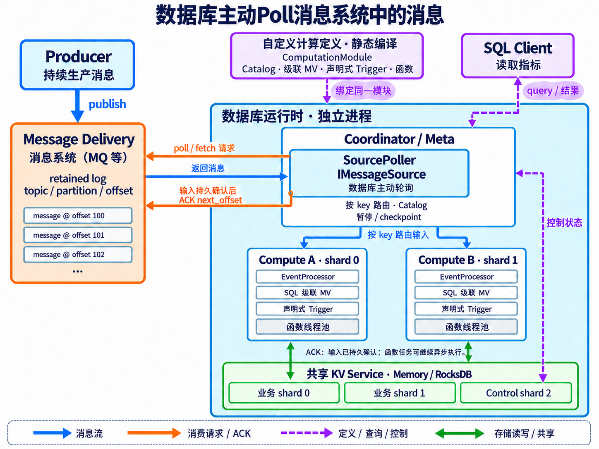

# EventFlow

EventFlow 是一个用 C++20 编写的**分布式特征计算流式数据库**。它接收持续到来的流式数据，用 SQL 物化视图更新特征；条件满足或定时器到期时，再按声明式 Trigger / Pattern 发起计算。保存的特征结果可以通过 SQL 查询。在设计之初，就设计成分布式系统，让系统具备具备水平扩容能力来处理超大规模数据集的能力。

虽然说原始题面只是要求实现一个Framework，但是由于一个纯粹的FeatureTopo Framework是比较难做到对海量数据仍然可以通过扩展处理能力来处理的。一般来说要做到这种程度，只有分布式计算框架/数据库才可以做到。基于这点考虑，我将整个Take Home Project做成一个完整的特征计算解决方案，而不是局限于Framework。**假如这不是个TakeHome Project，是一个需要在生产环境运行的系统，那么我会选择Fork RisingWave做二次开发，在SQL中扩展支持一下CEP Trigger这个feature，然后使用RisingWave的原生MV维护能力来表达特征计算的依赖关系。**

对于这个TakeHome Project，后续我选择把这个Project做成数据库语义，因为我个人认为未来流式数据库取代流式计算框架是大势所趋，除此之外，做成数据库语义支持基于SQL对状态进行查询（这恰好是Flink这种系统的不足，虽然在早期有Queryable State，但是后续因为性能问题、Qos无法控制等原因也Deprecated了），整个系统的可观测性会好非常多。

系统用两类依赖描述业务：**特征依赖决定先算什么，触发规则决定何时计算**。前者通过级联物化视图表达，后者组合事件条件、顺序和时钟。两者放在同一个系统内，便于管理计算定义、状态和结果。设计参考了 Flink 的CEP处理与 RisingWave 的持续物化视图维护机制。我的调研过程见[**调研文档**](docs/research.md)。

目前计算逻辑仅支持通过物化视图DDL和用户自定义计算逻辑和数据库内核联合编译来自定义（**跟Flink/Spark等计算框架类似，需要定义计算逻辑后编译，然后也无法热插拔**），尚不支持UDF、WASM、Lua等灵活的自定义计算逻辑的能力，但在设计空间上是预留了足够的这种用户自定义计算逻辑的空间，扩展只是一个工程工作量的问题，并不会存在很大无法解决的工程困难，毕竟这种动态热插拔的逻辑实际上在SQLite、Clickhouse、RisingWave这种成熟数据库系统中已经做得很好了，有非常典型的best practice可以借鉴。

可以在自己的 C++ 进程中include引入EventFlow的核心组件使用，也可以部署一个 Coordinator、一个Shared KV Service 和多个 Compute。当前按业务 key 静态分片，支持有限 SQL、条件与定时触发、有限时间内的事件序列匹配（CEP）、函数依赖图、选定成功结果（Latest）的查询和一致恢复点（checkpoint）。具体如何部署、使用这个数据库服务，可以见下方说明。

## 前言——一些碎碎念

其实我在这个take home project非常想做一个production ready的产品，而不是只是做一个embedded library的toy project runtime，但确实时间有限，因为担心影响招聘进度，到目前这个程度就先提交了。如果有足够长的时间继续迭代，我后续规划的演进迭代中会有：

- 支持online ddl定义物化视图，从而支持流式计算的动态图
- 基于udf/udtf/udaf/wasm/lua/pybind ffi的动态热插拔计算逻辑，**让投研可以动态定义计算逻辑而不需要停机或重新编译release产物**
- 支持控制面作为配置中心，支持配置可热更新
- 支持Ray作为调度Runtime，从而能支持CPU/GPU的hybrid调度，从而能在计算层做一些Model Inference的工作
- Ai Coding年代，复杂系统使用Rust构建的话，从包管理、项目构建和正确性约束上来说相比C++来说都会更有优势。不过此处为了reviewer能更好地看懂当前代码，先使用project reviewer大概率都更熟悉的C++技术栈
- 支持高可用机制，可以应付各种常见的Failover，提高系统稳定性
- 提供SQL ORM替代Raw SQL String，可以通过命令式API拼出一条SQL，降低使用者通过SQL查询Feature值和定义Materialize View的难度
- 让EventFlow变得更加cloud-native化
  - 底层KV不依赖于本地盘，只写MemTable，将Message Delivery系统中的Message作为可靠Redo日志，随后只需要定期Flush Memtable到S3等云上组件即可
  - 组件尽量解耦，让每个地方可以用不同的实例规格（不同的模块实际上对于核存比、本地盘的需求都会不同），足够cloud native的产品需要做到完全按需扩缩容，降低资源碎片带来的浪费
- 做完整的性能benchmark、在分布式场景下与各个开源组件pk一下
- 对外暴露的API/DSL都可以再思考一下，目前实际上没有做大量的DSL相关的调研，这个系统的DSL/API设计还是重度依赖了我个人的Context/Knowledge，应该再多调研一下相关系统的设计（主要是这一块太多了，API/DSL的种类数不胜数，需要比较长时间）

**如果reviewer们有什么疑惑，或者一些有意思的技术交流，或者遇到了项目的编译问题，可以随时通过邮箱联系我：uestc.zyj@gmail.com**

## Spec Coding方式

由于我在完成Take Home Project的时候我开了100+ SubAgent且有海量的prompt原文，所以此处不贴session原文了，仅说一下我使用Ai Coding的方法论

1. 首先，做任何复杂系统都需要调研，此时我会基于AI能力，做各个成熟组件的调研。调研过程中，我主要关注：
   - **系统对外暴露了什么能力**
   - **API语义是如何设计的**
   - **系统顶层设计是怎么样**
   - **对于我们的预期目标来说这个系统有什么启发性以及有什么不足的地方**
2. 调研完成后，我会基于调研的结果，大概想一下我要做的系统的产品形态（对外暴露的API、数据库还是流式计算系统、如何部署），**这一步高度依赖于我对于Quant Researcher的投研需求的认知，不会依赖AI的判断**
3. 确定产品形态后，我会与AI一起讨论适合的顶层设计，在这一点上会高度借鉴一些做得好的开源项目，但会根据我们的个性化需求，做一定的适配
4. 确定好顶层设计后，每个模块的职责已经确定，我会让AI根据顶层设计生成每一层的对外暴露接口，以及解释接口的语义，然后我来进行审核，反复执行这个流程，直到我对所有接口的定义都是满意的
5. 确定好接口语义之后，后续会设计相应的harness，包括对于C++项目需要有动态质量检测工具（UBSAN、LSAN、ASAN），以及通过TDD的方式先把每个模块的单元测试和跨模块的集成测试先固定下来【这一步非常核心，需要高度Human in the loop，test as harness的质量直接决定产物正确性】。通过质量检测工具和测试的搭建，让我们后续开发流程有一个可以让AI评估代码是否正确的harness
6. 对于任何和AI的讨论、milestone的拆解和制定、**都会基于specs进行落盘，specs as memory/context**
7. 开始逐个模块做接口实现
   - 每次进行接口实现后，先使用1-2个**fresh context subagent**进行对抗性review，让ai先通过对抗的方式暴露一些代码问题，再进行修复
   - 对抗完成后，AI开始检查能否通过harness
   - 当具体实现能通过所有harness约束后，我再介入进行code review
8. 当每个模块都实现完成后，再使用1-2个**fresh context subagent**进行全局架构、接口和实现review
9. 在开发流程中，如果遇到模型Context Window被打满的问题，我会用**保留session原文+生成原文摘要+开启新session通过摘要grep原文**的手段，而不会像普通的compact策略一样只保留摘要，这样会导致上下文丢失过于严重，在大型复杂项目中尤其常见

## 快速开始

从仓库根目录运行完整的[流式数据库示例](examples/streaming_database/README.md)：

```sh
./examples/streaming_database/run.sh
```

源码构建需要 Linux x86_64、兼容随包库的运行环境，以及 Clang、CMake 和 Make；环境准备见[编译](#编译)。示例脚本负责构建和启动 **1 个独立 HTTP 消息服务、1 个 KV、1 个 Coordinator 和 2 个 Compute**，随后生产消息并用 SQL 检查计算结果。

这条链路展示数据库的日常使用方式：**先定义表、级联 MV 和 Trigger，部署编译好的计算定义，再向消息源生产数据，由数据库持续拉取和计算，最后查询结果。** 追加输入后，计算仍由数据库内部运行循环推进；客户端生产消息和读取 SQL 结果，不调用 `ingest`、`pump` 或 `drain` 来替数据库执行这条链路。

## 完整使用流程

### 1. 定义输入表、级联 MV 和 Trigger

先在[示例计算定义](examples/streaming_database/)中描述业务数据和计算规则：

| 定义 | 需要表达什么 | 数据库如何使用它 |
| --- | --- | --- |
| 输入表 | 消息中的字段、类型和业务 key | 把源消息解码成关系数据，按 key 路由到负责的 Compute |
| 第一层 MV | 对输入表执行投影、筛选或聚合 | 输入到来后增量维护基础特征 |
| 后续 MV | 继续引用前面的 MV，组合特征和就绪条件 | 沿 Catalog 中的依赖顺序维护级联结果 |
| 声明式 Trigger | 哪类事件、什么条件或哪个时钟周期允许发起计算 | 检查条件与会话，按规则创建计算请求 |
| 静态计算函数与输入捕获 | 本次请求使用哪些固定输入、计算什么输出 | 保存受理时的输入，通过后台执行器完成函数计算 |
| 结果查询 | 要读取哪些特征、成功结果和触发记录 | 使用 SQL 查看已保存的状态 |

**MV 表达“算什么以及依赖什么”，Trigger 表达“何时发起一次计算”。** 更新 MV 不要求客户端按依赖逐步调用函数；用户通过声明式 Trigger API 绑定规则，也无需手工编写运行时状态转移。

这些定义共同组成一个 `ComputationModule`，随示例数据库程序静态编译。Coordinator 与 Compute 使用相同的模块身份和 Catalog。修改 C++ 函数或 Trigger 后需要重新编译、重新部署；当前不支持通过 SDK 上传 C++ 闭包，也不支持动态 UDF、UDTF、UDAF 或热插拔插件。

### 2. 启动消息服务和数据库集群

`run.sh` 分别启动消息服务与数据库进程。HTTP 消息服务只保存和投递消息；Coordinator 管理部署、路由和持续消费，两个 Compute 处理各自负责的 key，KV 保存共享持久状态。

部署阶段安装一致的表、MV 和计算定义。数据库进入运行状态后，Coordinator 托管的 `SourcePoller` 才开始持续消费。消息可以先写入 HTTP 服务，尚未部署的数据库不会提前确认这些消息。

节点地址、分片分配、内存预算和消息源地址属于运行配置；表、MV、Trigger 和函数属于计算定义。自定义业务时替换计算定义，集群仍使用同一套部署和路由机制。

### 3. 向消息源生产数据

示例客户端向独立 HTTP 消息服务追加数据。消息保留 source、topic、partition 和 offset，以便重试、去重和恢复。

数据库中的 `HttpMessageSource` 通过 HTTP 拉取消息，`SourcePoller` 将其送入现有集群输入入口，再按业务 key 转发给 Compute。**消费位置由数据库在确认输入已持久提交后推进。** 提交状态为 UNKNOWN 时，保留原消息及身份继续确认；不可恢复的错误保留消费位置并暴露失败，不能先 ACK 再补算。

HTTP 消息服务是便于本地运行的消息设施替身。它实现消息投递协议；真实 Kafka 集成属于独立的后续工作。消息适配接口统一为 `IMessageSource`，已有 MemMock、HTTP 和 Kafka 适配器，消息源的选择不改变表、MV 和 Trigger 的业务定义。

### 4. 数据库自动维护特征并执行计算

Compute 先按依赖更新基表和级联 MV，再检查相关 Trigger。符合请求受理条件时，数据库固定本次计算的输入，由后台执行器处理函数依赖；后续消息更新当前 MV，不会改写已经受理的输入。

同一 shard 由一个 owner 顺序推进，不同 Compute 可以并行处理不同 key。请求状态、成功结果与触发审计均保存在数据库中；后台函数尚未完成时，查询仍然只是读取已保存的结果。

持续运行循环也负责推进时钟和就绪任务，应用无需为了让一次计算完成而反复提交推进请求。具体的 Trigger 条件、输入时间线、预期结果和 SQL 断言见[示例说明](examples/streaming_database/README.md)。

### 5. 用 SQL 检查结果并追加输入

客户端通过 Coordinator 查询基表、级联 MV、成功计算结果和内置 `trigger_audit`。示例将预期业务结果写成断言，并覆盖不同 shard 的 key；追加消息后再次查询，确认数据库继续自动计算。

触发审计记录说明某条规则已经发出触发，函数是否成功需要结合请求状态和成功结果判断。SQL 查询不会隐式发起模型计算。

暂停、恢复和一致 checkpoint 用于控制正在运行的数据库。checkpoint 需要绑定源位置、Catalog 与运行时状态；KV snapshot 只是存储边界，不能单独作为完整恢复点。RocksDB WAL 仍然保留。

## 系统结构

<p align="center">
  <a href="docs/image/eventflow_streaming_architecture.png"></a>
</p>

图中的 `SourcePoller` 通过 `IMessageSource` 主动读取消息系统中的数据，消息系统可以是 MQ，也可以是提供拉取接口的其他服务；查询流从客户端经 Coordinator 读取物化结果。当前完整示例使用 HTTP 消息服务。各组件的职责如下：

| 组件 | 职责 |
| --- | --- |
| 生产与查询客户端 | 向消息系统生产数据，通过 SQL 读取并检查结果 |
| 消息系统（如 MQ） | 保存消息，提供读取、确认与重放位置；具体协议由 IMessageSource 适配 |
| Coordinator / Meta | 安装 Catalog 与计算定义、管理路由，托管 SourcePoller，协调运行状态、水位和 checkpoint |
| Compute | 按 shard 维护基表和 MV，检查 Trigger，固定请求输入并执行就绪函数 |
| KV Service | 保存共享持久状态，提供原子提交、确认版本和存储快照 |

源码中的嵌入式 C++ API 仍可供应用直接组合使用；完整示例展示的是独立部署的数据库服务。当前采用静态分片和已编译的计算定义，在线图迁移、动态扩展函数、Process Function 与 HA 继续保留为后续范围。

## 使用 Coding Agent 快速接入

Reviewer 可以把 [EventFlow 使用 skill](.skills/use-eventflow/SKILL.md) 交给自己的 Coding Agent，让它根据业务需求定义输入表、级联 MV、Trigger 和计算函数，并生成完整的消息生产、数据库消费和 SQL 验证流程。

在 EventFlow 源码目录中，可以直接给 Coding Agent 下面这段提示词，再替换最后的业务需求：

> 请先读取 `.skills/use-eventflow/SKILL.md` 和 `examples/streaming_database/README.md`，基于当前源码实现我的需求：按 ticker 汇总成交量，超过阈值时触发计算，并每五秒计算一次当前特征。请提供静态计算定义、数据库持续消费消息的部署方式、SQL 断言、运行命令和验证结果。

`.skills/` 是本仓库提供的 skill 目录，各 Coding Agent 的自动发现规则可能不同。显式要求读取上述文件即可使用；支持本地 skill 加载的工具也可以加载 `.skills/use-eventflow/`。其中的 `agents/openai.yaml` 是可选元数据，普通 Markdown 入口不依赖特定工具。

## 文档与源码入口

下面的文档记录了我从需求分析、开源系统比较到设计选择的思考过程。先运行完整示例，再按关注点阅读：

| 阅读目的 | 入口 |
| --- | --- |
| 自定义计算、启动集群、生产消息并执行 SQL 断言 | [流式数据库示例](examples/streaming_database/README.md) |
| 按主题查找文档 | [文档导航](docs/README.md) |
| 理解流处理概念与成熟系统的设计 | [流式计算与数据库调研](docs/research.md) |
| 沿 SQL、增量视图、触发和请求追踪实现 | [详细架构、接口语义与实现导读](docs/implementation_guide.md) |
| 理解产品形态和顶层设计取舍 | [产品形态与系统架构](docs/feature_computation_architecture.md) |
| 了解进程部署、运行控制和恢复协议 | [运行手册](docs/core_delivery.md) |
| 准备离线编译和运行环境 | [Docker 使用说明](docker/README.md)、[第三方依赖](cpp3rdlib/README.md) |

公开 C++ 接口在 `include/eventflow/`，实现按职责位于 `src/`；示例把业务定义与数据库进程入口分开：

| 关注点 | 源码位置 |
| --- | --- |
| 自定义业务定义、消息服务、数据库启动和 SQL 验证 | [examples/streaming_database/](examples/streaming_database/) |
| 声明式 Trigger、Pattern、静态函数与绑定 | [trigger.hpp](include/eventflow/trigger.hpp)、[computation.hpp](include/eventflow/computation.hpp) |
| 消息源及数据库持续消费 | [message_source.hpp](include/eventflow/message_source.hpp)、[source_poller.hpp](include/eventflow/source_poller.hpp)、[src/ingest/](src/ingest/) |
| Coordinator、Compute 和 KV 服务 | [src/service/](src/service/) |
| C++ 集群客户端 | [cluster_client.hpp](include/eventflow/cluster_client.hpp)、[src/client/](src/client/) |
| SQL 解析、绑定和 Catalog | [src/sql/](src/sql/) |
| MV 更新、触发、请求和执行器 | [src/runtime/](src/runtime/) |
| 持久化、原子提交和缓存 | [src/storage/](src/storage/) |
| 单元、适配器合同和真实多进程回归 | [tests/](tests/) |

开发约束、当前任务、验证证据和独立审查记录统一保存在 [specs/](specs/INDEX.md)。历史验证记录只覆盖各自的源码快照；当前示例的验收以对应的新证据为准。

## 编译

### Docker：准备编译环境和源码

镜像提供源码、Clang/CMake/Make 和 `cpp3rdlib/` 第三方依赖。制作镜像只准备环境与文件；默认启动显示帮助，编译、示例和测试由 reviewer 手动执行。在仓库根目录运行：

```sh
docker build --platform linux/amd64 -t eventflow:reviewer .
docker run --rm --network none eventflow:reviewer
```

进入容器后，可以查看或修改源码，再按需编译：

```sh
docker run --rm -it --network none eventflow:reviewer shell
```

在容器内执行：

```sh
eventflow-review build release
# Optional: run the streaming database example.
eventflow-review demo all
```

需要运行测试时，显式执行 `docker run --rm --network none eventflow:reviewer test`，它会构建 Debug 并执行 CTest。`--rm` 会在退出时删除容器内的修改与构建结果；需要保留时可挂载本地源码，见下方详细说明。首次制作镜像需要下载基础镜像和系统工具链，镜像内项目编译无需外部网络。

`eventflow:build-env` 工具链阶段也可单独构建，供挂载源码开发使用。平台、手动构建、示例、测试与文件保留方式见 [Docker 使用说明](docker/README.md)。

### 编译与运行环境要求

当前 `cpp3rdlib/` 中的预编译库面向 **Ubuntu 24.04 / Linux x86_64（amd64）**，建议使用该环境。编译机和运行机都必须满足这些库的系统 ABI 要求：

| 环境项 | 要求与原因 |
| --- | --- |
| C++ 工具链 | 支持 C++20 的 **Clang/clang++**，配套 C/C++ 开发头文件、GNU `libstdc++` 和链接器；CMake 会拒绝其他编译器 |
| 构建工具 | **CMake 3.20+、Make**；Debug 还需要 Clang 配套的 ASan、UBSan、LSan 运行库，Release 在工具链支持时启用 LTO |
| C 运行库 | **glibc ≥ 2.38**；本地预编译 RocksDB、ANTLR4、librdkafka、gflags、SASL 和 OpenSSL crypto 均引用 `GLIBC_2.38` 符号 |
| C++ 运行库 | GNU **`libstdc++.so.6` 必须提供 `GLIBCXX_3.4.32` 和 `CXXABI_1.3.13`**（GCC 13.2 或更新版本配套的 libstdc++）；使用 Clang 编译仍需满足这些预编译库的 GNU C++ ABI，不能直接改用 `-stdlib=libc++` |
| 系统基础库 | 系统提供 `libc.so.6`、`libm.so.6`、`libgcc_s.so.1`、`libstdc++.so.6`、动态加载器 `ld-linux-x86-64.so.2` 和线程设施；Sanitizer 还可能使用 `libresolv.so.2`。这些不随仓库打包 |

以上 glibc/C++ 符号版本来自对当前随包共享库的 `readelf --version-info` 检查，是**第三方二进制的最低 ABI 下限**；最终程序可能因编译机和工具链引入更高要求，应在目标运行环境检查。仅升级 Clang 无法解决旧 glibc 或旧 libstdc++ 的缺失符号；其他架构或 musl 环境不能直接使用这组预编译库。

### 引入的第三方库

下表中的头文件及预编译库均已放在 `cpp3rdlib/`，无需另外安装这些库的开发包。版本为随包版本；完整发行包修订号、来源、许可证和 SHA256 见[依赖说明](cpp3rdlib/README.md)。

| 第三方库 | 版本 | 用途与带来的依赖 |
| --- | --- | --- |
| RocksDB | 8.9.1 | 持久化 KV；共享库依赖 GNU libstdc++、gflags 及下列五种压缩库 |
| ANTLR4 C++ runtime | 4.10 | 执行已生成的 SQL 解析器；共享库依赖 GNU libstdc++ |
| nlohmann/json | 3.12.0 | JSON 编解码；单头文件，随项目编译，无单独共享库 |
| cpp-httplib | 0.20.1 | HTTP 服务与客户端；单头文件，使用系统网络/线程设施；当前未开启其 OpenSSL、压缩功能宏 |
| librdkafka C / C++ | 2.3.0 | Kafka 消息源适配；项目链接 C 接口，依赖 SASL、OpenSSL、LZ4、Zstd、zlib；另附可选 C++ 接口库，后者还依赖 GNU libstdc++ |
| GoogleTest | 1.14.0 | 预编译静态库；仅 `BUILD_TESTING=ON` 时由测试目标链接，使用 C++ 运行库与线程设施 |
| gflags | 2.2.2 | RocksDB 的传递运行依赖；依赖 GNU libstdc++ |
| Snappy / LZ4 / Zstandard / zlib / bzip2 | 1.1.10 / 1.9.4 / 1.5.5 / 1.3 / 1.0.8 | 压缩运行库；RocksDB 依赖全部五种，librdkafka 使用其中三种；Snappy 还依赖 GNU libstdc++ |
| Cyrus SASL | 2.1.28 | librdkafka 的认证运行库；随包包含核心库，其依赖的 OpenSSL crypto 也已附带；额外认证机制插件不在本包中 |
| OpenSSL SSL / crypto | 3.0.13 | librdkafka 的 TLS/加密及 SASL 的加密依赖；运行库已附带，连接实际 TLS broker 时仍需配置可信 CA/证书 |

构建使用已生成的解析代码，**不下载第三方源码，也不需要 Java 或 ANTLR 生成器**；只有重新生成 SQL 解析器时才需要匹配的 ANTLR 4.10 生成工具及 Java。默认 MemMock 测试不需要 Kafka broker 或 Docker；真实 Kafka 集成仍为后续范围。

运行时需保留 `cpp3rdlib/lib/` 及其符号链接；CMake 已为构建产物设置 RPATH 来定位随包库。拷贝部署时应保留对应目录布局，或显式设置 `LD_LIBRARY_PATH` 指向该目录。可以在仓库根目录检查系统版本及构建后程序的依赖解析：

```sh
getconf GNU_LIBC_VERSION
clang++ --version
cmake --version
ldd build/bin/eventflow
readelf --version-info cpp3rdlib/lib/librocksdb.so
```

`ldd` 不应出现 `not found` 或符号版本缺失；检查 Debug 程序不能代替对实际 Release 部署产物的检查。

### 构建命令

```sh
# Debug: ASan, UBSan and LSan; GoogleTest is linked only by test targets.
cmake -S . -B build -G "Unix Makefiles" \
  -DCMAKE_CXX_COMPILER=clang++ -DCMAKE_BUILD_TYPE=Debug
cmake --build build --parallel 4
ctest --test-dir build --output-on-failure -j 2

# Release: -O3, NDEBUG and supported LTO, without sanitizers.
make release JOBS=4
```

完整示例通过 [run.sh](examples/streaming_database/run.sh) 构建与运行；复用已有构建的方式见[示例说明](examples/streaming_database/README.md)。本地可用 `make compdb` 通过 Bear 记录实际编译；clangd 读取 CMake 自动更新的 `build/compile_commands.json`。
