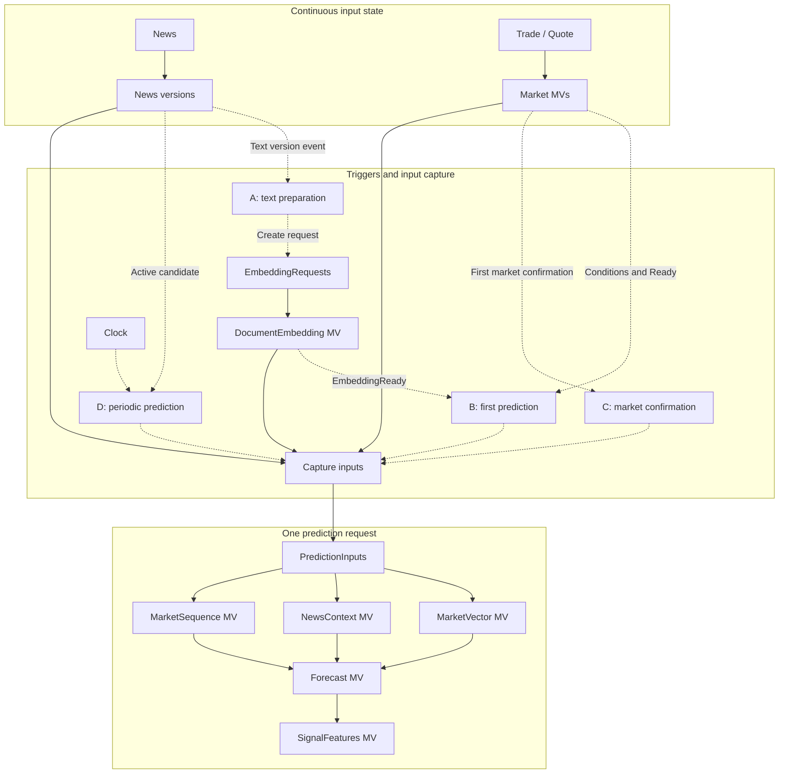
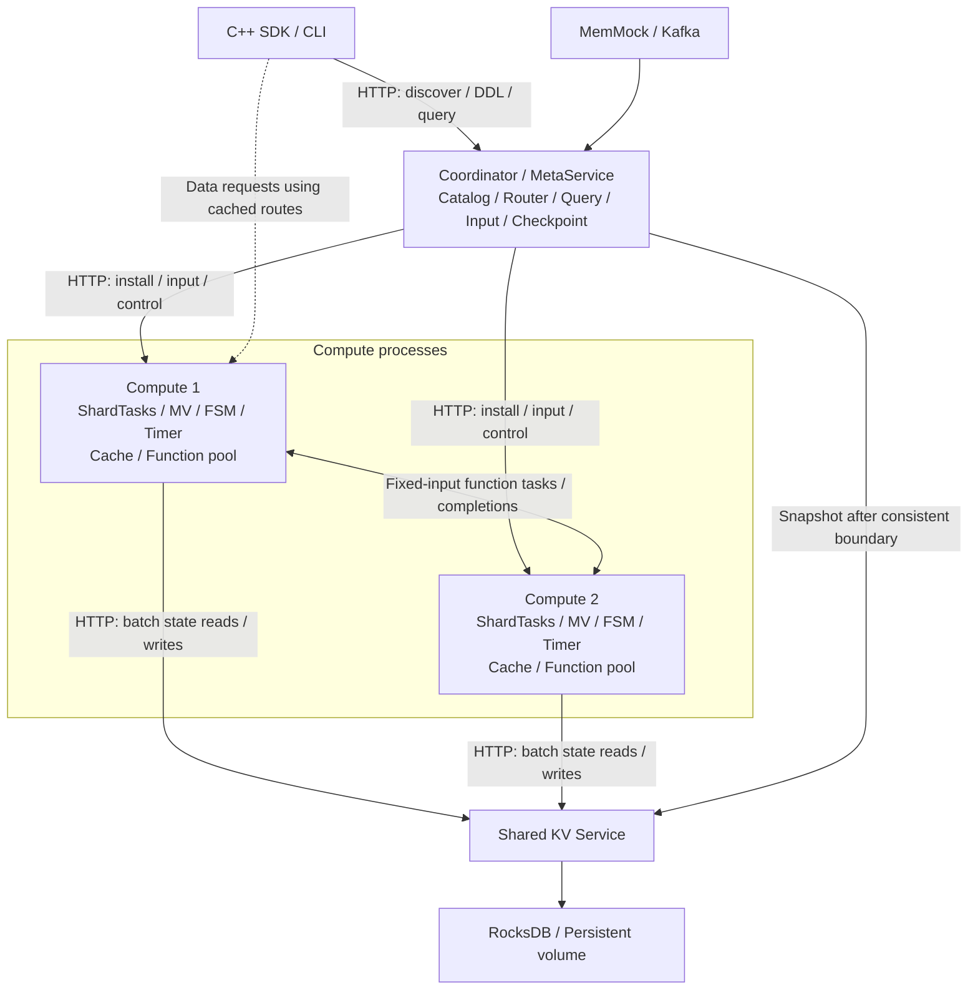
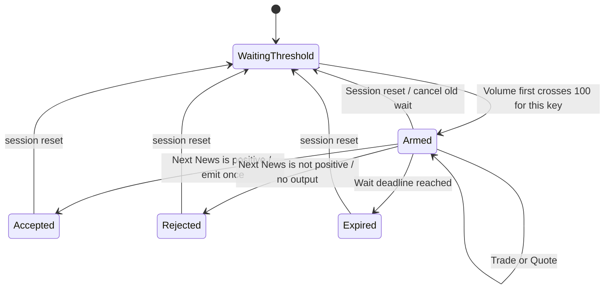

# EventFlow Feature Database：产品形态与顶层设计

EventFlow 面向持续到来的新闻与行情：先更新累计量、报价和窗口等状态，在条件成立或定时器到点时发起特征计算，再保存可查询的结果。本文解释这些步骤如何通过视图依赖和触发规则连接，以及计算、存储和恢复各自负责什么。

建议按“业务案例 → 视图与触发 → 进程职责 → 存储与输入一致性”的顺序阅读。运行命令见[运行手册](core_delivery.md)，沿当前源码追踪实现可读[实现导读](implementation_guide.md)。本文也保留产品建议与历史设计；标注为拟议或后续的内容需要按其所在段落的边界理解。

## 先认识几个对象

| 名称 | 在本文中表示什么 |
| --- | --- |
| 物化视图（Materialized View，MV） | 保存了查询结果的关系，例如按标的汇总的成交量；上游变化时可以继续维护它 |
| Catalog 与依赖图（DAG） | Catalog 集中登记输入、视图及规则；依赖图说明一个结果需要哪些上游结果，以及计算顺序 |
| Trigger、Clock 与 Request | Trigger 表达触发规则，Clock 提供定时触发；Request 标识一次独立计算及其输入、状态和结果 |
| 业务 key、分片（shard）与 owner | key 标识业务实体，例如股票代码 ticker；分片把多个 key 分组，owner 是唯一负责某分片状态更新的执行者 |
| 候选（candidate）与版本（epoch） | 候选表示当前跟踪的新闻版本；候选 epoch 用来区分新旧候选，owner epoch 则标识执行归属的版本 |
| Embedding 与 Ready | Embedding 是模型使用的文本向量；Ready 表示某项输入或依赖已经满足可计算条件 |
| 有限状态机（FSM）与 CEP | FSM 记住当前等待阶段并随事件转移；CEP 用事件顺序、条件和期限描述复杂匹配 |

## 用一条新闻串起四条业务路径

一条符合筛选条件的新闻先成为待跟踪候选。系统把文本转换成向量；向量和行情都准备好后做首次预测。候选有效期内，量价条件首次成立时做确认预测，定时器到点时做周期重估。图和请求记录用稳定计划 ID A/B/C/D 标识这些路径：

| 计划 ID | 业务动作 | 与其他路径的关系 |
| --- | --- | --- |
| A | 文本准备：为一个新闻文本版本生成 Embedding | B/C/D 可复用该版本的文本向量 |
| B | 首次预测：等待文本向量和市场输入 Ready | 为本次预测保存输入并生成结果 |
| C | 市场确认：有效候选在期限内首次满足量价条件 | 用新的市场输入重新预测 |
| D | 周期重估：Clock 到点且候选和输入可用 | 为当前时隙发起新的预测 |

这里的字母表示计算路径，不是四条输入新闻。新闻修订、候选到期与多个请求乱序完成的例子在第 10 节继续展开。模型运行期间，已经受理的请求继续使用自己的固定输入；后来的行情变化由新的请求使用。

## 1. 推荐方案与适用边界

本节列出产品模型与适用范围。已验证能力见[验证结果](../specs/verification/final-validation.md)；事件顺序、失败和恢复的精确约束见[运行时契约](../specs/runtime-contracts.md)。

建议将 EventFlow 定义为：**一个以物化视图依赖表达 Feature Computation DAG、以事件图控制计算时机、采用共享 KV 存储和按业务 key 分片执行的 C++ Feature Database。**

产品统一管理输入关系、视图定义、状态、Trigger、执行请求和物化结果。轻量视图随事件持续维护；昂贵特征以一次 Trigger 捕获的不可变输入为依据求值，结果仍作为数据库中的视图行保存。FunctionWorker是Compute内部的函数执行能力，复用同一份Catalog与视图依赖定义；首版不引入第四种进程角色。

这一设计让轻量状态持续更新，并在需要时执行昂贵计算。范围集中在有限 SQL、单 key 内的一致状态和有界触发规则；这些取舍来自产品约束，性能优劣仍需要实验验证。

| 已确定的约束 | 对架构的直接影响 |
| --- | --- |
| 自研有限 MV 能力的 C++ 数据库/运行时 | 自己实现 Catalog、视图依赖、有限算子、调度和 Trigger；复用存储与 RPC 库 |
| SQL 查询与 CREATE MATERIALIZED VIEW | 参考本地 RisingWave 的分层；ANTLR4 可生成 C++ 解析器，首版支持明确子集 |
| Trigger 统一为状态型流算子 | 维护 FSM/寄存器/Timer，在指定转移上向下游输出触发记录 |
| Feature DAG 通过 MV 依赖实现 | 连续维护和按请求求值共享视图模型，不另建独立业务计算框架 |
| 使用共享 KV Service | 计算状态统一持久化，计算实例与存储服务独立部署 |
| 不实现 MVCC | 通过 key 所属执行者的串行阶段捕获输入，不提供历史 as-of 查询 |
| 优先实时性 | 使用满足因果要求的当前已处理状态，记录实际输入进度，不承诺事件时间数据到齐 |
| 真实多进程水平扩展 | 同一逻辑视图按业务 key 分布到不同计算进程 |
| 跨 key 计算后置 | 首版不提供任意跨分片 Join、全市场一致快照或单热点 key 自动拆分 |
| HA 暂缓 | 静态分配、单控制实例、手动重启和有停顿调整；watermark与一致checkpoint仍必须实现 |
| 产品架构优先，保留 take-home 收敛路径 | 先完成一个窄而完整的数据库内核与可演示的分布式执行闭环 |

RisingWave 提供了“命名关系与 MV → 执行图 → 分区执行 → 物化状态”的成熟参照；其持续 MV 随上游变化维护结果。EventFlow 借鉴这一组织方式，同时把所支持的查询、分布式范围和存储协议明显收窄。[^4][^5]

## 2. 题面要求与调研范围

原始题面要求两类图、Clock、状态条件、每个 instrument 的状态维护、触发时计算、保存特征与时间戳，并强调接口易用性、实现可读性和效率。SQL、MV、分布式执行、灵活 Schema 与模型推理并非题面硬性要求，而是本设计的产品扩展。[^1]

| 题面要求 | 产品对象 | 首版可展示的行为 |
| --- | --- | --- |
| Feature Calculation Dependency Graph | Catalog 中的视图依赖图 | 多层视图、菱形依赖、共享 Embedding |
| Event Trigger Dependency Graph | Trigger 定义与有状态组合节点 | Clock、条件、顺序、超时、每候选一次 |
| State Management | 连续 MV、算子状态、规则状态 | 累计量、窗口、新闻版本、Ready 状态 |
| Compute when triggered | Trigger 产生不可变请求输入关系 | 未触发期间持续维护状态，不运行预测模型 |
| Save features and timestamps | 结果关系与请求记录 | 按请求查询结果，查看输入身份和时间 |
| 易扩展 | Schema、View、Function、Trigger 注册接口 | 新增业务字段或计算逻辑无需修改调度器 |

输入边界必须明确：原始新闻 Schema 没有成交量，只有新闻时刻的市场价格。成交量规则需要显式增加 Trade 输入；盘口、连续价格序列等需要 Quote/Trade 扩展。不能把新闻数量当作成交量，也不能把新闻采样价格当完整行情。情绪分数已经给定，首版无需训练情绪模型。[^1][^3]

开头的四条业务路径来自新闻预测案例：文本准备、首次预测、量价确认和周期重估。后三条路径共享特征依赖，用于说明持续状态、异步就绪、缓存、新闻修订和时间推进如何配合。[^2]

## 3. 产品形态

### 3.1 对使用者暴露一个数据库模型

主要使用者是编写特征与触发规则的 Quant Developer。其工作流程应当是：注册输入 Schema，定义视图依赖，绑定 Trigger，部署一个版本化应用，再查询特征结果及其生成原因。

| 对象 | 主要内容 | 使用者关心的问题 |
| --- | --- | --- |
| `Source / Table` | 输入 Schema、业务 key、事件身份、时间字段 | 什么数据进入系统？ |
| `MaterializedView` | 依赖、输出 Schema、求值策略、物化主键 | 特征依赖什么、何时维护、结果如何保存？ |
| `Trigger` | 事件来源、状态读取、组合语义、期限 | 什么情况下发起计算？ |
| `Function` | 输入输出、代码版本、状态能力、执行位置 | 如何编写自定义计算？ |
| `Request` | Trigger 身份、目标视图、捕获输入、执行状态 | 这一次计算为什么发生、进行到哪里？ |
| `ApplicationVersion` | 图、规则、Schema 和函数版本的绑定 | 当前部署的到底是哪套定义？ |

首版以 **有限 SQL + C++ SDK/Table API + CLI** 为入口。SQL 与 C++ 定义共用 Catalog、类型检查和关系计划；SQL 解析可使用 ANTLR4 生成 C++ 代码。首版提供关系查询与 CREATE MATERIALIZED VIEW，完整 SQL 兼容、成本优化器及 PostgreSQL wire protocol 后置。

建议查询入口包括：

- `get(view, business_key)`：读取当前已物化值及其状态。
- `get_result(request_id)`：读取该请求的结果。
- `explain(view)`：显示依赖、维护策略、分区 key。
- `explain_request(request_id)`：显示 Trigger 原因、输入身份、缓存命中与失败原因。

`get` 不隐式运行重模型；需要新计算时显式创建 Request。读取“最近一次预测”时，应同时返回其输入进度和时间，不能把旧预测包装成当前市场上的实时计算结果。

### 3.2 一个接口意图示例

以下是拟议 DSL，用来展示产品抽象，不是现有可编译 API；`capture`、`on_request` 等名称也不是 RisingWave 语法。

```cpp
auto volume = app.materialized("VolumeByTicker")
    .from(trades)
    .key_by("ticker")
    .aggregate(sum("quantity"));

auto quote = app.materialized("LatestQuote")
    .from(quotes)
    .key_by("ticker")
    .latest_by("accepted_sequence");

auto inputs = app.request_relation("PredictionInputs")
    .capture(volume, quote, market_history, active_news, embedding);

auto market_vector = app.materialized("MarketVector")
    .from(inputs)
    .on_request()
    .map(function("build_market_vector", "v1"));

auto forecast = app.materialized("Forecast")
    .from(market_vector, news_context, market_sequence)
    .on_request()
    .async_map(function("fusion_model", "v1"));

app.bind(every("5s").where(candidate_is_ready), inputs, forecast);
app.bind(market_confirmation.once_per_candidate(), inputs, forecast);
```

业务字段存在于 Schema 与应用定义中。引擎内部不应出现专门识别 `AAPL`、`Sentiment Score` 或 `Market Price` 的分支。

### 3.3 SQL 与 C++ API 共用一条定义链

首版支持的 SQL 应能完成真实关系查询与视图定义。以下示例采用常见 SQL 形式，依赖 Trades 表已通过 DDL/SDK 注册，且其分区 key 为 ticker：

```sql
CREATE MATERIALIZED VIEW VolumeByTicker AS
SELECT ticker, SUM(quantity) AS total_volume, COUNT(*) AS trade_count
FROM Trades
GROUP BY ticker;

CREATE MATERIALIZED VIEW ActiveVolume AS
SELECT ticker, total_volume
FROM VolumeByTicker
WHERE total_volume > 100;

SELECT ticker, total_volume
FROM ActiveVolume
WHERE ticker = 'AAPL';
```

VolumeByTicker 与 ActiveVolume 构成级联 Feature DAG。ActiveVolume 是一个条件关系：它描述哪些 key 当前满足条件；若要“首次满足后严格下一条新闻”，仍由 FSM 读取其变化/状态并维护事件记忆。

相同的 SELECT，作为查询时从已物化关系读取并执行有限投影/过滤；作为 CREATE MV 的定义时，被编译成持续运行的增量计划。两者共享绑定和关系算子，但执行生命周期不同。

| 首版 SQL 子集 | 语义范围 |
| --- | --- |
| CREATE TABLE | 字段、类型、nullable、主键；输入适配器与 partition key 可先通过 SDK 的输入与分区定义绑定 |
| CREATE MATERIALIZED VIEW ... AS SELECT | 级联视图；生成输出 Schema、依赖与持续计划 |
| SELECT / WHERE / 表达式 / 别名 | 有界读取已物化关系；业务查询限定一个 key 的一致性域 |
| GROUP BY + SUM/COUNT/AVG | 持续聚合必须保留业务分区 key；不支持隐藏的跨分片全局聚合 |
| 受限等值 Join | 两侧同分区 key、规模有界，并实现约定的更新传播 |
| 注册标量函数 | 名称与版本在绑定阶段解析；状态过程函数和异步模型使用显式扩展 API |

语法覆盖不能领先于执行能力。首版遇到跨分片 Join、缺少分区 key 的全局聚合、未实现的子查询或窗口语法，应在规划阶段明确拒绝。完整 PostgreSQL 方言、任意 SQL 窗口和递归查询不属于交付承诺。

单 key SQL 查询通过 owner 捕获有界输入，然后执行查询或返回数据，避免长时间占住写入入口。首版不承诺跨 key SELECT 的全局原子快照；这也不影响按 ticker 分组的同一个 MV 在多进程中分别维护各自的行。

### 3.4 本地 RisingWave 的参考链路

本地参考源码快照为 `7e7075acd5e71254499d3a38c46669046df874f7`。下面是 CREATE MATERIALIZED VIEW 的已核实分层；它用于结构参考，不表示需要移植整个 Rust 引擎。[^19]

```text
SQL
 -> Tokenizer / Parser -> AST
 -> Binder -> BoundQuery with column identities and types
 -> Planner -> LogicalPlan of relational operators
 -> Streaming plan conversion -> Materialize node
 -> Fragment graph / Catalog
 -> Install execution tasks -> View ready
```

| 本地入口 | 源码确认的职责 | EventFlow 裁剪方式 |
| --- | --- | --- |
| [parser.rs:201](/home/obscure/EventFlow/.reference-repos/risingwave/src/sqlparser/src/parser.rs:201) | Parser::parse_sql：token 化与语句解析；表达式使用前缀/中缀优先级循环 | ANTLR4 lexer/parser → 自有 AST |
| [handler/create_mv.rs:186](/home/obscure/EventFlow/.reference-repos/risingwave/src/frontend/src/handler/create_mv.rs:186) | handle_create_mv：绑定查询、收集依赖、生成物化图 | 一个 CREATE MV handler |
| [binder/select.rs:202](/home/obscure/EventFlow/.reference-repos/risingwave/src/frontend/src/binder/select.rs:202) | 名称、列、WHERE 布尔类型及聚合绑定 | 有限类型规则与分区约束 |
| [planner/select.rs:45](/home/obscure/EventFlow/.reference-repos/risingwave/src/frontend/src/planner/select.rs:45) | 绑定结果转关系算子计划 | Scan、Filter、Project、Aggregate、受限 Join |
| [optimizer/mod.rs:1172](/home/obscure/EventFlow/.reference-repos/risingwave/src/frontend/src/optimizer/mod.rs:1172) | gen_materialize_plan 包装 StreamMaterialize | 固定规则生成 key-local 增量计划 |
| [stream_fragmenter/mod.rs:175](/home/obscure/EventFlow/.reference-repos/risingwave/src/frontend/src/stream_fragmenter/mod.rs:175) | 流计划转 fragment graph | 首版按 key 复制计划，无任意 Exchange |
| [catalog_service.rs:363](/home/obscure/EventFlow/.reference-repos/risingwave/src/frontend/src/catalog/catalog_service.rs:363) | 提交创建并等待 catalog 版本 | 安装完成后才发布 READY |
| [ddl_controller.rs:1102](/home/obscure/EventFlow/.reference-repos/risingwave/src/meta/src/rpc/ddl_controller.rs:1102) | 作业目录、内部状态表、安装与失败处理 | CREATING → READY/FAILED 的有限生命周期 |

RisingWave 当前 parser 使用手写解析方法和 winnow，表达式路径是 Pratt 风格；并非 ANTLR。EventFlow 可以替换语法层，而保留“语法 → 语义绑定 → 关系计划 → 运行图”的职责划分。

ANTLR4 官方支持生成 C++ lexer/parser 及 Visitor/Listener。建议维护裁剪后的 EventFlow SQL grammar，用 Visitor 构建与工具无关的 AST，固定生成器与 C++ runtime 版本。ANTLR 解决词法/语法和错误位置，不会生成列绑定、NULL/聚合语义、增量维护或分布式计划。[^18]

首版先在开始接入数据前创建视图。已有数据上的 CREATE MV 必须定义初始化来源：可以暂停输入，对仍保留的有限基表做初始化；若历史已经丢弃且不足以恢复聚合，应拒绝或要求重放。不能安装一个空累计器并宣称它代表全部既有数据。在线分布式 backfill 和无停顿替换后置。


## 4. Feature DAG 如何成为物化视图依赖图

### 4.1 统一目录，明确两种关系语义

**连续视图**反映系统已经处理完的输入。若用 `r` 表示一次已经完成的状态推进，`D_applied(r)` 表示此时已处理的输入，`Q` 表示视图的查询定义，那么：

```text
V_current(r) = Q(D_applied(r))
```

例如累计成交量、最近报价和窗口摘要。每次相关输入推进后，运行时完成受影响的轻量视图依赖，再允许 Trigger 读取它们。

**请求派生视图**表示某次捕获输入上的派生关系：

```text
RequestInputs[q] = capture(current_state, trigger_context)
FeatureView[q]   = F(RequestInputs[q], fixed_dependencies)
```

一旦请求被受理，其输入不再随当前市场变化。请求派生视图的执行可经历 Queued、Running、Ready、Error；Ready 结果对应这个请求，而不是承诺等于对当前市场重新运行模型的结果。缺少捕获条件时先保存 PendingTrigger；输入冻结后才创建已受理 Request。

这一区别由**输入关系与主键**表达。不能只给一个传统 live MV 加上“暂时不刷新”的标记，却仍声称它始终代表最新上游关系。对于大模型等计算，把 Trigger 变成不可变请求行，语义更直接。

### 4.2 视图类别与执行位置是不同维度

| 视图 | 物化主键示例 | 求值时机 | 输出行为 |
| --- | --- | --- | --- |
| `VolumeByTicker` | `ticker` | 每个相关 Trade | 更新当前累计量 |
| `LatestQuote` | `ticker` | 每个相关 Quote | 替换当前报价 |
| `MarketHistory` | `ticker, bucket` | 数据到达或窗口过期 | 维护有限历史 |
| `DocumentEmbedding` | `ticker, news_id, text_version, encoder_version` | A 创建编码请求后 | 保存固定版本文本的表示 |
| `MarketVector / NewsContext` | `ticker, prediction_request_id` | 请求输入 Ready 后 | 保存本次请求的派生输入 |
| `Forecast / SignalFeatures` | `ticker, prediction_request_id` | 依赖 Ready 后 | 保存本次预测结果 |

`async` 是执行属性：某个视图节点可以交给远程 Worker；其定义、依赖和结果归属仍在数据库。首版不需要把每个加法、投影都拆成网络任务，可以把同一请求的廉价节点融合执行，只在昂贵节点处异步派发。

### 4.3 双图之间的连接

读图时，实线表示数据依赖，虚线表示事件与激活。上方是持续维护的新闻和行情，中间是四条触发路径及输入捕获，下方是一次预测请求内部的计算。



实线表示数据关系；虚线表示事件与激活。Catalog 统一保存对象，但仍区分数据依赖、事件顺序依赖和激活边。物理运行时中，FSM 是状态型流算子，其输出也是普通类型化消息；图中虚线用于说明触发语义，不代表绕过数据库的旁路调度。Feature 数据依赖保持无环；`EmbeddingReady` 在后续 dispatch 创建预测请求，是有明确阶段的事件因果链。

RisingWave 的 temporal join 提供了一个有用参照：其相关模式由左侧变化驱动，右侧后续变化不重新处理历史左行。但 EventFlow 采用显式请求输入捕获，还要自行定义 Ready、失败、重复请求与结果保存。[^6]

应避免以下连接：

```text
All permanently retained PredictionRequests
    JOIN continuously changing MarketCurrent
    -> Every market update changes old requests and reruns the model
```

正确连接是 `PredictionRequests → 捕获后的 PredictionInputs → 请求派生 MV`。市场只在捕获阶段被读取。

## 5. 顶层架构：计算与共享存储分离

先看三类进程：Coordinator 管理定义和入口，Compute 推进计算，共享 KV 保存状态。箭头上的标签说明调用内容；图中的函数池位于 Compute 内部。后续小节分别解释各条通信路径与职责。



首版固定为三类自有进程：一个Coordinator/MetaService、一个独立KV Service、N个Compute，共N+2个实例。Catalog、Router、查询/DDL入口和checkpoint协调合并在Coordinator内；函数池是Compute内部能力。Kafka是外部消息设施，不计入三类自有进程。

| 组件 | 首要职责 | 首版简化 |
| --- | --- | --- |
| MetaService（Coordinator内） | Schema、计算定义、运行配置、Catalog/Job/源/路由/checkpoint及函数定义的权威；持久版本、依赖与部署回执 | 单写入队列；复用共享KV的control shard，无HA |
| Catalog / Planner | 类型、依赖、图版本、分区检查，生成执行计划 | 静态图；拓扑排序与规则校验，不做成本优化 |
| Coordinator / Router | 维护 key→shard→计算实例映射 | 单实例、静态配置、不自动故障切换 |
| Compute / Shard Runtime | 按序维护连续 MV、Timer、Trigger 和请求 | 每个 shard 同时只有一个执行者 |
| FunctionWorker | 执行指定请求的视图节点 | Compute内部函数池；模型可用确定性替身 |
| Shared KV Service | 共享状态、批量读写、有限扫描与提交去重 | 一个服务进程起步，复用 RocksDB |
| Query API | 当前结果、请求历史、执行解释 | key 查询与有界扫描，复杂分析后置 |

**控制面管理“按哪份计算定义、运行配置和版本在哪里执行”，计算面管理“下一步计算什么”，存储面管理“哪些字节已经提交”。** 不应把 Trigger 判定逻辑放进存储服务器，使 KV 再长出一套业务调度器。

### 5.0 SDK发现、DDL与通信协议

首版进程间采用HTTP/1.1 + JSON RPC，复用cpp-httplib；Kafka输入使用librdkafka原生协议。结构化Status、有限消息/批次预算、超时、路由epoch与稳定操作身份属于应用契约。HTTP超时不能证明提交失败，必须按原commit/request身份确认。外部库通过接口隔离，协议更换不改变状态提交规则。

当前SDK只配置MetaService bootstrap地址，ingest/query由Meta按业务key代理到Compute；discover返回静态路由，调用方保留原SourceIdentity。SDK直连Compute、route epoch缓存与刷新属于后续产品能力，不能把Meta代理称为这些能力已经交付。

当前核心只在STAGING阶段接收DDL，全部worker安装确认后才发布RUNNING；运行后DDL明确拒绝。后续在线DDL的目标流程为Coordinator串行验证Schema/依赖/分片属性并冻结候选DeploymentImage，再暂停全部署输入与普通数据查询，排空或显式取消已受理请求，向所有目标Compute安装同一版本。全部shard确认安装与激活后才持久发布active pointer和READY，再开放准入。部分节点已安装而另一个失败时，保持暂停并保留操作进度用于重试/修复，不允许混用两套图版本，也不假装分布式回滚已经完成。首版不需要共识选主，但控制面元数据仍需持久化。

MetaService是Schema、计算定义、运行配置及全部必要元数据的唯一权威。Catalog/Planner、输入适配与查询入口消费其定义，KV负责保存字节，Compute只安装和缓存明确版本。下表保留完整控制面目标接口与归属；当前CLI/HTTP已经提供核心discover/catalog/ddl/deploy/status及输入、查询、暂停/恢复、checkpoint接口。独立Schema注册、完整运行配置更新和多Job/扩展生命周期仍后置。

| 元数据 | Meta管理的内容 | 目标读取/变更入口 |
| --- | --- | --- |
| Schema / Catalog | Schema ID/version、字段/键与编码；关系/状态ID、依赖、Trigger/请求定义与完整图 | get_schema/get_catalog、register_schema、apply_ddl |
| 运行配置 | 节点、资源预算等有效运行参数、作用域与生效方式 | get_config、update_config |
| Source | 输入映射、解析器/Schema、源身份与恢复策略 | get_source、submit_job |
| Job / Deployment / Assignment | Job定义与运行状态；部署固定版本集合、节点路由、安装/激活回执 | get_deployment/discover/get_operation、submit/stop/resume/unregister |
| Extension | UDF/UDTF/UDAF的类别（Process Function仅预留未来扩展）、签名、输入输出/状态Schema、版本、实现/制品内容身份与位置 | get_extension/register_extension；实际扩展执行后置 |
| Checkpoint / References | 源位置、水位、控制/运行时切面及恢复manifest；活动请求、历史结果和checkpoint所需版本引用 | create_checkpoint/restore_checkpoint及部署/操作状态读取 |

完整控制面的目标是：注册只产生不可变定义，DeploymentImage固定Catalog、Schema、计算定义、运行配置、源和函数的精确版本引用。Meta核对独立Schema记录与Catalog内嵌描述一致，Compute安装时验证同一图、计算定义、有效运行配置与implementation_identity，不能自行补不同默认值。容量等运行配置也要有desired/active版本与各节点确认结果。查询在一次权威读取中固定active image，再按其Schema绑定计划并送owner；图已切换则重新获取元数据并绑定。Request始终使用受理时的版本，历史结果按原Schema解码，版本保留不提供业务行MVCC。

Catalog wire codec及静态核心Meta持久状态、启动前DDL发布和多节点安装已经实现；更完整的版本引用、运行配置更新、Job与迁移模型保留在[控制面契约](../specs/control-plane.md)，不是五小时核心的已实现清单。用户扩展的元数据与同一Catalog生命周期统一管理；核心阶段仅激活已编译的内部函数，不以保存扩展声明替代UDF/UDTF/UDAF三类实际算子。用户已暂缓Process Function，其实现和专门研究不是本次验收条件。

### 5.0.1 后续完整Job生命周期

后续完整SDK将提供长期运行的Job handle（job_id、version和状态）；当前集群部署应用静态编译的 ComputationModule 与静态路由，输入没有预定终点；单次触发形成的Request则必须成功、失败或取消终结。没有输入时可等待/推进Timer，所有队列、状态和缓存仍有预算。

`stop(job_id)`暂停准入、确认提交并排空或记录取消，保存可恢复进度；`resume(job_id)`继续已保存状态；`unregister(job_id)`停止并移除部署、释放执行与订阅/Timer/cache资源，使旧路由失效。Compute进程是容器，可继续承载其他任务。默认保留物化数据/结果，显式清理另行检查依赖和在途引用，不能因注销隐式删除共享对象。上述属于完整控制面的后续范围，当前组件接口不等于已有集群任务管理。

### 5.1 计算分配的单位：ShardTask，执行逻辑的单位：Executor

首版采用以下层次。这里统一术语：`ComputeWorker`是服务进程；`FunctionWorker`是该进程中的函数执行能力/工作池；`Executor`是某个物理算子在运行时的对象，不代表一台机器或一个线程。

```text
SQL / C++ definitions
  -> Logical relation DAG
  -> Physical operator graph template
  -> One ShardTask instance per logical shard
  -> Create an ExecutorGraph inside each ShardTask
  -> Assign ShardTasks to ComputeWorker processes
```

| 层次 | 含义 | 首版示例 |
| --- | --- | --- |
| Logical View | 用户命名的派生关系 | VolumeByTicker |
| Physical Operator | 计划中的执行步骤 | GroupSum、Project、Materialize |
| Executor | 物理步骤的运行实例 | shard 1 上的 GroupSumExecutor |
| ShardTask | mailbox、ExecutorGraph、本轮暂存与提交边界 | 拥有 logical shard 1 |
| ComputeWorker | 承载多个 ShardTask 的进程 | compute-0 |
| FunctionWorker | 执行固定输入上的昂贵函数 | Compute内部CPU函数池，能力由函数版本声明 |

**一个 MV 可以包含多个 Executor；同一个 Executor 类型也会因分片而有多个实例。** 不需要为每个 ticker 创建一套进程、线程或 Executor 对象：一个 shard 内的算子实例以 business key 索引各实体状态，处理分配给该 shard 的多个 ticker。

在 RisingWave 本地源码中，Executor 包含静态信息和可执行对象，Actor 内递归装配输入与当前 Executor，再由运行时启动 Actor。EventFlow 借鉴这一层次，将首版可调度对象简化为 ShardTask。[^20]

### 5.2 分配算法与本地数据传播

Planner 首先推导每条边的分布属性，首版只允许持续有状态计算保持相同 business key。`GROUP BY ticker` 保留 ticker 分布，可以部署；`GROUP BY sector` 会把不同 ticker 重新聚合到 sector，首版应拒绝，不能因为 KV 可共享访问就隐式执行。

在分区规则不变时，把同 key 的连续视图、TriggerFSMExecutor、CaptureExecutor 放进同一个 ShardTask。需要物化的关系在输出处设置 MaterializeExecutor；它将结果放入本轮暂存批，并通过本地数据通道把变更传给下游。分支和汇合保留为图，不需要退化为重复执行的多条独立链。

下面假设配置 8 个固定 logical shards，并假设 AAPL 映射到 1、MSFT 映射到 6；这些数值只用于展示分配：

| 对象 | 分配结果 |
| --- | --- |
| shards 0–3 | ComputeWorker 0 |
| shards 4–7 | ComputeWorker 1 |
| AAPL 的 Trade/Quote/News/Timer | shard 1 的 mailbox |
| MSFT 的 Trade/Quote/News/Timer | shard 6 的 mailbox |
| 所有 shards 的持久状态 | 首版均在共享 KV Service 0 |

两个 shard 会分别实例化相同的算子图：

```text
SourceInput
  -> Aggregate / Latest / Window
  -> Materialize continuous views
  -> TriggerFSM
  -> CaptureInputs
  -> Materialize request inputs
  -> AsyncViewExecutor
```

这表示主要阶段，具体执行结构仍可有多输入、分支与共享节点。ComputeWorker 的事件循环/线程池执行就绪的 ShardTask；一个 shard 同时最多推进一轮状态转换。等待 KV 响应时可以让其他 shard 运行，但不能先处理本 shard 的下一事件。

部署时，Coordinator 先下发图版本和 shard 分配，Worker 根据算子类型创建 Executor、绑定输入端口和 StateTable，再确认安装完成，最后开放输入。首版可以静态均分 shards；有数据后按实际负载调整，调整仍遵循有停顿交接。

一个 MaterializeExecutor 输出的变化直接进入本地订阅者，不需要等待其他节点定期查询 KV 才发现更新。KV 提供持久化与查询；数据流依赖和消息传播由计算运行时管理。只有在通信边界确实跨进程时才需要 RPC。

### 5.3 昂贵计算如何分配

当前RequestMachine/RequestRuntime负责Ready、固定输入和任务身份，FunctionExecutor只执行已提交任务。Simple与ThreadPool组件已实现；真实Compute接入ThreadPool及验证正在进行，不能据组件存在声称最终集群执行已通过。下图保留后续跨Compute函数调度目标；当前核心未提供按函数能力选择远程worker或任务迁移。

```text
ShardTask 1 / AsyncViewExecutor
  -- EvalTask(request_id, node_id, input_refs, function_version) -->
Any Compute / FunctionWorker pool with the required function version
  -- ResultReady(request_id, node_id, attempt_id, output) -->
ShardTask 1 / Result validation and MaterializeExecutor
```

FunctionWorker 不修改 AAPL 的实时聚合、FSM 或 latest 结果；完成后由原 shard owner 校验并物化输出。因此昂贵函数可以跨进程调度，而状态仍保持唯一所有者。重试可落到另一个 FunctionWorker，输入身份保持不变。

同一请求的廉价纯函数节点可以融合成一个任务，减少网络开销；依赖都 Ready 的独立重节点可以并行执行。共享祖先按 node/input 身份去重，不因下游有两个模型就创建两份相同工作。

### 5.4 与通用流引擎的分布式执行边界

RisingWave 能在 Exchange 处切分 Fragment，为 Fragment 实例配置 Actor、Worker 和 vnode，并跨执行实例传递数据。首版 EventFlow 保留“计划 → 分片任务 → Executor”的结构，把同一个业务 key 所需的有状态计算放在同一个执行者中，先实现不同 key 之间的数据并行。[^20]

因此，同一个逻辑 VolumeByTicker MV 在两个进程中处理不同 ticker，是明确支持的；把一个 ticker 的有状态链任意拆到数台机器，是后续能力。将来如果允许后一种方式，就要补充中间流、输入进度、背压与完成切面，不能只把每个节点随机分配给空闲 Worker。


## 6. 共享 KV 能简化什么

### 6.1 全局可访问，与计算状态一致是两件事

共享 KV 提供统一地址空间：一个计算实例写入的已提交状态，可以由另一个实例读取。Compute 不必因为 key 换了执行位置，就必然复制一整套本地数据库文件。

但存储不会自动推断以下事实：

| 问题 | 共享 KV 是否天然解决 | EventFlow 需要的机制 |
| --- | --- | --- |
| 其他实例能否寻址并读取状态 | 是，前提是服务和访问配置允许 | 统一命名与编码 |
| 两个实例同时修改一个累计量 | 否 | 一个 key 的唯一 Compute owner |
| Sum 已更新时 Average 是否也算完 | 否 | 完成连续 MV 依赖后再提交和捕获 |
| 一条新闻之前是否已经跨过阈值 | 否 | key 内事件序与 Trigger 状态 |
| 推理使用哪次市场状态 | 否 | 不可变请求输入 |
| 全市场是否处理到同一业务时间 | 否 | 后续跨分片进度协议 |

甚至多键写入具有原子性，客户端分两次读取，也可能分别读到两次提交前后的值。所需的保证应落实到具体读操作，而不能用“所有实例访问同一个 KV”替代。

### 6.2 推荐的首版后端

建议实现一个**薄的 RocksDB KV RPC Service**：复用 RocksDB 的 KV、LSM、WAL、范围迭代与原子批写能力，仅增加网络接口、逻辑分片路由和提交身份检查。它不负责 SQL、视图、Trigger 或用户函数。RocksDB 本身是嵌入式存储，同一数据库目录不能由多个独立进程直接同时打开作为共享服务。[^10]

| 路线 | 优点 | 代价与适用边界 |
| --- | --- | --- |
| 计算进程内 RocksDB | 延迟低、依赖少 | 不符合当前优先展示共享存储的选择 |
| **RocksDB KV RPC Service** | C++ 可控、支持磁盘状态、共享部署、接口可裁剪 | 需要实现有限 RPC、批提交与错误处理 |
| Redis 类 KV | 服务成熟、接入直观，适合快速原型 | 内存容量与持久化配置需单独评估；事务和集群键分布有限制 |
| 通用分布式事务 KV | 提供更强的已有存储能力 | 部署、客户端和概念成本较高，首版未必需要 |

这并非断言 RocksDB RPC 后端性能优于其他 KV，而是当前自研范围与可解释性的推荐。若以后改用成熟共享 KV，应保持相同语义接口，而不是只替换 `Get/Put` 函数名。

Redis 官方文档明确：事务内部命令不会被其他客户端命令插入，但执行期错误不会自动回滚其他成功命令；Cluster 的多键操作还受 slot 分布约束。因此“有事务 API”不能直接等同于本设计要求的任意跨节点原子批提交。[^16][^17]

### 6.3 最小存储契约

以下接口中，`revision` 是分片的提交版本号，`commit_id` 标识一次提交，`receipt` 是保存该提交结果的回执。一次 owner 轮指该执行者完成一组状态更新并提交的处理步骤；源输入、请求受理和函数完成分别在下文展开。

```text
GetMany(shard, keys)
Scan(shard, prefix_or_range, limit)
ApplyBatch(shard, owner_epoch, expected_revision, commit_id, payload_hash, mutations)
ReadCommitStatus(shard, commit_id)
```

`ApplyBatch` 应满足：

1. 同一 logical shard 的检查与批写串行执行。
2. 先检查已记录的 `commit_id`：相同 ID 与相同内容返回原结果，相同 ID 不同内容拒绝；再校验 `expected_revision`、owner 和 key 范围。否则提交成功后的正常重试会被版本检查错误拒绝。
3. 每次owner轮的业务修改和revision/receipt同批：源轮保存base/MV/FSM/Trigger与源进度，后续受理轮保存捕获输入/Manifest/occurrence消费/once，完成轮保存结果/status/Latest。它们是多个明确原子批，不是source与请求全生命周期的一次事务。
4. 同一个 `commit_id` 重试，返回原有结果；不能再次执行相对增量。
5. 响应丢失时，调用方查询提交状态或重试相同提交；状态未确定前不处理下一条依赖事件。

提交状态明确区分 COMMITTED、REJECTED 与 UNKNOWN。网络超时或不确定 I/O 结果不能当作确定未写入；UNKNOWN 时暂停该 shard，只确认或重试同一提交。首版每 shard 只允许一个未决批次，可以保存最后一份提交回执；超出保留范围的旧批次无修改地返回 stale/conflict，不能重新应用。

`GetMany` 可在 KV 服务对该 shard 的短暂读写互斥区间内完成，提供该次调用的一致读取，不需要 MVCC。分页 Scan 不自动保证跨页同一切面；请求捕获由唯一 owner 执行，期间不推进该 shard 的下一事件，从而避免逻辑写入穿插。

多台存储节点时，一个 logical shard 的上述批次必须落在同一个存储提交域。计算路由与存储路由可以不同：`shard → Compute` 决定谁计算，`shard → KV partition` 决定状态存在哪里。首版使用单 KV 进程，产品后续可独立增加 KV 分区。

### 6.4 缓存与状态生命周期

共享 KV 保存权威状态；Compute 可缓存自己拥有的 hot state，并在本轮计算中使用暂存更新。提交成功后才更新已提交缓存与确认输入；确定 REJECTED 时丢弃本轮暂存。UNKNOWN 时保留原 commit_id、完整批内容及暂存结果并暂停 shard，确认 COMMITTED 后再发布缓存；不能擅自丢弃、重算或继续推进。

KV 服务不能擅自淘汰权威状态。窗口过期、候选 TTL、规则重置由 Compute 产生明确变更；缓存可以淘汰，业务状态不能因为缓存压力静默消失。其他 Compute 不长期缓存可变的外部分片状态，避免引入缓存一致性协议。

远程 KV 的主要成本是每条事件的 RPC 次数、状态读写字节和写放大。优先使用批量预取、owner 内计算和批写，避免沿视图 DAG 每走一条边就进行一次远程 Get/Put。

### 6.5 基表、MV 与内部状态如何编码为 KV

基表和 MV 的持久化行采用同一套关系存储接口。两者的差别在于写入来源：基表由接纳的输入修改，MV 由算子派生修改；KV 层只处理已经编码的键和值。

Catalog 为每张关系保存 `relation_id、schema、primary_key、partition_key、key/value 编码版本`。Planner 还为需要持久化的算子分配内部 state_table_id，并记录其状态 Schema；这些 ID 在部署和恢复期间保持稳定，不使用线程地址或临时任务指针。

建议首版键布局如下。斜杠和元组仅是可读展示，实际实现使用有明确边界的二进制编码：

```text
Data rows:
  D / database_id / shard_id / T / relation_id / encode(primary_key)

Internal operator state:
  D / database_id / shard_id / S / state_table_id / encode(state_key)

Optional local secondary indexes:
  D / database_id / shard_id / I / index_id
    / encode(index_columns) / encode(primary_key)

Shard commit metadata:
  D / database_id / shard_id / M / revision_or_receipt

Value:
  encoding_version | schema_or_state_version | null_bitmap | encoded_fields
```

`T` 与 `S` 用于区分对外关系和内部状态，也可以统一实现成不同 ID 的 StateTable。采用少量 RocksDB column families 即可，首版甚至可以放在同一个 column family 中；不要给每个 ticker 或 MV 建一个 RocksDB 实例。

键中不包含当前 ComputeWorker ID，因此 shard 交给其他 Compute 时无需重写数据行。普通最新状态的键也不追加 revision；更新覆盖同一逻辑 key，revision 在分片元数据和请求来源中记录。这不引入历史多版本读取。

### 6.6 分区 key、主键和行值各自做什么

分区 key 决定谁处理数据；主键决定关系中的哪一行；Schema 决定行值如何解释。这三个概念不能合并。

首版要求每张分片关系的主键包含 partition key，Planner 在定义时校验，输入层也检查实际 key。否则主键只声明 trade_id、分区却按 ticker 时，同一 trade_id 可能在不同 shard 重复而无法本地保证唯一性。已有行不允许通过普通 UPDATE 原地修改 partition key；跨分片迁移不属于当前的单 shard old/new 更新协议。

| 关系/状态 | 分区 key | 主键或 state key | Value 示例 |
| --- | --- | --- | --- |
| Trades 基表 | ticker | ticker, trade_id | timestamp、price、quantity |
| VolumeByTicker MV | ticker | ticker | total_volume |
| LatestQuote MV | ticker | ticker | bid、ask、quote_time |
| MarketHistory MV | ticker | ticker, bucket_start | 该 bucket 的量价摘要 |
| AVG 算子内部状态 | ticker | ticker | sum、count |
| Trigger FSM 状态 | ticker | ticker, rule_id, candidate_id | phase、匹配寄存器、期限 |
| PredictionInputs | ticker | ticker, request_id | 固定市场值、窗口输入、新闻/函数版本 |
| SignalFeatures MV | ticker | ticker, request_id | 本次请求的特征值与执行状态 |

多个 ticker 可能映射到同一个 shard，所以 `shard_id` 不能代替主键中的 ticker。一个 ticker 也有很多 Trade；把整个 Trades 表只编码为 ticker→最后一行，会丢失基表中其他行。

例如，假设数据库为 1、AAPL 属于 shard 1、Trades 的 relation ID 是 10、VolumeByTicker 是 20：

```text
D/1/1/T/10/(AAPL,T9001)  -> {price:150.25, quantity:20, ...}
D/1/1/T/10/(AAPL,T9002)  -> {price:150.30, quantity:30, ...}
D/1/1/T/20/(AAPL)        -> {total_volume:110}
D/1/1/S/31/(AAPL)        -> {sum:120, count:10}
D/1/1/T/21/(AAPL)        -> {average:12}
```

后两行独立展示 AVG 的内部状态与对外结果，并非把前面的 quantity 当作 price。结果行保存 12，内部状态保存继续计算所需的 120 和 10；只保存平均数通常不足以正确处理下一条输入。对于简单 SUM，内部状态与输出值有时可以复用存储，但接口不能假定所有聚合都如此。

首版请求结果及 Embedding 的物理关系也应保留 ticker/作用域信息，并按所属 key 路由。相同文本被多个 ticker 引用时，跨 key 的全局单次计算去重不作为当前承诺；不可变内容可以后续共享存储。按 request_id 查询时，可以让 ID 携带 shard 路由信息，或者要求调用者同时提供 business key，避免扫描所有分片找结果。

Source 不一定是保留全部历史的基表。如果只声明外部输入 Source，运行时可只保存源进度和必要状态；如果声明 Trades 基表并承诺查询历史行，则需要按表的保留规则存储相应输入。这个决定必须在 Catalog/接口中明确。

### 6.7 点查、范围查询与 Schema

对于 `SELECT total_volume FROM VolumeByTicker WHERE ticker='AAPL'`，查询层可以直接得到：

```text
Catalog: VolumeByTicker -> relation_id=20, PK=ticker
Router:  AAPL -> shard 1
Encode:  D/1/1/T/20/(AAPL)
KV Get:  Read row bytes
Decode:  Decode total_volume using the Schema
```

如果查询 AAPL 最近 120 秒的 MarketHistory，主键采用 `(ticker, bucket_start)` 后，可以按表与 ticker 前缀，在时间键范围内扫描。没有索引的普通字段条件，例如 `price > 100`，需要对限定范围扫描再过滤；KV 不会自动具备 SQL 的任意列检索能力。

二级索引本身也是需要维护的 KV 数据。其键可保存索引列及主键，值保存主键引用或覆盖字段；它的增删必须与原行在同一个 shard 批次中更新。首版只提供必要主键和范围访问，不必实现任意索引优化器。

二进制键编码要同时保证无歧义与所需排序。不能直接拼接未转义的字符串，也不能把时间数值的十进制字符串用于排序后认为结果仍按数值递增。可以复用成熟的有序行编码，或只实现有限类型并验证边界、NULL、复合键和时间范围顺序。

Value中的Schema ID/version用于选择并校验解码定义；目标由MetaService持久管理精确Schema，Catalog和Compute保存部署所需副本。当前encode_row使用带ID/version的JSON值数组，decode_row只接受精确匹配，不支持自动兼容投影。旧结果必须按原版本解码；不能查询最新Schema后直接解释旧行。

### 6.8 一条输入怎样更新基表、MV、FSM并受理请求

以累计量90加一条20的Trade、规则读取110后形成Trigger为例。当前核心的两个提交边界是：

```text
Source round (same owner)
  Source -> Stage base -> Stabilize cascading MVs -> FSM reads 110
         -> Stage rule state / Timer / Trigger / PendingIntent
         -> Atomically commit source progress and state; confirm revision R

Later admission round (same owner)
  Process expiry / prerequisites -> Read current confirmed revision R
  -> Copy actual inputs when Ready
  -> Atomically commit R+1: capture rows + RequestManifest / record / index
                          + occurrence consumption + accepted-once
  -> Dispatch committed tasks; owner later commits results / Latest
```

源轮提交不包含尚未受理请求的固定输入。若中间还有expiry/completion/其他owner轮，capture使用更晚的已确认当前R；即使立即Ready，也不把源轮staging假称为已提交capture版本。RequestManifest实际记录`capture_revision=R`与`admission_revision=R+1`，后来查询返回的revision另表示查询读版本。

同轮MV/FSM读取使用“已提交状态+当前overlay”，避免读到上轮旧值；accepted输入随后保持不可变。Trigger/请求outbox用于框架身份和派发恢复，不是通用CDC或持久观察witness队列。关系替换/删除继续通过old/new传播下游，不能仅KV Put后结束。

### 6.9 RisingWave 存储实现的参考边界

本地 RisingWave 的 StateTable 根据 catalog 提取主键与分布列；`serialize_pk_with_vnode` 生成 vnode 前缀和有序 PK 编码；Hummock UserKey 再组合 table_id。MaterializeExecutor 使用 StateTable 保存结果，聚合计划则单独推导所需内部状态表。[^21]

本设计借鉴“关系 ID + 分区 + 主键编码”和“结果表与内部状态表分离”，但采用 shard 在前的自有键布局，便于分片提交与管理。RisingWave 的 Hummock FullKey 还带 epoch，EventFlow 不需要照搬这一版本后缀、历史版本存储或回收机制。


## 7. 不做 MVCC 的执行与输入一致性

### 7.1 一个 key 的状态只有一个执行入口

News、Trade、Quote、Clock、函数完成和一致查询进入该key所属shard的串行owner入口。当前Compute以服务准入和shard锁串行状态推进，Meta代理核心输入；不要把概念mailbox当作已经部署的另一套Actor/观察消息通道。

同一 ticker 的多条源流放在同一个进程里，并不会自动产生业务总序。首版明确采用 **owner 接纳顺序**，保留 source/partition/offset 与本地接纳序号。若要精确重放线上跨源时序，还需记录合并后的事件与 timer 序列；仅保留各源 offset 不足以恢复原来的交错顺序。

### 7.2 一次dispatch可以包含多个已确认子轮

`dispatch` 表示一次外部输入或控制调用。读下图时先看三个动作：更新源状态、受理并固定请求输入、确认函数结果；再看各动作对应的提交版本。`overlay` 或 `staging` 指本轮尚未提交的临时修改，`occurrence` 指已经产生的触发记录。

```text
Fix now and validate Schema / identity / routing
  -> Process due fences and existing control work first
  -> Source overlay: base -> Continuous MVs -> Same-round FSM state / Trigger
  -> Atomically commit source round and confirm input progress
  -> Later admission reads current confirmed R and captures needed inputs
  -> R+1 atomically saves request / inputs / occurrence consumption / once
  -> Owner commits claim / completion separately; results / status / Latest stabilize together
```

staging只属于当前尚未提交的owner轮。下游读取已提交状态加本轮修改；远程KV不会自动提供应用overlay。[^11] 同轮观察基础在最终关系稳定后同步运行并保存受控规则状态，不把观察推迟到持久队列。

一个公开dispatch可以已经提交源轮、随后因请求额度不足返回背压。调用方必须分别读取`input_committed`和`operation_status`，保留已确认子轮；UNKNOWN只确认原批，不能以新capture重算。各批的原子性与owner串行顺序共同提供一致性，不需要MVCC或跨批事务。

### 7.3 输入捕获只复制本次需要的数据

捕获内容包括当前数值、必要窗口切片、新闻版本及已完成Embedding。当前请求在后续受理轮读取已确认当前R，固定输入与Manifest在R+1同批保存；提交成功后才能派发。以下是产品级InputBundle概念字段，当前实际字段以RequestManifest和capture关系为准，不表示已经提供通用源位置/完整witness审计：

```text
InputBundle:
  request_id
  application_version / function_versions / schema_versions
  business_key / shard_id / input_revision
  accepted_input_positions
  news_id / text_version
  evaluation_time
  selected_values / bounded_history / immutable_artifact_refs
```

`input_revision` 只表示实际使用的处理进度，不提供历史读能力，也不要求保留所有旧状态。保存一次请求的输入，是保存业务记录；它不等于建立全库多版本存储。

必须复制可变窗口内容，或持有具有独立生命周期的不可变对象。将当前 ring buffer 的指针交给异步 Worker，会在行情继续到来时改变输入；只保存 revision 也无法还原已经被覆盖的值。

同一请求的各节点使用其固定capture及已确认依赖输出，排队/尝试不重新读取实时Latest。将callback执行移出owner关键区是ThreadPool接入的目标；当前最终接入验证另记，不能把该目标视为旧Simple集群路径已经满足。

### 7.4 为什么触发，与用什么计算

产品上区分两类证据：

- `TriggerWitness`：规则版本、致因事件、当时读取的条件值、状态转移。
- `InputBundle`：真正受理计算时捕获的输入。

例如条件在110时成立、Ready稍后才满足，受理允许捕获当时已经变为95的当前状态。当前PendingTrigger在消费前保存occurrence，但受理/ACK后没有独立历史TriggerWitness；Manifest及capture行保存真正使用的输入和版本时间。完整保留“为何触发时的110”是后续审计能力，不能宣称当前查询能还原所有历史guard读值/source cause。

符合条件后尽早在后续受理控制轮捕获；等待Ready/额度时可以继续延后。任务已经受理后，普通排队和重试不得悄悄换输入。条件成立是否需要在受理时仍保持为真，应作为规则选项；阈值事件默认保留其已经发生的事实。

## 8. Trigger：状态、时钟与 CEP

### 8.1 FSM 是统一的状态型流算子

把灵活 Trigger 实现为流节点中的 FSM 是合理的。更准确地说，它是一个**带寄存器、guard、输出动作和 Timer 的状态机**：有限控制状态表示 Waiting/Armed 等阶段，寄存器保存候选身份、时间、消费位置；累计量等数据可以读取已经维护的 MV。

统一节点接口可以表达为：

```text
step(control_state, registers, input_message, declared_view_reads)
  -> next_state, register_changes, emitted_records, timer_changes
```

输入消息包括 News、Trade、ViewChanged、TimerFired、EmbeddingReady 和其他 FSM 输出。输出为类型化 TriggerOccurrence，因此 Trigger DAG 就是这些状态型流算子的消息连接图；不需要一套不同的网络或线程运行时。

| Trigger | FSM 表达 |
| --- | --- |
| 周期 Clock | TimerFired 触发一次输出，同时登记下一时隙；每次 Timer 有独立 occurrence 身份 |
| level 条件 | 每次显式检查且 guard 为真，就执行输出转移；可以是 self-loop |
| rising edge 条件 | 保存 previous_truth，仅 false→true 时输出 |
| 顺序 / CEP | 保存 Armed、候选与期限，按事件转移，在成功转移时输出 |
| Ready 组合 | 保存或读取各依赖可用状态，条件同时满足后输出并设置 once 标志 |

所以“到达接受态发消息”适用于一次性匹配；更一般的规则是**在指定转移上执行 emit 动作**。不能每次看到当前状态属于接受集合就自动发送，也不能只用“状态名称发生变化”判定是否发送，因为周期/level 可以通过同一状态上的转移重复输出。

输出发生路径为：

```text
Maintained MVs + Original event / Timer
 -> FSM step
 -> TriggerOccurrence
 -> CaptureInputs operator
 -> Immutable PredictionInputs rows
 -> Downstream view evaluation and materialization
```

FSM 的 guard 读取哪些 MV，要作为依赖登记；本轮这些视图未维护完成，FSM 就不能提前读取。昂贵异步函数不在 step 内阻塞，而以请求和完成消息参与状态转移。

同shard的source/MV/FSM状态、Timer和occurrence在源轮同步推进并原子提交；后续Capture/Admission在已确认R读取输入，R+1同批保存Request与occurrence消费/once。任务只从已确认outbox派发，网络发送与KV写不构成一个原子事务，因此依靠稳定task/request身份与完成fence。这里无需通用CDC或独立观察队列。

采用这一模型，可以复用一般流算子的分区、状态序列化、背压和调度机制。复杂 CEP 的难点仍在多个活跃候选、匹配消费和状态容量；首版固定有限模式组合，后续再扩展到更通用的匹配器。


### 8.2 条件必须声明读取依赖与检查时机

`sum > 100` 至少需要以下定义：

| 维度 | 首版建议 |
| --- | --- |
| 聚合范围 | 当前 business key；全市场总和后置 |
| 被读取关系 | 已声明的 `VolumeByTicker` 等连续 MV |
| 检查时机 | 相关源事件导致 MV 完成更新之后，或显式 Clock |
| 本条事件是否计入 | 默认计入更新后的状态 |
| 触发方式 | 显式区分 level、rising edge、once-per-session/candidate |
| 缺值 | NotReady，不把缺值视为 0 |
| 重置 | 显式 session/candidate reset 事件 |

level 表示每次检查为真都可产生 occurrence；rising edge 表示 false→true；once 表示某个生命周期最多一次。一个持续为真的关系并不自动等于一次明确的业务事件。

对顺序敏感的条件，首版逐输入事件推进。以后可以批量提交，但不能将 `90 → 110 → 90` 合并成最终 90 后才判定，从而丢掉中间的阈值事件。也不能假定任何数据库 MV 订阅都完整保留原始事件及其顺序。

### 8.3 严格“下一条新闻”的完整语义

`WaitingThreshold` 表示等待累计量越过阈值，`Armed` 表示等待下一条新闻确认；`Accepted`、`Rejected` 和 `Expired` 分别表示确认成功、失败和超时。下面的表再按具体输入验证这些转移。



下一条 News 消耗匹配机会；正面进入 Accepted 并执行一次 emit，负面或中性进入 Rejected。两者都要等待重置才重新武装。任意状态收到 session reset，包括 Armed，都清空本 session 累计与匹配寄存器、取消旧 Timer 并回到 WaitingThreshold；旧 session 的等待不能消费新 session 的新闻。先过滤负面新闻再匹配会改变业务含义。

| 接纳顺序 | 累计量 / 新闻 | 状态 | 是否成功 |
| --- | --- | --- | --- |
| 1 | Trade，累计量 90 | WaitingThreshold | 否 |
| 2 | Trade，累计量 110 | Armed | 否 |
| 3 | Quote | Armed | 否 |
| 4 | 负面 News | Rejected | 否 |
| 5 | 正面 News | Rejected | 否 |

Flink 的 CEP 区分严格与宽松相邻、匹配跳过和时间限制，说明这些语义需要分别定义。首版可采用有界 FSM 组合实现所需子集，不必实现通用 NFA 与全部模式语法。[^7]

### 8.4 建议的有限 Trigger 组合

`OnEvent`、`Where`、`Crosses`、`Every`、`And`、`Or`、`Next`、`FollowedBy`、`Within`、`Once` 和 `Reset` 足以覆盖主要案例，但每个组合必须给出消费语义。

`And` 可以组合当前 Ready 状态；若组合的是两个发生过的事件，就要定义记忆期限与消费策略。`Or` 默认保留每个输入 occurrence 的身份，不自动将同一时刻的两个原因合并。`Next(News)` 忽略其他事件类型；`FollowedBy` 允许跳过不匹配事件，两者不同。

CEP 候选数量、最长等待时间和重叠策略必须有界。首版可规定每个规则、key、candidate 只维护一个活跃匹配实例；无界重复、复杂否定模式和迟到后的历史撤回后置。

### 8.5 Clock 与 Ready

首版建议处理时间 Timer，线上以单调时钟安排周期，另存计划墙钟时间用于审计；回放使用可注入虚拟时钟。即使没有新输入，窗口过期、候选失效与 Clock 仍要执行。Flink 的 Process Function 将事件、keyed state 和 Timer 分开暴露，是相应 API 的参考。[^8]

窗口建议先明确为处理时间区间 `(now - W, now]`。`trigger_interval`、`window_length`、`candidate_ttl`、`ready_timeout` 各自独立。保留输入 event_time 供结果解释，但不承诺事件时间乱序完整性。

在线周期任务积压时，建议默认合并错过的时隙、执行最近一次并记录跳过数量，避免产生大量过时预测；需要每个时隙一条结果的应用可显式选择补发。两种模式都必须受队列容量约束。

B 的 Ready 检查需要同时订阅 Embedding 完成和市场 Ready 变化。若只检查一次 EmbeddingReady，而当时行情不足，后续就绪不会触发首次预测。PendingTrigger 还必须有明确超时结果；创建 Request 后的排队与重试不能改变其冻结输入。

## 9. 有限物化视图与用户可编程性

### 9.1 首版算子集合

| 能力 | 首版范围 | 必须明确的限制 |
| --- | --- | --- |
| Filter / Project / Map | 类型化字段与纯函数 | 用户函数失败不能污染已提交状态 |
| Keyed aggregate | sum、count、mean 等 | mean 保存 sum/count，不把平均值简单相加 |
| Latest / Upsert | 按声明版本或接纳序覆盖 | 旧修订和新修订需要确定比较规则 |
| Window / History | 有限滚动窗口与定时过期 | 限制时间、容量与超限行为 |
| Key-local lookup / join | 相同分区 key 的有限关系关联 | 不支持任意 many-to-many 无界 Join |
| Request map / async map | 输入固定的自定义计算 | 结果按请求身份发布 |
| 自定义状态算子 | 受控 state 与 on_event/on_timer | 不自动支持撤回、合并或迁移 |

连续 MV 的正确性基线是：处理相同输入前缀后，其结果应等价于按定义重新计算。内部可以使用 before/after 或带符号增量来传播替换。

例如窗口 sum 从 110 变成 95，下游应接收“旧值被新值替换”，不能将两个数当独立新增值继续相加。删除当前最大值需要辅助状态或重算；普通 sum 的减法技巧不能推广到任意 UDF。

DBSP 研究提供了系统化增量维护的理论参照，但其方法依赖明确的语言和算子模型，并不意味着任意带 I/O、全局可变状态的 C++ 函数都可自动增量化。首版只承诺已实现算子及用户显式提供的状态转移。[^9]

### 9.2 灵活代码应分成三类接口

| 接口 | 用户提供 | 运行时可以保证 |
| --- | --- | --- |
| Pure Function | 固定输入→固定输出 | 依赖调度；满足声明时缓存复用 |
| Stateful Operator / Aggregate | 状态编码、apply、timer；按需提供 retract/merge | 有序调用与托管状态；只开放声明过的变更能力 |
| Async Function | 输入输出 Schema、模型/函数版本、调用适配 | 隔离调度、超时、重试身份与结果校验 |

使用者可以编写复杂 C++ 逻辑，但状态访问通过受控上下文表达。同步条件函数只读已声明的轻量状态；需要昂贵计算才能判定的条件应形成“计算请求 → Ready → 条件判断”的事件链。

缓存仅对声明可复用的函数开放。随机数、外部服务和当前时间如影响输出，应成为显式上下文或禁用相应缓存；模型调用成功一次并不意味着同输入在任意环境下都能复现同结果。

动态UDF/UDTF/UDAF的后续产品路径是独立构建模块，向MetaService注册类别、`function_id + version`、签名、Schema及不可变制品内容身份，再随新图部署绑定；有版本引用时保留旧模块。当前核心使用版本固定的内部函数，尚无用户制品上传/分发与实际扩展算子交付。模块ABI和序列化描述另按扩展契约验证，不能分发`std::function`或进程指针；Process Function已移出本次交付，未来若重新启用，再研究状态/Timer/撤回/checkpoint和接口。

### 9.3 灵活 Schema

运行时已有Schema ID/version、字段ID、名称、类型、nullable及主键/分区键描述，输入另有事件身份提取规则。入口JSON用于便捷接入；内部编译字段位置，避免在每个算子中反复按字符串查找。Schema 的集中管理职责属于 MetaService，包括统一注册、持久分配和引用；当前Catalog按列位置产生字段ID，尚无跨版本字段身份分配与演化协议，不能仅因Field.id存在就宣称支持稳定字段迁移。

首版支持布尔、整数、浮点、字符串、时间戳、可空字段和一种向量/二进制表示即可。复杂嵌套类型作为后续扩展；“灵活”意味着业务可注册新 Schema，而非每条消息都可随意改变字段类型。

将来添加可选字段可设计兼容投影；当前decoder要求精确版本，已有关系的ALTER/Schema演化尚未实现。更改字段类型、主键或单位必须产生新Schema/图版本，并经过明确支持的安装/迁移校验，不支持时拒绝。旧请求固定其Schema与函数版本，不因新部署被重新解释。

Arrow 适合作为未来批量数据、向量和跨语言边界。其 C Data Interface 定义进程内数据交换 ABI，不负责跨机器传输；跨进程/机器需要 IPC 等机制。首版不必为了几个标量事件引入完整 Arrow 依赖。[^12]

## 10. 代表性复杂 DAG 的完整落地

原案例的时间参数继续保持独立：5 秒周期、120 秒历史、5 分钟候选有效期、30 秒确认期限和 2 秒 Ready 等待分别控制不同机制，不应合并为一个含义不清的 window 参数。[^2]

| 路径 | 输入与前置条件 | Trigger 产物 | 物化结果与复用 |
| --- | --- | --- | --- |
| A：文本准备 | 新的合格新闻文本版本 | `EmbeddingRequests` 行 | 按文本与编码器版本保存 Embedding |
| B：首次预测 | 该版本 Embedding 与市场均 Ready | 一次 `PredictionInputs` 行 | 首次 Forecast、SignalFeatures |
| C：市场确认 | 有效候选在期限内量价条件首次满足 | 新的 `PredictionInputs` 行 | 重估预测，复用已有 Embedding |
| D：周期重估 | Clock 到达且候选有效、输入可用 | 本时隙的 `PredictionInputs` 行 | 使用新的市场输入和新闻年龄 |
| 新闻修订 | 新 text_version 到达 | 旧候选失效，新版本进入 A | 旧完成结果可留历史，不能激活新版候选 |
| 候选过期 | Timer 到达 | 停止未来周期请求 | 已受理请求按明确发布策略结束 |

一次预测请求中，`MarketSequence`、`NewsContext`、`MarketVector` 都是从固定请求输入派生的视图。`Forecast` 同时产出收益与风险预测，公共模型节点执行一次，再由下游投影生成 `SignalFeatures`。

假设 R1 与 R2 按顺序受理，而 R2 先完成：两次结果都可保存，但 `LatestSignal` 按请求受理序与候选版本更新，不按完成时间覆盖。建议区分“最近受理请求的状态”与“最近成功结果”，避免最新请求失败时，接口静默返回旧值却不解释。

Embedding 缓存键包含新闻身份、文本版本、编码器版本及实际影响计算的参数；请求内公共祖先按节点与输入身份去重。**业务请求身份与可复用计算身份分开**：两个不同 Trigger 可以得到相同数值，也仍应各有请求与结果记录。

## 11. 水平扩展与 cloud native

### 11.1 按业务 key 的真实计算扩展

使用固定数量的 logical shards：

```text
business_key -- stable_hash --> logical_shard
logical_shard -- assignment --> Compute process
logical_shard -- storage_route --> KV partition
```

同一个 key 的连续视图、窗口、Trigger 与请求发布归同一 owner；不同 keys 分布到多个 Compute。逻辑图定义共享，运行状态分片，因而**同一个逻辑 MV 可以由多个进程共同维护不同 key 的行**。这已经是计算水平扩展，不只是在外部模型服务增加副本。

RisingWave 的分区与 streaming job 并行度提供了成熟参照。EventFlow 首版只需要静态映射，无须实现其完整扩缩容、回填与恢复协议。[^4][^15]

可以增加具备函数执行能力的Compute实例和池额度，但一个热点key的严格有序状态链仍有单owner上限。网络、共享 KV 写吞吐和输入路由都可能先成为瓶颈；单 KV 进程能够验证计算分布，不能证明总吞吐无限增长。

### 11.2 共享存储下的实例调整

首版采用有停顿的流程：

1. 停止目标 shard 接收新输入。
2. 等待本轮提交结束，排空或明确保留在途请求。
3. 保存可恢复的状态与输入进度，关闭旧 owner。
4. 更新静态 assignment，由新 owner 加载共享状态。
5. 重建 Timer、缓存和等待索引，再恢复输入。

共享 KV 减少了状态文件搬迁，但 Timer、在途任务、输入进度和唯一 owner 仍要处理。首版可要求整体停机调整，避免同时存在新旧 owner；后续在线调整再增加 assignment epoch/fencing 与协调协议。

“共享状态”不自动把跨 key 计算纳入范围。全市场累计量可以以后采用 partial aggregate→repartition→final aggregate，但下游进度与触发语义需要重新定义；跨分片逐个读 latest 不构成全市场一致切面。

### 11.3 部署形态

| 部署单元 | 推荐形态 | 说明 |
| --- | --- | --- |
| Coordinator / Query / Router | 单副本服务 | 元数据固定版本；无 HA 承诺 |
| Compute | 普通容器进程 | 状态在共享 KV，可替换，但替换需要 owner 交接 |
| FunctionWorker | Compute内部工作池 | 按请求积压调整池额度或增加同类型Compute实例 |
| KV Service | 有持久卷的服务 | 首版单实例，存储目录由该服务独占 |
| 测试与回放 | CLI / 容器任务 | 与在线使用相同图与状态转移逻辑 |

Cloud native 的首版价值体现在容器镜像、声明式配置、明确的进程职责、健康/就绪探针、资源限制、优雅停止和可观测性。可以先用 Compose 验证，再提供 Kubernetes manifests；不需要先开发 Operator。

StatefulSet 能提供稳定身份及持久卷关联；HPA 可以依据资源或自定义指标调整副本数。但它们不会替应用分配业务 key、交接状态或确定安全缩容条件。首版Compute手动扩容并调整映射；池额度和函数任务分配可以参考积压，但扩容不能跳过owner交接。[^13][^14]

与 RisingWave 的对象存储 LSM 相比，共享 KV 是更高层的存储接口。二者都能让计算与存储分离，但 KV 已提供按键访问；对象存储还需要状态索引、缓存、版本与 Compaction 等机制。首版无需自建 Hummock 式存储层。

## 12. 持久化、资源与保证范围

HA、崩溃恢复、持久化和幂等是四个不同问题。暂缓 HA 允许单实例服务故障时不可用，不意味着可以忽略结果保存或在重试时重复累计。

首版建议保证成功受理的请求及结果被写入 KV，并明确持久化确认配置。RocksDB 的同步写与非同步写具有不同掉电丢失边界；存在 WAL 不能直接推导任何时刻的写入都已稳定落盘。[^10]

受控恢复必须支持停止/启动，保存算子状态、Trigger、Timer、输入进度和请求，并按实现契约重建。非正常退出后的自动续算不在首版承诺内，检测到未清理运行必须明确拒绝普通 resume。来自源系统的重复输入与 RPC 丢响应分别去重；不是用一个 request_id 就覆盖所有故障面。首版必须实现单协调实例管理的一致checkpoint；不承诺自动HA或外部副作用的端到端exactly-once。

| 资源 | 有界策略 |
| --- | --- |
| 输入 mailbox | 限制容量，向适配器施加背压 |
| 活跃 CEP/candidate | TTL、每 key 上限、明确拒绝或过期行为 |
| 窗口历史 | 时间范围、字节预算，磁盘承载与有限热缓存 |
| PendingTrigger / 未受理 Clock | 限制条数与期限；仅在受理前按声明策略合并周期时隙 |
| InputBundle / 已受理 Request | 同时限制条数与字节；满时背压。保留已受理请求的身份与输入，取消必须记录显式状态 |
| Embedding/结果缓存 | 容量与引用生命周期；独立请求仍保留身份 |
| 请求/结果历史 | 保留策略及导出；过期后不承诺重新查询完整输入 |
| 用户函数 | 同步函数执行约束；重计算采用隔离进程及超时 |

状态存入磁盘可使总状态超过 Compute 内存，但某个函数若要求一次加载巨大窗口，仍可能耗尽内存。“支持超过内存的状态”与“任意运算自动 spill”需要分别表述。

### 12.1 Watermark、snapshot与checkpoint的边界

当前核心Meta记录已确认源分区的最大event_time，对已登记分区取最小值并保持已发布watermark单调；新分区或晚到事件不使其回退，输入相对先前watermark报告late。当前没有完整idle分区配置/乱序容忍事件时间算子；这些是后续产品项。计算定义的 Timer 和窗口仍按 processing time，到期先于该时刻新数据。

KV的`create_snapshot(snapshot_id)`只冻结存储边界：全shard状态、revision、receipt和assignment。RocksDB flush后创建不可变checkpoint，新snapshot先在临时目录准备并同步，再原子发布名称；同ID重试保持原版本，发布同步失败不能仅凭目录存在就确认成功。恢复使用新目录，不能把snapshot目录直接当活动库写开。Memory提供进程内副本用于契约测试。

Coordinator的一致checkpoint流程为：暂停输入适配、排空或暂停到明确的round边界、确认全部UNKNOWN、记录每shard进度与源processed positions，并保证FSM/Timer/请求/outbox/Catalog状态属于同一停顿切面，然后调用KV snapshot并原子发布manifest。重新启动按manifest所记位置seek；不能使用Kafka consumer group中可能更靠后的最新commit覆盖checkpoint位置。

可靠输入消息日志可承担应用重放，但原始业务消息不一定足以复现处理时间、跨源接纳顺序、异步完成和有外部副作用的函数。必须把必要控制/完成事实纳入恢复协议，或限定为可确定重放的执行策略；不再重复建设应用redo log不等于省略这些规则。当前RocksDB内部WAL与同步写保留，尚未实施禁用WAL的方案。

### 12.2 Compute缓存与测试部署

Compute的状态缓存按已确认revision和owner epoch维护，有界存放正值和不存在结果。当前组件在命中前确认后端revision；部分未命中整批读取，避免拼接两个版本。成功提交后保留未修改条目，resident修改在已知读取预算内写穿；UNKNOWN清空并阻止读取，只有原批次确认后才能恢复。计划缓存只保存内部已验证计划，并在Catalog激活后失效；函数结果缓存按固定输入与函数版本标识。所有缓存预算需要在节点范围统一分配。

现有核心进程测试已实际启动Coordinator、KV和两个Compute，覆盖不同key路由、DDL/特征计算/Clock/查询与Rocks整体恢复；这些历史回归以固定输入身份的 SDK 投递驱动。当前完整示例由 Coordinator 托管 SourcePoller，通过 HttpMessageSource 主动消费独立 HTTP 消息服务，再路由到 Compute；MemMock、HTTP 和 Kafka 适配器均保留共享接口。真实 Kafka broker 联调仍需独立验证。五小时核心之后再增加独立脚本，以Docker Compose启动Apache官方`apache/kafka:4.3.1`单节点KRaft，兼任broker/controller，无ZooKeeper，验证真实KafkaMessageSource。仓库仅保存配置/脚本/测试，不含Kafka发行包或镜像；版本来源见[Apache Kafka Docker文档](https://kafka.apache.org/43/getting-started/docker/)。

## 13. 当前版本与演进方向

当前核心由同一个可执行文件的三个子命令组成：`eventflow coordinator`、`eventflow compute`和`eventflow kv`。Coordinator 管理静态路由、启动前 DDL、checkpoint 和 SourcePoller；每个Compute按业务key推进关系与触发状态，并把已捕获输入交给函数线程池。共享KV保存基表、物化视图和恢复状态。

[可运行示例](../examples/streaming_database/README.md)展示 SQL 级联 MV、条件和 Clock 触发、数据库主动消费、暂停与恢复消费，以及创建一致 checkpoint。示例模型是确定性计算，用于验证依赖、输入冻结和结果复用；其数值不代表预测效果。

Rocks 全进程恢复的独立验证由[核心进程测试](../tests/core_cluster_test.cpp)覆盖，使用固定输入身份的 SDK 投递；这项证据不代表新 HTTP 消息源的全进程恢复已经验证。

当前提供有限SQL、静态分片和有停顿checkpoint。后续可以增加动态UDF/UDTF/UDAF、在线图迁移、多Job生命周期、通用观察规则的集群注册，以及 Kafka 真实 broker 集成。完整SQL、跨key交换、MVCC和HA都需要额外协议，不能由共享KV本身推导出来。

性能实验应分别记录输入到状态可见、触发到请求受理、请求到结果的延迟，并区分均匀key分布与单热点key。当前验证证明功能与一致性，没有提供吞吐或线性扩展测量；[验证结果](../specs/verification/final-validation.md)明确列出实际覆盖范围。

## 历史注记

下列记录保留了本文形成过程中的交付进度与调研修订说明，首次阅读可以跳过。其中的进度和阶段用语均保留记录当时的表述。

### 交付状态记录（2026-09-14，原文保留）

以下旧示例目录已退出当前交付；相应业务回归保留在 [tests/support](../tests/support/)，当前使用流程见[主动消费示例](../examples/streaming_database/README.md)。

当前可运行版本提供：真实1 KV + 1 Coordinator/Meta + 多Compute、Meta bootstrap SDK、启动前DDL、统一Catalog与级联MV、条件/Clock、请求固定输入、Latest及Rocks整集群checkpoint恢复已接通。Meta持久保存核心Schema、内置计算定义、运行配置、路由、交付前缀和水位；静态单部署不等于完整在线Job/Schema生命周期。

审查前核心56项通过144.61s，全量44个CTest目标通过413.60s；条件、Clock、恢复三个旧端到端示例当时均已运行。最终多个reviewer已并行完成一轮，3项去重P1已整改并通过限定回归，Compute真实ThreadPool接入仍进行中。旧日志不代签最终代码，实际运行入口及最终证据见[核心手册](core_delivery.md)。

同轮observer基础已实现；规则在变化产生的owner轮内同步推进并持久化状态/Trigger，不建设通用CDC、持久witness队列或独立逻辑观察通道。完整host绑定、UDF/UDTF/UDAF、在线迁移、复杂Job、Kafka Compose、深度性能及完整打包后置；Process Function不在本次交付。下文保留的产品目标不是当前完成声明。

### 调研范围修订记录（原文保留）

下表是后续整合 `research.md` 时应采用的修订方向；本文件提出设计，不直接改写原调研。

| 原调研位置 | 需要澄清的问题 | 本设计采用的表述 |
| --- | --- | --- |
| §1.3 | 将 Trigger DAG 全部等同 CEP | CEP 是 Trigger 的一类；时钟、状态谓词、Ready 也是独立触发机制 |
| §3.2.1 | 通过 at-least-once 与 test-and-set 就达到 exactly-once | 去重、状态提交、请求保存和输出发布各有保证范围，分别定义 |
| §3.2.1 | 有 CEP/窗口就必须有 watermark | 处理时间CEP无需等待事件时间进度；本项目另行实现watermark/idle/late协议，不能以不做HA为由省略 |
| §3.2.2 | 不支持快照读，所以同一次计算允许混用各特征状态 | 不做通用 MVCC，但一次请求必须拥有一致捕获的输入 |
| §3.2.2、§3.3.2 | 不做分布式事务，通过始终重试确保一致 | 首版同一分片批量提交；跨分片事务后置，重试依赖稳定身份和明确错误处理 |
| §3.3.1 | SQL、动态 UDF、Process Function 同时作为初始入口 | 有限 SQL 与 C++ 构图进入首版，共用 Catalog/计划；完整 SQL 兼容和动态状态迁移后置；Process Function已移出本次交付 |

原调研已经正确指出，一致输入可以通过复制、锁或串行阶段获得，并不必然要求 MVCC。这里采用其中最容易收敛的串行捕获方案。[^2]

## Sources

本地题面与调研用于需求及案例；官方资料用于核实参考机制。架构、接口和阶段划分属于设计建议。在线资料访问日期为 2026-09-13；动态文档未标注统一发布日期时，不据此推断某版本首次支持时间。本文中的外部资料用于解释设计；本项目的实际运行证据单独列在验证结果中，尚无性能测量结论。

| 编号 | 来源与版本/日期 | 主要用途 |
| --- | --- | --- |
| 1 | 本地《GenAS QD GF Take-home Project C++.pdf》，内文标题《Jump Trading: Quantitative Developer Take-home Project》，第 1–3 页；文内未署日期 | 原始任务、输入、评价与交付范围；本地访问 |
| 2 | [EventFlow research.md](research.md)，§1、§2.5.9、§3、§4；本地版本 | A/B/C/D、概念与已有范围判断 |
| 3 | [产品范围](../specs/product-scope.md)与[运行时契约](../specs/runtime-contracts.md) | 当前输入边界与执行契约 |
| 4 | RisingWave，[Architecture](https://docs.risingwave.com/get-started/architecture)，动态官方文档 | Catalog、streaming graph、分区与存储分工 |
| 5 | RisingWave，[CREATE MATERIALIZED VIEW](https://docs.risingwave.com/sql/commands/sql-create-mv)，动态官方文档 | 持续物化视图 |
| 6 | RisingWave，[Joins](https://docs.risingwave.com/processing/sql/joins)，temporal join 部分 | 左侧驱动的查询语义参照 |
| 7 | Apache Flink，[Event Processing (CEP)](https://nightlies.apache.org/flink/flink-docs-release-2.3/docs/libs/cep/)，release-2.3 文档 | 相邻、匹配消费、时间限制 |
| 8 | Apache Flink，[Process Function](https://nightlies.apache.org/flink/flink-docs-release-2.3/docs/dev/datastream/operators/process_function/)，release-2.3 文档 | keyed state 与 Timer |
| 9 | Mihai Budiu、Frank McSherry、Leonid Ryzhyk、Val Tannen，[DBSP: Automatic Incremental View Maintenance for Rich Query Languages](https://arxiv.org/abs/2203.16684)，2022-03-30，arXiv:2203.16684 | 增量维护的语言/算子基础 |
| 10 | RocksDB，[Basic Operations](https://github.com/facebook/rocksdb/wiki/Basic-Operations)，官方动态 Wiki | KV、WriteBatch、同步写与进程访问边界 |
| 11 | RocksDB，[WriteBatchWithIndex: Utility for Implementing Read-Your-Own-Writes](https://rocksdb.org/blog/2015/02/27/write-batch-with-index.html)，2015-02-27 | 暂存写入与本轮读取 |
| 12 | Apache Arrow，[The Arrow C Data Interface](https://arrow.apache.org/docs/format/CDataInterface.html)，访问时页面版本 v25.0.1 | Schema/ABI、进程内互操作边界 |
| 13 | Kubernetes，[StatefulSets](https://kubernetes.io/docs/concepts/workloads/controllers/statefulset/)，动态官方文档 | 稳定身份与持久卷 |
| 14 | Kubernetes，[Horizontal Pod Autoscaling](https://kubernetes.io/docs/concepts/workloads/autoscaling/horizontal-pod-autoscale/)，动态官方文档 | 资源与自定义指标扩容 |
| 15 | RisingWave，[Cluster scaling](https://docs.risingwave.com/deploy/k8s-cluster-scaling)，动态官方文档 | streaming job 分区并行的参照 |
| 16 | Redis，[Transactions](https://redis.io/docs/latest/develop/using-commands/transactions/)，动态官方文档 | 批命令隔离、错误与无回滚限制 |
| 17 | Redis，[Cluster specification](https://redis.io/docs/latest/operate/oss_and_stack/reference/cluster-spec/)，动态官方文档 | 多键操作与 hash slot 边界 |
| 18 | ANTLR，[C++ target](https://github.com/antlr/antlr4/blob/master/doc/cpp-target.md)，动态官方文档 | 生成 C++ lexer/parser 与 runtime 依赖 |
| 19 | 本地 RisingWave 源码，commit `7e7075acd5e71254499d3a38c46669046df874f7`，入口见 §3.4 | SQL → 物化视图安装主链；静态源码核实，未运行构建 |
| 20 | 同一本地源码快照，Executor/Actor/Fragment 入口见脚注 20 | 计划、算子对象与进程的层次 |
| 21 | 同一本地源码快照，StateTable/row serde/Materialize 入口见脚注 21 | 关系行的 KV 编码与内部聚合状态 |

[^1]: 本地 PDF《GenAS QD GF Take-home Project C++.pdf》，第 1–3 页；访问路径见仓库根目录，未使用公开网页副本。
[^2]: [EventFlow 调研文档](research.md)，§1.2–§1.3、§2.5.9、§3 及 §4。
[^3]: [产品范围](../specs/product-scope.md)与[运行时契约](../specs/runtime-contracts.md)。
[^4]: RisingWave，[Architecture](https://docs.risingwave.com/get-started/architecture)。
[^5]: RisingWave，[CREATE MATERIALIZED VIEW](https://docs.risingwave.com/sql/commands/sql-create-mv)。
[^6]: RisingWave，[Joins](https://docs.risingwave.com/processing/sql/joins)，temporal join。
[^7]: Apache Flink，[Event Processing (CEP)](https://nightlies.apache.org/flink/flink-docs-release-2.3/docs/libs/cep/)。
[^8]: Apache Flink，[Process Function](https://nightlies.apache.org/flink/flink-docs-release-2.3/docs/dev/datastream/operators/process_function/)。
[^9]: Budiu et al.，[DBSP](https://arxiv.org/abs/2203.16684)，2022。
[^10]: RocksDB，[Basic Operations](https://github.com/facebook/rocksdb/wiki/Basic-Operations)。
[^11]: RocksDB，[WriteBatchWithIndex](https://rocksdb.org/blog/2015/02/27/write-batch-with-index.html)，2015。
[^12]: Apache Arrow，[The Arrow C Data Interface](https://arrow.apache.org/docs/format/CDataInterface.html)。
[^13]: Kubernetes，[StatefulSets](https://kubernetes.io/docs/concepts/workloads/controllers/statefulset/)。
[^14]: Kubernetes，[Horizontal Pod Autoscaling](https://kubernetes.io/docs/concepts/workloads/autoscaling/horizontal-pod-autoscale/)。
[^15]: RisingWave，[Cluster scaling](https://docs.risingwave.com/deploy/k8s-cluster-scaling)。
[^16]: Redis，[Transactions](https://redis.io/docs/latest/develop/using-commands/transactions/)。
[^17]: Redis，[Cluster specification](https://redis.io/docs/latest/operate/oss_and_stack/reference/cluster-spec/)。

[^18]: ANTLR，[C++ target](https://github.com/antlr/antlr4/blob/master/doc/cpp-target.md)。
[^19]: 本地 `.reference-repos/risingwave`，commit `7e7075acd5e71254499d3a38c46669046df874f7`；源码入口见 §3.4。

[^20]: 本地 RisingWave： [Executor 定义](/home/obscure/EventFlow/.reference-repos/risingwave/src/stream/src/executor/mod.rs:244)、[递归组装节点](/home/obscure/EventFlow/.reference-repos/risingwave/src/stream/src/task/actor_manager.rs:209)、[创建 Actor](/home/obscure/EventFlow/.reference-repos/risingwave/src/stream/src/task/actor_manager.rs:424)、[Exchange 切分 Fragment](/home/obscure/EventFlow/.reference-repos/risingwave/src/frontend/src/stream_fragmenter/mod.rs:614)、[Actor 到 Worker/vnode 的映射](/home/obscure/EventFlow/.reference-repos/risingwave/src/meta/src/barrier/checkpoint/state.rs:265)。
[^21]: 本地 RisingWave： [StateTable 构造](/home/obscure/EventFlow/.reference-repos/risingwave/src/stream/src/common/table/state_table.rs:780)、[vnode 与 PK 编码](/home/obscure/EventFlow/.reference-repos/risingwave/src/storage/src/row_serde/row_serde_util.rs:31)、[UserKey](/home/obscure/EventFlow/.reference-repos/risingwave/src/storage/hummock_sdk/src/key.rs:573)、[MaterializeExecutor](/home/obscure/EventFlow/.reference-repos/risingwave/src/stream/src/executor/mview/materialize.rs:306)、[聚合内部状态表推导](/home/obscure/EventFlow/.reference-repos/risingwave/src/frontend/src/optimizer/plan_node/generic/agg.rs:322)。
