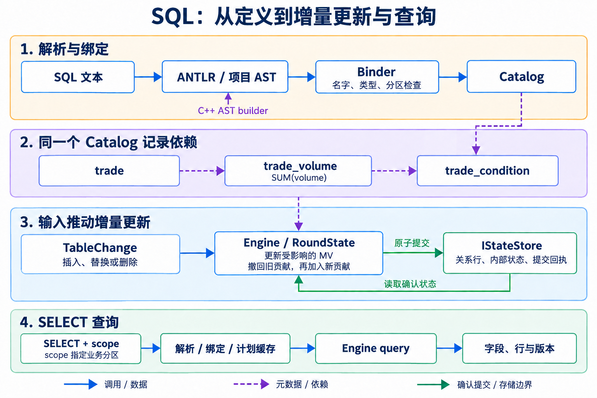
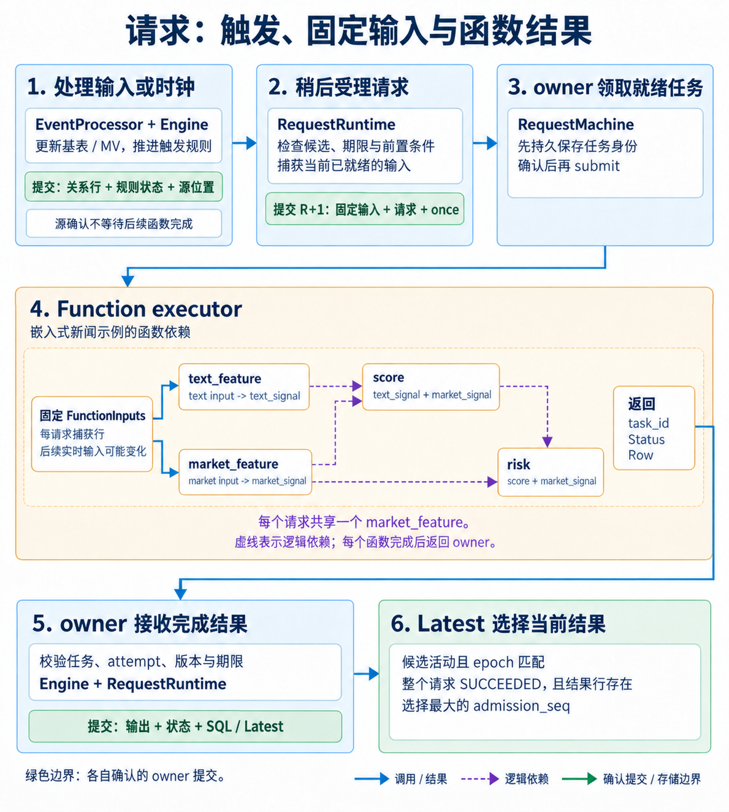

# EventFlow 实现导读：从 SQL、状态与触发到异步特征结果

当前默认完整用法是 [SDK 上传 UDF 的流式示例](../examples/streaming_database/README.md)；本文中保留的静态模块代码参考已移到 [static_streaming](../examples/static_streaming/README.md)。原生上传与分发的最新范围见 [生产 UDF 规格](../specs/native-udf-delivery.md)。

以[新闻影响指标示例](../examples/static_streaming/README.md)为主线：生产者将六字段新闻写入独立消息服务，EventFlow 主动消费，更新新闻统计和级联特征；条件或 Clock 触发请求后，系统固定本次计算需要的输入，由后台函数计算并发布结果。后来的新闻不会改写旧请求的输入。本文也用局部新闻 Pattern 和多目标 DAG 片段解释通用机制；它们不是示例中额外安装的业务图。

Catalog 记录表、视图和函数之间的依赖；物化视图（MV）保存随输入更新的查询结果。Trigger 声明触发条件，Pattern 声明多条事件的匹配顺序，Latest 保存当前选中的成功请求结果。多个 Compute 进程处理不同业务分片，状态共同存放在独立的键值存储服务（KV Service）中。每个分片只由一个执行者（owner）推进状态，并由它原子发布相应结果与 Latest。

阅读路径：

- 想先理解进程和部署，读第 1、2 节。
- 想理解 SQL 如何变成执行逻辑，读第 3、4 节。
- 想理解 MV 如何存储和更新，读第 5、6 节。
- 想理解 Trigger、固定输入、异步 DAG 与 Latest，读第 7 至 9 节。
- 想沿一个实际输入查源码，读第 10 节。
- 想理解缓存、消息确认与恢复，读第 11 至 13 节。

## 1. 运行系统由谁组成


上图展示生产者、独立消息服务和数据库消费链路；本节以当前源码说明服务职责。

图中的线表示 HTTP/JSON 调用或共享状态读写，不表示不同 Compute 之间已经实现跨 key 的数据交换。

| 运行单元 | 当前职责 | 主要源码 |
| --- | --- | --- |
| Coordinator / Meta | 持久保存部署定义与路由，托管 SourcePoller 主动消费并转发输入，接收 DDL/查询，推进集群时钟，记录确认进度与水位，协调 checkpoint | [coordinator_service.cpp](../src/service/coordinator_service.cpp) |
| Compute | 为分片装配 owner，更新受输入影响的 MV，处理状态到期和请求，管理函数执行器与缓存 | [compute_service.cpp](../src/service/compute_service.cpp) |
| KV Service | 按分片（shard）原子提交一批写入，返回确认的数据版本（revision）与提交回执，提供数据快照（snapshot）；后端为 Memory 或 RocksDB | [kv_server.cpp](../src/service/kv_server.cpp)、[state_store.cpp](../src/storage/state_store.cpp) |
| C++ SDK | 连接一个 Meta 地址，调用部署、查询和控制接口，保留结构化结果；直接 ingest 是另一种输入接入方式 | [cluster_client.hpp](../include/eventflow/cluster_client.hpp) |

一个 KV、一个 Coordinator 和 N 个 Compute，共有 N+2 个数据库服务进程。完整示例另外启动独立 HTTP 消息服务，其有界日志通过 IMessageSource 接口交付给数据库。函数 worker 是 Compute 内执行计算函数的线程。每个 Compute 可以拥有多个 shard；同一个 shard 的关系、有限状态机（FSM）、定时器（Timer）和请求状态只由一个 owner 推进。业务 key 标识一组相关数据，例如股票代码；同一 key 的数据分配到同一个 shard。

业务分片由 `shard_for(partition_key, shard_count)` 决定。实现先编码分区键，再计算固定的 FNV-1a 64 哈希，最后对逻辑分片数取模。Meta 把计算出的 shard 映射到配置中的 Compute，Compute 接收时再次校验 key 与 shard 是否一致。具体实现见 [key_codec.cpp](../src/core/key_codec.cpp) 和 [ComputeService](../src/service/compute_service.cpp)。

共享 KV 使多个计算进程能够访问同一套持久数据，但不会自动完成写入串行化或分布式事务。当前通过静态 shard 所属关系、owner 身份和 expected revision 限制写入。一次原子提交只覆盖一个 shard；跨 key join、shuffle、自动再均衡与全市场聚合没有因此获得支持。

### 启动与就绪

[database_main.cpp](../src/service/database_main.cpp)实现 `kv`、`compute`、`coordinator` 三个子命令；应用入口将自己的 `ComputationModule` 传给公开的 [database_main](../include/eventflow/database_main.hpp)。示例先启动消息服务，再启动 KV、Compute、Coordinator，随后通过 Meta 执行 `deploy`。Compute 的静态配置包含 KV endpoint、逻辑 shard_count 和所分配的 shards；并非只连接 Meta 就能自动发现一切。

```text
KV listens
  -> Compute processes listen with static shard assignments
  -> Coordinator loads or creates control metadata
  -> SDK stages optional DDL while STAGING
  -> Coordinator deploys one definition to every Compute
  -> All workers confirm the same fingerprint and shard count
  -> Coordinator publishes RUNNING
  -> SourcePoller consumes messages and acknowledges confirmed inputs
  -> Database time advances timers and function completions
```

`EVENTFLOW_KV_READY`、`EVENTFLOW_COMPUTE_READY` 和 `EVENTFLOW_COORDINATOR_READY` 表示服务已开始监听。Meta 需要收到配置中全部计算节点的安装确认，才将部署状态设为 `RUNNING`。安装失败的节点仍属于待完成的部署，成功条件按配置中的完整节点集合判断。

数据逻辑分片数为 N 时，KV 配置 N+1 个物理 shard；索引 N 专门保存 Meta 控制记录。业务 hash 只使用前 N 个 shard。这样 Meta 不会成为第二个写业务 shard 的 Engine。

## 2. 计算定义、运行时和集群 SDK

计算定义描述 SQL/MV、静态函数、Trigger、请求和输入捕获；运行配置描述节点地址、分片、预算、源订阅与时钟周期。用户可以把自定义定义编译进数据库可执行文件，再用 SDK 控制已经启动的集群。

| 入口 | 使用方式 | 职责 |
| --- | --- | --- |
| Catalog + Engine | 定义 SQL/AST，打开存储并应用 TableChange | 嵌入式增量关系维护 |
| TriggerSet + BoundComputation | 声明 Trigger/Pattern、capture 和静态 Function，整体 bind | 校验并产生单一 Catalog 的计算定义 |
| ComputationModule + database_main | 提供 name/version/bind 工厂，链接到所有服务角色 | 静态应用集群入口 |
| ComputationRuntime | 打开 BoundComputation 与 store，拥有 EventProcessor 和执行器 | 通用 shard 运行、请求调度与完成确认 |
| ClusterClient | 连接 Meta，执行部署前 DDL、deploy、SQL 与控制操作 | 操作已编译并安装的模块 |

### 独立定义与服务装配

[definition.cpp](../examples/static_streaming/definition.cpp)先定义 `news_updates -> news_stats -> news_features`，然后定义 session、阈值 Trigger 和周期 Trigger。`capture_current` 将新闻条数、平均情绪和情绪价格乘积合计固定给影响指标函数，最后调用 `TriggerSet::bind`。示例工厂接收 `staged_ddl`，在绑定 Trigger 前应用它们；工厂失败时不发布部分定义。

```cpp
ComputationModule computation_module() noexcept {
  return {.name = "streaming_news", .version = 1, .bind = &bind_definition};
}
```

`bind_definition` 的完整签名与实现见示例源码；它返回 `StatusOr<BoundComputation>`。入口 [main.cpp](../examples/static_streaming/main.cpp)调用 `database_main(argc, argv, computation_module())`。服务通用实现通过同一模块生成 Catalog、规则与 Registry，并校验持久定义身份和部署 fingerprint。模块随程序编译，SDK 不传函数地址或上传闭包。

[ComputationRuntime](../src/runtime/computation_runtime.cpp)接管原先由业务示例维护的通用 owner/executor 循环：源行进入 EventProcessor，确认的任务交给执行器，completion 回到 owner 完成原子发布。Compute 为每个 shard 创建运行时；worker 不拥有 Engine 或 KV 写权限。服务库无需链接示例业务定义；旧业务 fixture 只保留作回归支持。

### 定义、安装与推进是不同阶段

[Catalog](../include/eventflow/catalog.hpp)的 `define_sql` 返回 RelationId，`snapshot` 返回不可变定义；它们尚未写入业务数据。SQL 场景通过 `Engine::open` 安装。含规则和请求的定义由 `TriggerSet::bind` 返回完整 `BoundComputation`，再由 `ComputationRuntime::open` 安装并恢复 EventProcessor。

C++ 编译检查静态函数输入输出与 `noexcept`；bind 检查实际 Schema、scope、引用、版本和预算；运行时仍验证每条 Row。`TableChange.row = std::nullopt` 表示删除，非空 Row 是完整 upsert，不是局部列 patch。

嵌入式应用可以直接组合 Engine 或 EventProcessor；若自行管理执行器，还需负责有界推进和 completion 提交。数据库部署使用 Coordinator 后台循环和通用运行时，无需客户端重复编写该循环。

### 客户端只生产、部署并查询

完整流程见 [verify.cpp](../examples/static_streaming/verify.cpp)：先 publish 新闻到独立消息服务，确认 STAGING 未消费，再 `deploy()`；数据库自行消费并更新结果。验证器的等待循环仅查询 SQL/消息确认位置，不调用数据库 ingest/pump/drain。

```cpp
Status query_news_features() noexcept {
  EF_ASSIGN_OR_RETURN(auto client, ClusterClient::open("http://127.0.0.1:8080"));
  EF_ASSIGN_OR_RETURN(auto result, client->query(
      "SELECT news_count,average_sentiment,sentiment_price_sum FROM news_features",
      Row{std::string("TICKER_0")}));
  return {};
}
```

这是对已运行部署的查询节选，实际地址和 ticker 取自运行输出。查询返回字段、行、`node_id/shard`、`revision` 和 `catalog_version`；不会触发模型计算。启动前 DDL 可以增加受支持的表/MV，在线 DDL、动态模块替换和远程 C++ 上传尚未实现。

## 3. SQL 从文本到 AST



上图按解析、依赖、更新和查询四部分阅读；列身份、增量算子和存储接口见[完整 SQL 执行图](image/eventflow_sql_pipeline.png)。

SQL 先被解析成抽象语法树（AST），再由绑定器（Binder）检查名字、类型和分区，最后交给运行时执行。三个阶段各有检查：通过语法解析后，还需通过类型、分区和运行时权限校验。

### ANTLR 只负责语法结构

项目自有语法位于 [EventFlowSql.g4](../src/sql/EventFlowSql.g4)，生成的 lexer/parser 位于 [src/sql/generated](../src/sql/generated/)。[sql_parser.cpp](../src/sql/sql_parser.cpp)把 ANTLR parse tree 转成项目自己的 AST。普通 CMake 构建直接编译已生成的自有代码，链接 `cpp3rdlib` 中的 ANTLR runtime，不运行 Java 生成器。

语法顶层要求一条 CREATE TABLE、CREATE MATERIALIZED VIEW 或 SELECT，允许一个末尾分号，之后必须 EOF。关键字忽略 ASCII 大小写；未加引号的标识符转为小写，双引号标识符保留原文。字符串使用 SQL 单引号及双单引号转义；输入必须是合法 UTF-8。

解析器还检查输入字节、token 数、括号与表达式深度，避免无限递归或超大语法结构。当前上限分别为 256 KiB SQL、4096 tokens、64 层括号、128 层表达式。这些是解析器的结构预算，不是整个进程的内存保证。

### AST 保存“用户写了什么”

[sql_ast.hpp](../include/eventflow/sql_ast.hpp)中顶层为：

```cpp
using StatementAst = std::variant<CreateTableAst, CreateViewAst, SelectAst>;
```

| AST 类型 | 关键内容 |
| --- | --- |
| CreateTableAst | 表名、列名/类型/nullable、主键列、分区列 |
| CreateViewAst | 视图名与一个 SelectAst |
| SelectAst | 投影、FROM、可选 JOIN、WHERE、GROUP BY |
| ExprAst | kind、运算符/名称文本、qualifier、literal、子表达式、源码行列 |

表达式 kind 包括 Column、Literal、Number、Unary、Binary、IsNull、Cast、Call 和 Star。`ExprAstPtr` 是 `shared_ptr<const ExprAst>`，构建之后供绑定器只读使用。数字 token 的文本保留在 Number 节点中，之后按类型和范围转换；不是在 lexer 中一律先变成 double。

例如：

```sql
SELECT ticker, volume * 2 AS doubled
FROM trade_volume
WHERE volume >= 100;
```

其 AST 的关键结构可读作：

```text
SelectAst
  from: trade_volume
  projection:
    Column(ticker)
    Binary(*) -> Column(volume), Number("2")  alias=doubled
  where:
    Binary(>=) -> Column(volume), Number("100")
```

C++ 的 `column`、`number`、`binary`、`call` 等 builder 也构造这些节点。因此 SDK 风格的本地 AST 构造和 SQL 文本走同一个 binder，不维护另一套表达式语义。AST 本身还没有 RelationId、输入 slot 或经过证明的分区属性。

## 4. Binder 与 Catalog 如何固定执行含义

[binder.cpp](../src/sql/binder.cpp)把名字解析到 Catalog 中的关系与字段，生成 [BoundPlan 与 BoundExpr](../include/eventflow/catalog.hpp)。此阶段决定“这段表达式从哪一行的哪个位置读什么类型”。

### 从列名到带类型的 slot

`BoundExpr::Input` 用列在 Row 中的位置（slot）读取值，同时保存 `DataType`、是否可空（nullable）等属性。双输入 join 先按左侧、右侧的顺序拼接可见字段；聚合后的投影读取“分组列 + 聚合输出”，不再读取原始交易行。

BoundPlan 保存左右 RelationId、filter、group_by、AggregateSpec、projection、output_fields，以及 identity_types、partition_types、unique_per_partition、请求身份域和绑定来源。`catalog_version` 与完整 `catalog_fingerprint` 用来拒绝在另一份定义上执行旧计划。当前 fingerprint 是规范定义内容，比较的是完整规范身份。

### 类型、NULL 与关系限制

| 检查 | 当前规则 |
| --- | --- |
| 列解析 | 列必须存在；别名、限定名和歧义明确检查 |
| WHERE | 必须可绑定为 Bool；NULL 不通过过滤 |
| NULL | 未定型 NULL 需要类型上下文，输出不能保留未知类型；`IS NULL` 有独立节点 |
| 聚合 | 支持 COUNT(*)、COUNT(expr)、SUM、AVG；SUM/AVG 要求有类型的数值参数 |
| GROUP BY | 必须覆盖完整业务分区键，不能随意按非分区字段做全局分组 |
| JOIN | 当前只有同分区 one-to-one inner lookup join；两侧都要证明每分区至多一行，ON 覆盖对应完整分区键 |
| 查询 scope | 可显式提供，或从完整分区键常量等值条件推导 |

表达式计算在 [expression.cpp](../src/sql/expression.cpp)中，类型转换、算术范围和 NULL 语义不依赖用户自行从 Value 中猜测类型。有些结构可以被 grammar 识别为函数调用，却会被 binder 拒绝，例如当前未支持的 SQL 标量函数。DISTINCT、窗口函数、子查询、任意多表 join、ORDER BY/LIMIT 等不属于已实现 SQL 子集。

### Catalog 是唯一关系图

[catalog.cpp](../src/sql/catalog.cpp)创建 RelationDescriptor，统一描述四类关系：BaseTable、SqlView、FunctionView、LatestView。`dependencies(relation)` 从相应 plan 中派生上游关系；它不是用户另外提交的一份可编辑 DAG。规范定义可经 [catalog_codec.cpp](../src/sql/catalog_codec.cpp)编码、恢复并重新校验。函数回调地址和函数体不进入元数据 wire，执行端仍需匹配已编译的 implementation_identity。

基表写角色还分为 PublicInput、RequestCapture、RuntimeStatus。普通输入不能写固定捕获表，worker 不能直接写函数关系，普通 hook 不能伪造候选或请求成功状态。这一权限边界与图定义一起约束运行时，而不是只靠对象命名约定。

## 5. 灵活 Schema 与 KV 布局

[types.hpp](../include/eventflow/types.hpp)定义统一数据模型：

```cpp
using Value = std::variant<std::monostate, bool, std::int64_t,
                           double, std::string, std::vector<double>>;
using Row = std::vector<Value>;
```

Schema 持有稳定 ID/version、Field 列表、主键与分区键。DataType 中的 TimestampMicros 使用 int64 值表示，但仍由 Schema 区分语义。`std::monostate` 表示 NULL，FloatVector 是一列向量，不是额外的关系行。行写入、输入 JSON 解码和读取都要经过 Schema 校验。

### 物理 key 的实际编码

[key_codec.cpp](../src/core/key_codec.cpp)使用以下布局：

```text
'D' | shard:u32be | kind:byte | object_id:u32be | encoded_key_parts
```

| 部分 | 含义 |
| --- | --- |
| shard | 物理 KV 分片，固定宽度大端编码 |
| kind `T` | 关系行：基表、MV、捕获表、函数结果与 Latest 都可存放在这里 |
| kind `S` | 聚合状态、Latest selector、生命周期和请求等内部状态 |
| kind `I` | 保留的扩展/索引命名空间；并不意味着所有当前索引都使用它 |
| object_id | RelationId 或单独分配的状态对象 ID |
| key parts | 该对象的完整物理身份，业务分区字段排在前面 |

键中没有 Compute 地址、进程 ID 或 revision 后缀。例如 trade 行使用完整 `(ticker, trade_id)`；按 ticker 聚合的 trade_volume 只需要 `(ticker)`。RequestCapture 与函数结果使用 `(ticker, request_id)`，这样一次请求的多个函数输入能够按同一身份对齐。

键分量只接受非 NULL 的 Bool、Int64/TimestampMicros 和 String。Bool 有类型标记；有符号整数先翻转符号位再按大端写入，使字节顺序与整数顺序一致。String 的 NUL 字节编码为 `00 ff`，以 `00 00` 终止，避免多个字符串分量拼接时产生歧义。Float64 和向量不作为主键分量，不能借助 NaN 或浮点比较含义构建不稳定身份。

### 可见列和物理身份分离

MV 可以投影掉主键列，但仍须精确撤回原行。RelationDescriptor 因此分别记录 visible_count、storage_schema、physical_key_slots 与 partition_slots。隐藏身份列接在可见列之后，由 Engine 存储和维护；查询通过 `visible_row` 去除它们。普通投影不会因为两个输出值相同就错误合并两条源记录。

[encode_row/decode_row](../src/core/types.cpp)目前使用带 `format`、`schema_id`、`schema_version` 和 `values` 的 JSON 字节保存关系行。因此“KV 是字节接口”不等于当前行存储已经采用列式格式或自定义紧凑二进制。聚合等内部状态有自己的编码，结果行不能代替精确累计器。

## 6. Engine 如何增量维护级联 MV

[Engine](../src/runtime/engine.cpp) 每次操作创建一个 `RoundState`，保存本轮尚未提交的修改（overlay）、读取到的初始值、关系变化（`RowChange`）、资源计数和固定处理时间（processing time）。`StateImage::Before` 读取轮开始时的状态；`Staged` 则在该状态上叠加本轮修改。这两个读取视角只在当前计算轮内有效，任意历史 revision 的 MVCC 查询仍不在支持范围内。

存储读取会携带实际 revision，Engine 在当前 owner 边界核对读取版本。单 owner 串行化保证捕获期间不会被另一条本分片操作穿插；如果外部写入破坏该前提，版本检查应拒绝继续，而不是自动提供旧版本数据。这正是当前一致读取能够不依赖 MVCC 的条件。

### 一次 upsert 的传播

1. 校验 relation 写角色、完整 Row/identity、业务分区与当前 shard。
2. 读取原值，将新值放入 overlay，并记录 old_row/new_row。
3. 按 Catalog 依赖顺序，处理本轮受影响的 SQL/Latest 后继。
4. 更新内部状态与关系行，完成权限和 rows/bytes/mutations 等预算检查。
5. 将 overlay 编成一个 CommitBatch，交给 StateStore；确认后才更新 Engine 内存 revision 并公开 changes。

同一行在本轮被多次修改时，向后续关系传播的是轮开始时的旧值（before）与最终新值（after）。多条依赖汇合时，中间更新顺序仍属于本轮内部过程。Engine 的 `stabilize` 沿关系依赖只更新受影响的部分，无需每来一条数据就重跑全部 SQL。

### 过滤、投影、聚合与 join

过滤和投影根据新的源行计算结果；条件从 true 变为 false 时删除原结果行。聚合先扣除每个受影响分区中旧行的贡献，再加入新行的贡献，最后生成结果。如果组内已没有源行，则删除组状态和结果；COUNT 的行数与 SUM/AVG 的非 NULL 数量分别维护。

浮点 SUM/AVG 使用 [ExactSum](../src/runtime/exact_sum.cpp)支持精确撤回和最终舍入，不会只保存一个不断加减的 double 并让更新顺序决定累积误差。聚合状态存于该 MV 的 state_id，公开结果存于 RelationId，两者同批提交。

lookup join 收集两边变化涉及的业务 scope，对同一个 scope 分别读取 before 与 staged 的左右输入。任一侧缺失时 inner join 无输出；有输出时再经过 filter/projection。它依靠 binder 已证明的“一分区至多一行”，没有实现任意 many-to-many join 的索引和交换网络。

初始化已有数据上的新 MV 允许有界扫描，但必须在一个可承受的原子安装中完成。超出预算明确拒绝，不公开半初始化视图。正常查询也受 scope、行数和字节上限约束。

## 7. Trigger、强类型 Pattern 与绑定语义

通常先用 [Trigger](../include/eventflow/trigger.hpp)、[Pattern](../include/eventflow/trigger_pattern.hpp) 和 [TriggerSet::bind](../include/eventflow/computation.hpp) 描述业务规则。底层用 FSM 表达单次等待，用有界 E-NFA 保存多条可能的匹配路径。声明式入口生成这些状态迁移、字段索引、待读取关系和请求绑定；持久状态仍由每个 shard 的唯一 owner 推进。

### 字段表达式读取本轮稳定 MV

下面假设 `news` 是包含 `sentiment_score` 列的新闻表 ID；`ready` 是按业务 key 唯一定位的物化视图 ID，视图中有 Bool 类型的 `ready` 列。`event` 表示当前新闻事件，`ready_now` 读取当前视图中的条件值。这是说明表达式的局部片段；当前完整建表、绑定和运行入口见[新闻示例](../examples/static_streaming/definition.cpp)。

```cpp
const auto event = EventRef::source({.kind = "news", .payload_relation = news});
const auto ready_now = ViewRef(ready).column<bool>("ready").is_true();
const auto positive_news = event.column<double>("sentiment_score") > 0.0;
const auto rule = Trigger::on_event("ready_positive_news", event)
    .when(ready_now && positive_news);
```

`EventRef` 声明事件类别（kind）和事件数据（payload）的 Schema，`ViewRef` 声明要读取的同 key 关系。`column<T>` 按列名绑定物理位置并检查类型；`Predicate` 自动汇总这些读取关系，生成底层所需的两份 read 声明，调用方只需声明一次别名（alias）与关系 ID（RelationId）。

事件更新已传播到相关 MV 后，条件函数（guard）才读取这份当前状态。读取关系必须能在本 scope 唯一定位。缺行或 NULL 的比较为 false；`is_null()` 可识别缺失，`value_or(...)` 给出显式默认值。Schema 不符、实际 payload 长度或类型错误返回 Status。布尔 `&&/||` 保留短路次序。

普通 `.when` 每次检查条件当前是否为真，不保存上次的判断结果。若只想在条件从 false 变为 true 时触发，需要显式定义记录前后状态的规则；这种变化检测称为 crossing。

基表写入与事件 payload 是独立字段：`ProcessorEvent.changes` 不自动证明 `values` 正确。调用方可用 `encode_typed(news)` 编码，但仍需显式填入 `source`、`scope`、`kind`、`values` 与 TableChange。原始行不会因为声明了 `payload_relation` 就被直接强转成业务 struct。

当前新闻示例在 [definition.cpp](../examples/static_streaming/definition.cpp)中直接声明读取自己定义的级联 MV：

```text
news_updates -> news_stats -> news_features(news_count, average_sentiment, sentiment_price_sum)
news event + active session + news_count >= 2 + average_sentiment >= 0.5 -> sentiment_threshold
```

读取 MV 不等于订阅其每次变化。完整通用 `on_change` / `on_request_terminal` host 仍未接入集群 SDK；[observation_definition.hpp](../include/eventflow/observation_definition.hpp) 与私有 observer 提供基础，没有引入通用 CDC 服务或持久事件观察队列。

### 强类型 Schema 与静态用户函数

[typed_schema.hpp](../include/eventflow/typed_schema.hpp)提供显式 `SchemaTraits<T>`，通过 `field<&T::member>("column")` 映射成员。支持 `bool`、`std::int64_t`、`double`、`std::string`、`std::vector<double>` 及对应 optional；不是任意 struct 的自动反射。

实际列可以重排，绑定按名称选择并校验类型、可空性。运行时解码仍检查整份实际 payload，包括 typed struct 没有投影出的字段，防止仅验证被读取部分。可空到不可空的不兼容声明不能依赖“当前这条数据恰好非空”混过绑定。

[Function<Fn>](../include/eventflow/static_function.hpp)接受返回 `StatusOr<Output>`、接收 `const Input&` 且 `noexcept` 的静态函数或无捕获静态 callable。Input/Output 都需显式 Schema。它生成 Registry 签名与适配回调；计算发生在执行器处理已受理任务时，链式声明和 bind 不执行模型。

函数 ID、version 与 `implementation_identity` 都是显式持久身份。函数地址、类型名和机器码猜测不构成可跨进程的身份。复用相同 ID/version 时 Schema 或实现身份必须一致。这个入口不提供动态插件/JIT，也不等同于完整 SQL UDF/UDTF/UDAF 算子族。

### 单次等待与多候选 Pattern 是不同语义

| 入口 | 状态模型 | 适用规则 |
| --- | --- | --- |
| `Trigger::on_event(...).when(...)` | 每事件判断 | 条件成立即发射 |
| `.then_next(event, NextPolicy::OfKind).within(2s).rearm_on_next_event()` | 每 key 最多一个等待状态（armed） | 第一条同 kind 确认失败立即复位 |
| `.then_next(event, NextPolicy::Strict)` | 每 key 最多一个等待状态（armed） | 规则所见数据流中紧邻事件必须确认 |
| `Pattern::begin<News>(...).next(...).where(...)` | 有界 E-NFA 多路径 | 多起点、分支、历史捕获与 skip |

普通等待必须显式指定复位策略：确认成功、确认失败或到期后回 idle；一条数据事件至多做一次数据转换，不能把失败确认立即当作新起点。精确截止时间先到期，再处理该时刻的新事件。窗口是 processing time 的半开区间，新闻自带 `timestamp` 不会自动变成事件时间窗口。

下面的强类型模式使用新闻类型 `News`；`news` 是新闻表 ID，`positive(const News&)` 检查新闻情绪是否为正。`source` 限定输入为同一股票代码的新闻，`pair` 匹配两条相邻的正面新闻。该片段用于解释匹配语义；完整接口见 [typed_trigger.hpp](../include/eventflow/typed_trigger.hpp)，相应行为由 [typed_trigger_test.cpp](../tests/typed_trigger_test.cpp)回归覆盖。

```cpp
using namespace std::chrono_literals;
const auto source = EventRef::source<News>({
    .kind = "news", .payload_relation = news}).key_by(&News::ticker);
const auto pair = Pattern::begin<News>("first")
    .where<&positive>("news.positive.v1")
    .next("confirm")
    .where<&positive>("news.positive.v1")
    .within(2s)
    .after_match(CepSkipStrategy::SkipPastLastEvent);
```

`key_by` 验证当前 Catalog 的业务分区键，不负责路由或 shuffle。typed source 将规则的数据输入域限定为声明的 kind，其他 kind 不执行该规则的数据匹配，但仍推进时间与超时；负面新闻仍属于 news 域，不能被上游过滤掉。因而上面的 `next` 是相对于 news 域的严格相邻，不是相对于所有进入 owner 的事件。

底层 Pattern 可以使用多个 EventRef 描述多 kind。`next_of_kind` 忽略其他 kind，第一条目标 kind 不符合则终止路径；`followed_by` 跳过不符合者；`followed_by_any` 保留多个可行分支。`optional/repeat` 包裹整个当前组合；要让单个事件可选，应单独构造后 `then`。外层提供统一 within/after_match，内嵌右侧组合不能各自偷偷带一个不同的窗口。

E-NFA 的 Take 消费事件，Ignore 跳过，Proceed 表示不消费的 epsilon 转换。NoSkip、SkipToNext、SkipPastLastEvent 控制匹配后保留哪些候选。路径、历史事件、状态字节、单步工作和输出都有明确上限；超限不会静默丢掉部分匹配再报告成功。事件时间重排、negative/greedy 等完整 Flink 方言仍不在范围内。

### 显式业务会话

每个有请求的声明都需要 `.in_session(SessionRef::candidate(candidate))`。这里的 Candidate 保存一个业务 key 的活动会话、截止时间和代次（epoch）；epoch 用来区分同一 key 先后建立的会话。请求声明引用的会话必须与 owner 的 `CandidateExpiryPolicy` 一致。下面用新闻说明一个 60 秒会话策略；`catalog` 是正在构建元数据的 Catalog，`news` 是前面创建的新闻表 ID。

```cpp
EF_ASSIGN_OR_RETURN(auto candidate, catalog->define_candidate({
    .name = "news_session",
    .scope_fields = {
        {.id = 1, .name = "ticker", .type = DataType::String, .nullable = false}},
    .payload_fields = {
        {.id = 2, .name = "deadline_us", .type = DataType::Int64, .nullable = false}}}));

ProcessorConfig definition;
definition.input_relations = {news};
definition.requests.emplace();
definition.requests->candidate = CandidateExpiryPolicy{
    .relation = candidate,
    .deadline_column = "deadline_us",
    .version = 1,
    .on_source = [candidate](RoundContext& round, const ProcessorEvent& event) noexcept
        -> StatusOr<std::optional<CandidateActivation>> {
      EF_ASSIGN_OR_RETURN(auto existing, round.read_relation(candidate, event.scope));
      if (existing)
        return std::optional<CandidateActivation>{};
      if (event.processing_time_us > std::numeric_limits<std::int64_t>::max() - 60'000'000)
        return Status(ErrorCode::InvalidArgument, "news session deadline overflow");
      return std::optional<CandidateActivation>(CandidateActivation{
          .expected_epoch = 0,
          .payload = {event.processing_time_us + 60'000'000}});
    }};
const auto session = SessionRef::candidate(candidate);
```

它只在首次观察到该 ticker 时开启一个 60 秒会话，后续新闻不替换 epoch，也不延长截止时间。会话何时建立、换代、过期以及能否重开，由明确的 candidate 策略决定；SessionRef 与 Clock 均不代办这些操作。`once_per_candidate=false` 仍需活动候选，不能解释为无会话请求。

### Clock 与无输入推进

`Trigger::clock` 一次生成 `PeriodicPolicy` 和匹配该策略的规则。`ClockSchedule` 包含 `policy_id`、`every`、`phase` 与可选 `event_kind`；显式 kind 也须通过冲突校验。稳定 ID 和实现身份参与恢复检查，不能按注册次序任意变化。

一次公开操作固定一个 now，不在不同回调里重读墙钟。[TimerQueue](../src/runtime/time.cpp)处理到期顺序、generation、周期和 skipped slots。到期先于同刻新输入；延迟 guard 读取执行时的稳定状态，原 scheduled time 只是审计事实。相对 Timer 从实际执行 now 起算，不伪造过去的 MV 快照。

当前[完整示例](../examples/static_streaming/README.md)使用 Coordinator 的 `tick_interval_ms=20` 自动推进已安装的 Clock，同时配置 `source.poll_interval_ms=10` 主动读取新闻。客户端无需调用 drain。没有 source 输入仍能处理 TTL/候选过期。周期按已经观察到的 scope 激活，不补激活前历史，错过时隙合并并记录 skipped。builder 自身没有定时线程。

### 内置触发审计表

`TriggerSet::bind` 在同一 Catalog 的末尾自动生成 `trigger_audit`，将其标为专用 `BaseWriteRole::TriggerAudit`。表随计算定义一起安装，用户无需执行 DDL。默认名称已占用时绑定整体失败，不静默复用用户表。原来的低层 `ProcessorConfig` 在 `trigger_audit.relation=0` 时保留未接线模式；正常声明式入口和采用 TriggerSet 的静态集群模块自动完成接线。

记录点位于 FSM/CEP 确认 occurrence 可保留并发出之后。受理前的请求 ID 已可确定，因此 Wait、NotReady 和后续 TryOnce skip 也有历史；once 已消费、无活动会话或条件失败导致没有发出的 occurrence 不记行。记录仅表示 emitted，没有伪造的“计算已成功”字段。旧的 level binding 和手工直接受理没有声明式 occurrence，仍通过请求状态关系和 `read_request` 查询。

| 列 | SQL 类型与语义 |
| --- | --- |
| `scope_key_0` 等 | 与业务分区键同类型、非空；统一名称避免与用户的 `rule_id` 等字段冲突 |
| `occurrence_id` | 非空 STRING，本次触发的稳定身份；与全部 scope 列组成主键 |
| `rule_id`、`rule_version` | Trigger 名称与版本；版本用十进制 STRING 保留完整 UInt64 |
| `emission`、`event_kind` | 发出名称与驱动事件 kind；Pattern emission 固定为 match |
| `occurred_at_us` | 非空 INT64，FSM 发出时间或 CEP 匹配完成时间 |
| `evaluated_at_us` | 非空 INT64，实际处理并发出的时间；CEP 延迟交付时可能晚于匹配完成 |
| `scheduled_at_us` | 可空 INT64，Clock 原定时隙；与实际处理时间分开保存 |
| `skipped_slots` | 非空 STRING，当前 Clock 合并的错过时隙数 |
| `firing_revision` | 非空 STRING，本行与触发状态共同提交的 shard revision；不是后续 capture/admission revision |
| `request_id`、`binding_id`、`plan` | 可空 STRING，已确定的请求身份、绑定与计划 |
| `candidate_epoch`、`request_mode` | 可空 STRING，候选代次与 WAIT／TRY_ONCE_AT_FIRING |
| `intent_deadline_us` | 可空 INT64，待受理意图的绝对截止时间 |
| `source_id`、`source_topic` | 可空 STRING，驱动本轮的上游来源 |
| `source_partition`、`source_offset` | 可空 INT64，源投递身份；内部时钟不虚构源 offset |

时间均为处理时间微秒。`source_*` 只描述驱动本轮的源消息，不替代完整 CEP match 或持久化历史 TriggerWitness；审计不复制全部事件 payload、guard 读取值和模型输入。详细请求与固定输入应按 `request_id` 查询。

```sql
SELECT rule_id, evaluated_at_us, scheduled_at_us, request_id, firing_revision
FROM trigger_audit
WHERE scope_key_0 = 'CLOCK';
```

也可把 scope 通过 `QueryContext` 或 SDK `query(sql, scope)` 传入。当前没有跨 key 的无条件全表查询或 SQL ORDER BY/LIMIT；返回顺序不作为时间排序合同。`bound.explain()["trigger_audit"]` 给出实际 relation ID、源字段到审计字段的映射及预算。

`ProcessorConfig.trigger_audit.max_rows_per_scope` 默认 128，`max_bytes_per_scope` 默认 256 KiB，字节计数包括 KV key 和编码行。每个 scope 每轮只扫描一次，按 `(evaluated_at_us, occurrence_id)` 淘汰最旧项；相同时间用稳定 ID 决定保留顺序。单条记录还受 `max_occurrence_bytes` 约束。超大记录或本轮预算不足返回 ResourceExhausted，原子回滚本轮，不能静默丢掉应记录的触发。

写入走私有生命周期能力，和触发状态／源去重记录同批提交。普通输入、公共 hook、请求状态写入和 observation 都不能冒充审计生产者。ACK 删除 outbox 不删除历史。snapshot 保存普通关系状态，因此协调 checkpoint 恢复后审计行及去重边界一并保留；UNKNOWN 重试使用原批，不重新求值并造出另一条记录。

schema、写角色和保留策略参与 Catalog／生命周期指纹。新增内置表后的定义与旧部署不保证指纹兼容；已有无审计表的部署需要新建或经过明确迁移，不能直接把旧 checkpoint 解释为新定义。RocksDB WAL 保持开启。

### 整体绑定、诊断与持久兼容

| 阶段 | 实际工作 |
| --- | --- |
| C++ 构建 | 检查函数类型、`noexcept`、Schema traits 与 capture/Function 的静态连接，生成用户机器码 |
| `TriggerSet::bind` | 按 Catalog 校验字段、scope、label 数量、会话、版本及预算；生成规则与必要关系、函数和请求 |
| `EventProcessor::open` | 校验当前部署与持久化指纹，安装 owner 运行时 |
| `process/pump` 与执行器 | 校验实际 payload、推进匹配、受理请求、执行任务与确认结果 |

绑定器在 Catalog/Registry 的私有副本上工作，最终返回包含 `catalog`、`registry`、`definition`、`explanation` 的 `BoundComputation`；出现错误不发布半个函数或半张业务图。调用者使用 `bound.explain()` 查看输入域、字段索引、规则/模式、capture 来源、函数身份、生成的 capture/function/status/Latest 关系、plan 和期限；解释报告不是新的运行时业务图。

恢复时，部署中的 ID/version、Schema、声明结构与实现身份必须与保存的定义一致。声明式绑定语义参与持久化指纹；从手写 FSM 改为声明式定义时，即使保留 rule 名称，也需要验证快照兼容性。采用不同定义应创建新部署，或另行实施并验证迁移；当前没有热更新或状态迁移协议。

底层 `ProcessorRule`、`ProcessorCepRule`、`FsmProgram` 和手写 guard 保留为高级入口。`Predicate::guard` 需要一次显式声明 `{alias, relation}` 读依赖及实现身份，绑定器不会分析任意 lambda 捕获了哪些数据。guard/update/capture 不得重入 Engine、直接写 KV、跨 key 查询或执行外部 I/O。

## 8. 从触发意图到固定输入请求



上图按编号展示请求的主要步骤；UNKNOWN、确认与资源预留等细节见[完整请求执行图](image/eventflow_request_lifecycle.png)。

图中函数执行阶段之前的持久任务 claim 由 owner 完成；worker 只执行已经获准的任务，不能自行取得 KV 写权限。

### 两种输入来源必须明确选择

声明式函数请求先选择输入捕获方式（capture），再连接计算函数（Function）。下面继续使用上一节的 `source`、`pair` 和 `session`：它们分别表示新闻输入域、两条新闻的匹配规则和业务会话。`make_input` 把匹配到的两条新闻转换成 `calculate` 所需的输入类型；这是局部 API 片段，函数需有相应 SchemaTraits；输入来源的运行行为见 [typed_trigger_test.cpp](../tests/typed_trigger_test.cpp)。

```cpp
const auto trigger = Trigger::pattern("matched_news_score", source, pair)
    .in_session(session)
    .capture_match<&make_input>({"first", "confirm"}, "news.pair_input.v1")
    .request(Function<&calculate>{
                 .id = "matched_score",
                 .version = 1,
                 .implementation_identity = "news.score.v1"},
             {.id = "matched_request",
              .mode = RequestTriggerMode::Wait,
              .pending_for = 1s,
              .lifetime = 10s});
```

`capture_match` 按给定标签（label）的顺序调用投影函数，其输出类型参与 `.request` 的编译期类型检查。确定出现一次的 label 对应 `const News&`，可选 label 对应 `const std::optional<News>&`，重复 label 对应 `const std::vector<News>&`。绑定器检查标签是否存在、可见字段是否匹配，以及数量范围是否相容。

投影读取的是触发记录（occurrence）中保留的实际匹配事件，无需再到基表寻找历史行。投影后的参数（arguments）随待受理意图保存。

`capture_current<&mapper>(relation)` 则明确选择受理时的同 key 当前关系。mapper 接收与该关系可见字段匹配的强类型输入，返回 Function 需要的类型；该关系必须 `unique_per_partition`，没有行时 capture 返回未就绪。两种来源均在最终受理时写入受控 RequestCapture 根表，之后保持不变。

生成链路为：`RequestCapture -> typed input projection -> FunctionView`，并创建 RequestStatus 和 Latest。业务身份列与 typed payload 分开，Catalog 的隐藏 key 继续关联同一请求。旧多目标计划可以使用 `.request({.plan = ...})` 复用，其 capture 仍由原计划定义；它不会因为换用 Trigger builder 就自动变成 `capture_match`。

### 延迟受理不能只靠不调用 pump

用一个延迟受理场景说明：新闻按 A、B、C、D 的顺序到达。新闻 A/B 完成匹配时，基表当前行是新闻 B。两个评分请求设置 `required_accepted_binding = "release_gate"`，等待前置请求受理；新闻 C 的情绪达到 0.9 后才产生并受理这个前置请求。新闻 C 更新完成后，`capture_match` 仍使用新闻 A/B，`capture_current` 读取当前新闻 C。

必须有这个受理屏障，因为 `EventProcessor::process(C)` 可能先推进旧 pending 请求，再执行 C 的基表变更。只是在 B 后不主动 pump，不能保证请求一定看到 C。实际业务无需延迟时可移除 gate；输入来源语义不会改变。

### 触发成立不等于请求已受理

条件成立时，系统记录一次触发；输入与执行条件准备好后，保存请求及其固定输入，这一步称为受理；后台函数随后执行。函数结果经校验并保存，且整个请求成功后，才可发布为 Latest。这三个时点分别对应“触发”“受理”和“完成”。

`TriggerOccurrence` 保存规则版本、事件、当轮读取值、触发输出及必要来源信息。[RequestTriggerBinding](../include/eventflow/event_processor.hpp) 将这条记录绑定到 `RequestPlan`，并声明活动候选、前置请求已受理、每会话受理一次（once）或绝对截止时间（deadline）等条件。输入尚未就绪（Ready）或资源不足时，意图可以等待（pending）；周期 `TryOnceAtFiring` 则可跳过当前时隙。

这里有两个不同提交：

```text
Source round:
  base/MV + FSM/Timer + Trigger/PendingIntent + source position -> commit

Later admission at confirmed revision R:
  select saved match arguments OR read declared current inputs
  capture rows + RequestManifest + request state/index
  + consume occurrence + accepted-once -> commit R+1
```

源轮和受理轮可能相邻，但不能把它们统称为一个原子事务。`capture_current` 或原计划的当前读取在等待 Ready 后可能看到后续行情；`capture_match` 保留的是已匹配事件投影出的参数。两者都记录真正的 capture_revision、admission_revision 和受理时间；match 参数的事件内容可以更早，但版本记录描述实际受理读写边界，不声称回到触发时的整库历史快照。

### RequestPlan 从 Catalog 派生所需子图

[RequestPlanDefinition](../include/eventflow/request_runtime.hpp)声明目标 RelationId、capture 回调和资源/期限。capture 返回写入 RequestCapture 根表的固定行；依赖图从 Catalog 中反向获得。同一个请求的函数输入按完整 request identity 对齐，不能将两个请求的行情和 embedding 混在一起。

一次成功受理后，捕获行不再随实时 quote/history 更新。RequestMachine 保留 Manifest、节点状态、attempt 与任务信息，RequestRuntime 负责和 Engine 同批提交。capture 的 `ready=false` 不消费 once，也不提交一份不完整的 InputBundle。

### 为什么要有独立释放通道

[EventProcessor](../src/runtime/event_processor.cpp)的请求模式按以下顺序推进：

```text
expiry fence -> completion/cancel/request timeout/admission -> ordinary timers
```

到期屏障（expiry fence）先删除已到期的表行、使候选失效，并保存待处理通知；此时暂不执行可能继续产生大量输出的普通条件函数。随后处理完成、取消和超时，释放已受理请求占用的资源，最后再处理一般定时器、周期和新意图。

例如，活动请求上限 `active=1` 与待处理触发记录上限 `trigger outbox=1` 都已用满。若先执行一个还要新增触发记录的 Timer，就会因容量不足而阻塞；先处理已有函数的完成消息，则能释放请求资源。这是独立处理完成、取消和超时的原因。

一个公开 process/pump 可能完成多个原子子轮，再在后续轮遇到背压。`ProcessResult.committed_rounds` 明确保留已确认效果；后续失败不回滚此前真实提交，也不能让调用方丢弃这些结果。

## 9. 异步函数 DAG、共享祖先与 Latest

[FunctionRegistry](../include/eventflow/function_executor.hpp)保存已编译的函数签名、版本、implementation_identity 和回调。FunctionView 的依赖属于 Catalog；执行器收到的 FunctionTask 已包含固定 typed inputs。worker 只返回 payload 与任务身份，规范关系身份和最终成功状态由 owner 添加和验证。

### 同一请求中的共享计算

通用 RequestMachine 也支持多目标请求；例如下面的函数依赖图用来说明共享祖先，它不是新闻示例额外安装的业务图：

```text
quote_capture -> market_sql --+
history_capture --------------+-> features --+-> prediction --+
embedding_capture --------------------------+                +-> risk
                                             features -------+
```

RequestMachine 按目标的共同祖先形成一个子图。`features` 正常只执行一次，prediction 和 risk 复用它；risk 还等待 prediction。“共享祖先一次”是同一请求的正常调度保证，不能解读为发生故障时物理计算绝不会重做。

owner 先持久 claim/task 身份，提交确认后才向 IFunctionExecutor::submit 派发。结果经 poll 回到 driver，再调用 `complete_request`。同一完成提交可以保存函数结果、更新节点和整请求状态、推进 SQL/Latest，并产生下一批 ready 节点。

SimpleFunctionExecutor 通过显式 `run_ready` 确定性推进，适合测试和嵌入式示例。真实 Compute 使用 ThreadPoolFunctionExecutor；每个实际创建的执行器默认有两个 worker。如果一个 Compute 拥有多个 shard，当前装配为每 shard 一个 driver/执行器，不能把两个线程误当整个节点的总线程数。

### 回包身份与取消

task_id 编入 scope/request/relation/attempt/owner_epoch，执行器只将其作为不透明身份回传。RequestMachine 验证版本、当前 attempt、期限与终态，拒绝旧 attempt 或取消后的回包改变逻辑结果。正在运行的 C++ 回调不会被强杀；取消后的物理任务仍需退出，再释放相应执行器容量。

纯函数结果缓存和有限的执行器回执可以避免重复计算，但它们不是持久 exactly-once 保证。回执淘汰或恢复后允许物理重执行，逻辑结果仍由 owner 的持久请求状态和 attempt fence 决定是否接纳。已经 poll 出来的 completion 在 owner 提交 UNKNOWN 时必须由 driver 保留，不能丢弃后假设执行器会再次返回。

### Latest 选谁

LatestView 显式依赖结果关系、RequestStatus 和 Candidate 三者。候选活跃、epoch 相同、整个请求为 SUCCEEDED 且结果行存在，才有资格参与选择。在有资格的请求中，选择最大的 admission_seq，而不是最后完成的那个。

例如，两个请求的 `admission_seq` 分别为 10 和 11。seq=11 先成功，seq=10 随后才成功，Latest 仍保持 seq=11 的结果。某个中间函数成功但整个请求失败，不会发布其结果为 Latest。候选更换 epoch 或到期时，当前 Latest 与后继 SQL 同批撤回，旧请求结果仍可作为历史保存。

[Engine::latest_view](../src/runtime/engine.cpp)通过变化涉及的 scope 和 request identity 点读结果/status，同时维护 selector state 与公开行，并检查两者 provenance 一致。它不是每次完成都扫描全部历史请求重新做 arg-max。

## 10. 一条完整轨迹：新闻触发一次固定影响指标计算

[新闻示例](../examples/static_streaming/README.md)是这条轨迹的完整入口：

```sh
bash examples/static_streaming/run.sh
```

以其中一个 ticker 为例，先向消息服务写入两条新闻，情绪/价格分别为 0.25/100 和 0.75/104。部署前消息不被确认；部署后数据库主动消费。第二条新闻使条数达到 2、平均情绪达到 0.5，触发阈值请求：

| 步骤 | 执行者 | 状态变化 |
| --- | --- | --- |
| 1 | producer | 向独立 HTTP 消息服务 publish 业务 JSON，获取 source offset |
| 2 | Coordinator / SourcePoller | poll 一条原投递，固定内容、token 与处理时间，按目标表 Schema 解码 |
| 3 | Coordinator | 计算 shard，保存原 pending 投递，转发到该 key 的 Compute |
| 4 | Compute / Engine | 写入 news_updates，更新 news_stats 与 news_features；条数 2、平均情绪 0.5、乘积合计 103 |
| 5 | EventProcessor | 在本轮稳定 MV 上判断 news_count >= 2 且 average_sentiment >= 0.5，保存 Trigger/intent；关系、生命周期和源进度同 owner 提交 |
| 6 | Coordinator / SourcePoller | 输入确认后推进源前缀并 ACK；模型完成不作为输入 ACK 的前提 |
| 7 | 请求受理 | 在已确认版本读取 2/0.5/103，写入固定捕获行、请求状态与 once 消耗 |
| 8 | ComputationRuntime / worker | owner 持久 claim，worker 计算 103/2=51.5，completion 由 owner 确认 |
| 9 | SQL client | 查询 MV、捕获与 Latest，断言 shard、打印 node_id，并核对请求身份 |

客户端随后暂停集群并追加情绪 0.5、价格 112 的第三条新闻。暂停期间源位置和 MV 不变；resume 后数据库自动消费，条数变为 3、平均情绪仍为 0.5、乘积合计变为 159。旧阈值请求的 once 已消耗，输入仍为 2/0.5/103、指标仍为 51.5；新周期请求重新捕获当前 MV，指标为 159/3=53。

完整[定义](../examples/static_streaming/definition.cpp)同时展示阈值 Trigger 与 Clock 的声明，完整[验证器](../examples/static_streaming/verify.cpp)检查两条不同 shard 的链路。循环中没有客户端 ingest/pump/drain。该例的预期数值并非本轮执行通过记录，验收证据见[当前规格](../specs/news-streaming-example.md)。

## 11. 缓存、存储提交与 UNKNOWN

### 缓存位于不同层次

| 缓存 | 保存什么 | 失效或预算边界 |
| --- | --- | --- |
| RoundState | 本轮读取值与未提交 overlay | 仅当前 owner 轮，不能跨 UNKNOWN 重新解释 |
| CachedStateStore | 跨轮确认态、可缓存缺行、resident 写穿 | owner/epoch/revision 一致，bytes/entries 有界 |
| Engine 查询计划缓存 | 内部验证过的 SQL BoundPlan | Catalog 激活时清空；外部传入的任意 BoundPlan 不直接放入可信缓存 |
| 函数结果缓存 | 纯函数版本/实现身份与精确输入对应的结果 | 有界条目/字节，不能替代持久 attempt fence |

[Compute 装配](../src/service/compute_service.cpp)将 16 MiB 可淘汰状态缓存和 65,536 个条目预算分给本节点各 shard。pending commit 有单独的空间要求；16 MiB 不是整个 Compute 进程或所有缓存加总的 RSS 上限。实际状态缓存实现见 [cached_store.cpp](../src/storage/cached_store.cpp)。

### StateStore 的返回值有两层

[IStateStore](../include/eventflow/state_store.hpp)的正常失败使用 Status/StatusOr。commit 内部还返回 Committed、Rejected 或 Unknown；网络超时或写入结果不明不能简单等同于 Rejected。CommitBatch 包含 shard、owner、expected_revision、规范 commit_id 和 mutations。

Memory 与 Rocks 后端共用提交验证和回执状态机。同一 commit_id 的重试必须与原 canonical batch 完全相同，确认重复后返回原 revision。同身份改内容会被拒绝；不能给未知提交换一个新 ID 再算一遍。Rocks 将 mutations 与 receipt 放入同一个 WriteBatch，启用同步写并保留 WAL。

Engine 遇到 UNKNOWN 时保留原批、changes、候选 Catalog 和固定时间，阻止新操作穿过未确认边界。`resolve_pending_commit` 只确认这份原始效果；不会再次读最新 MV 运行 capture 或 guard。缓存也必须遵守相同的确认规则，不能因为“数据就在本机”跳过它。

### 预算要覆盖未来的释放操作

`IStateStore::limits()` 报告实际能力，`resolve_engine_config` 将请求预算收敛到后端可同时满足的范围。完整 canonical batch 头、每 mutation framing、最大身份宽度以及 Remote JSON wire 都需要留空间。普通队列满时，已受理请求仍应有保存 completion/cancel/timeout 及相关状态的保留容量。无法容纳合法后果的资源预算应在初始化或准入时拒绝，不能先接受一个永远无法结束的请求。

## 12. 上游消息、时钟和 watermark

[message_source.hpp](../include/eventflow/message_source.hpp)将消息适配与业务 Schema 解析分开。MemMock、HttpMessageSource 和 KafkaMessageSource 共享 poll、ack、pause/resume、seek 契约；[SourcePoller](../src/ingest/source_poller.cpp)只依赖 IMessageSource。Coordinator 通过 SourceSubscription 安装它，由后台循环自动消费、路由、确认，再推进函数与时钟。CLI 支持 HTTP/Kafka source 配置，Kafka 使用 librdkafka 并关闭自动 commit 和 offset store；本例实际配置 HTTP 消息设施，真实 Kafka broker/Compose 管线需另行验收。

SourceIdentity 是可重放的 source/topic/partition/offset；DeliveryToken 属于当前 adapter 实例。重启或 seek 后重新 poll 会产生新 token，持久业务投递身份不应随之改变。计算已经提交但 broker ACK 失败时，不能撤销计算，只能遵循原 token/恢复边界继续确认。

一个分片的 `ProcessedPosition` 记录它接纳过的最大 `offset+1`。整个 broker 分区的确认前缀则表示：按实际投递顺序，前面的消息已经全部确认到哪个位置。两者范围不同，Meta 需要按实际投递顺序跟踪确认。offset 可以合法跳号；但较早已投递的消息尚未确认时，不能跳过去 ACK 较晚的消息。当前 Coordinator 串行保存并处理原投递的待确认状态，保留最近 256 条紧凑路由回执，以维持这一顺序。

新输入的实际处理时间为 `max(submitted_now, cluster_now)`；旧投递重试使用原来分配的时间。未确认的新输入会限制 pump 推进到它的固定 dispatch time，避免 Timer 越过后使原输入无法重试。SourcePoller 保留原 token 与输入时间，未确认时不 poll 新记录；永久错误停留原位置并在 source_reader 状态中报告。后台时间推进也受原输入屏障约束。显式 `ClusterClient::drain` 仍只重复明确成功的 pump，供手动接入与测试使用。

WatermarkTracker 组件支持固定源分区、显式 idle 和乱序跨度；当前 Meta 核心暴露的是已知分区进度的单调水位与 late 报告。它没有把所有组件策略都自动开放为集群运行参数，也没有把现有 processing-time TTL/FSM 转成事件时间窗口。水位、处理时间和函数完成时间是不同事实，应分别读取与记录。

## 13. 一致 checkpoint 为什么不只是一次 KV flush

[Coordinator::checkpoint](../src/service/coordinator_service.cpp)把计算边界与存储快照绑定：

1. 如果存在尚未确认的原输入，则拒绝创建 checkpoint；否则持久保存暂停准入的状态，并固定本次 now。
2. 向全部 Compute 发送暂停推进请求（quiesce），推动当前工作至可以保存状态的位置；有未确认提交或尚未持久保存的函数工作时，不能确认该节点已经静止。
3. 校验全部 worker 的版本、owner 身份、数据版本（revision）、提交回执（receipt）与对应的源消息位置。
4. 在 control shard 写入不可变的 checkpoint 意图，固定本次恢复点的信息：需要核对的 control_revision、worker 报告、源确认前缀和 watermark。
5. 调用 KV create_snapshot；检查 snapshot 内业务 shard 的 revision/receipt 与 control revision 都匹配。
6. 在活动 Meta 状态中标记完成；集群保持 QUIESCED，需要显式 resume 才继续。

快照保留的是创建时已经固定的意图记录，`complete=true` 可以在快照创建之后才写入活动数据库。恢复需要核对 snapshot 中的原意图与实际保存的源位置和各节点状态，最新的完成标记本身不足以完成这项检查。同一 snapshot ID 对应的内容不可变；失败后继续原意图，pause/DDL 等控制写也不能修改它已经固定的恢复边界。

Rocks 恢复时停止全部数据库服务，保留原活动目录，从 snapshot 创建不存在的新活动目录，再以 restore_checkpoint 配置启动新一代服务并 deploy；源码入口见 [database_main.cpp](../src/service/database_main.cpp)，真实进程回归见 [core_cluster_test.cpp](../tests/core_cluster_test.cpp)。Meta 校验图、静态分配、control revision、worker 状态和源位置后才允许继续。在原 live 数据库上添加 restore 标志，不能冒充从快照恢复。配置消息源时，恢复订阅依据 checkpoint 的已保存位置 seek；不能从更后的源端 commit 跳过待重放消息。独立消息设施必须保留相应日志，HTTP 示例服务本身不提供跨进程持久日志。

Memory snapshot 只在保留原 MemoryStateStore 对象的进程内有效；关闭 KV 进程后的恢复使用 Rocks。可靠消息日志能承担框架输入重放，但不能代替上述一致切面，也不会自动记录跨源合并、实际处理时间或外部副作用。当前 Rocks WAL 始终启用，没有提供 Raft/Paxos、自动 failover 或任意脏实例续跑。这些有界运行时结构也不意味着持久历史总量自动有界；通用历史 GC 与保留策略没有作为完整产品能力交付。

## 14. 阅读源码时怎样验证自己的理解

按一个业务 key 沿下面路径阅读，比按目录逐个打开文件更容易看清状态所有权：

| 关注的问题 | 推荐入口 |
| --- | --- |
| SQL 语法与 AST | [grammar](../src/sql/EventFlowSql.g4)、[parser/AST builder](../src/sql/sql_parser.cpp)、[AST 类型](../include/eventflow/sql_ast.hpp) |
| 列类型、分区和身份 | [binder](../src/sql/binder.cpp)、[Catalog](../src/sql/catalog.cpp)、[Value/Schema](../src/core/types.cpp) |
| base/MV 的实际读写 | [Engine](../src/runtime/engine.cpp)、[key codec](../src/core/key_codec.cpp)、[StateStore](../src/storage/state_store.cpp) |
| 时间与源确认 | [SourcePoller](../src/ingest/source_poller.cpp)、[message source](../src/ingest/message_source.cpp)、[EventProcessor](../src/runtime/event_processor.cpp)、[time](../src/runtime/time.cpp) |
| 请求和函数调度 | [ComputationRuntime](../src/runtime/computation_runtime.cpp)、[RequestRuntime](../src/runtime/request_runtime.cpp)、[RequestMachine](../src/runtime/request_machine.cpp)、[executor](../src/runtime/function_executor.cpp) |
| 真实进程与控制面 | [database_main](../src/service/database_main.cpp)、[Coordinator](../src/service/coordinator_service.cpp)、[Compute](../src/service/compute_service.cpp)、[SDK](../src/client/cluster_client.cpp) |

用一次替换、一次迟到完成或一次 UNKNOWN 思考状态变化：旧值由谁撤回、哪个 revision 已确认、哪个对象仍拥有尚未提交的结果、接下来由谁释放容量。这些问题能区分真实运行语义与名称上的直觉。

查阅具体能力时，可回到对应章节：第 2 节区分静态模块定义、通用运行时与集群 SDK，静态模块细节仍可参考；当前已支持首次部署前的原生 UDF 上传，见默认流式示例；第 1、6 节说明单 shard 提交和同 key 当前一致读取，未提供跨 shard 事务或历史 MVCC；第 9 节说明 Latest 的当前结果选择，完整历史触发见证（TriggerWitness）仍未提供；第 12 节说明数据库托管消息消费，并区分 HTTP 运行示例与尚未验收的真实 Kafka 管线。
