# 流式计算系统调研

## 前言

本文围绕一个具体问题展开：持续接收新闻与行情，更新特征状态，在条件满足或时钟到点时执行计算，并保存结果。我会按以下步骤讨论系统需要哪些能力，以及可以借鉴哪些开源实现：

1. 明确原始任务中的输入、输出和触发规则。
2. 从业务场景推导状态、时间、计算和恢复需求。
3. 按这些需求，调研流式计算框架、流式数据库和进程内计算库。
4. 比较各产品的机制，说明自研系统可以复用什么、还需要补充什么。

本人邮箱：uestc.zyj@gmail.com

如果在编译、理解系统设计或阅读概念说明时遇到问题，欢迎通过邮箱联系我。我也很愿意在项目审阅期间答疑，交流数据管理系统的设计与实现。

本文包含需求分析、概念解释和调研建议；第 3 章列出的是设计目标，第 4 章讨论各产品的机制。

如果希望先看结论，可以先读[横向比较](#47-横向比较)和[对自研系统的启发](#48-对自研系统的启发与现有系统的不足)，再选择感兴趣的产品章节；第一次接触流处理时，建议从第 1、2 章开始。

## 目录

1. [问题定义](#1-问题定义)
2. [名词解释与概念模型](#2-名词解释与概念模型)
   - [批处理、流处理与微批](#21-批处理流处理与微批)
   - [流式计算框架与流数据库](#22-流式计算框架与流数据库)
   - [数据、算子、状态与结果](#23-数据算子状态与结果)
   - [数据流图、依赖、触发与执行方式](#24-数据流图依赖触发与执行方式)
   - [时间、窗口、进度与结果版本](#25-时间窗口进度与结果版本)
   - [故障恢复与处理保证](#26-故障恢复与处理保证)
3. [从需求出发的系统能力分析](#3-从需求出发的系统能力分析)
4. [流式计算系统与 Embedded Library 调研](#4-流式计算系统与-embedded-library-调研)
   - [Apache Flink](#41-apache-flink)
   - [RisingWave](#42-risingwave)
   - [Timely Dataflow](#43-timely-dataflow)
   - [Materialize](#44-materialize)
   - [Point72 CSP](#45-point72-csp)
   - [Jane Street Incremental](#46-jane-street-incremental)
   - [横向比较](#47-横向比较)
   - [对自研系统的启发与现有系统的不足](#48-对自研系统的启发与现有系统的不足)
5. [附录：参考资料](#附录参考资料)

## 1. 问题定义

### 1.1 Take-home 项目的原始目标

**项目目标与必须实现的功能**

设计并实现一个流式处理框架，接收持续到来的新闻更新，为股票等金融工具计算特征。框架用特征计算依赖图表达“计算依赖什么”，用事件触发依赖图表达“计算何时触发”。具体要求如下：

| 工作内容 | 原始要求 | 题面说明 |
| --- | --- | --- |
| 特征计算依赖图（Feature Calculation Dependency Graph） | 用节点表示特征计算，用边表示计算之间的依赖关系 | 特征可以是移动平均值、情绪分数等；具体选择哪些特征具有开放性 |
| 事件触发依赖图（Event Trigger Dependency Graph） | 用节点表示触发计算的事件，并支持事件之间的依赖关系 | 某个事件只有在另一个事件已经发生之后才会触发，特定指标的计算可以是由 Trigger 满足条件后再触发，不需要实时维护 |
| 时钟事件（Clock Events） | 支持按固定时间间隔触发计算 | 例如每小时触发一次，具体周期并未固定 |
| 条件事件（Conditional Events） | 支持根据状态条件触发计算 | 例如累计成交量超过 100，并且下一条新闻为正面新闻；该例同时涉及状态与事件先后关系 |
| 市场指标状态管理（State Management） | 为每个市场指标维护和更新计算及触发所需的状态 | 例如累计成交量、情绪分数 |
| 触发时计算特征 | 在触发发生时，根据当前状态计算特征，并遵循特征间的依赖关系 | 两类图需要共同支撑从事件到特征结果的完整流程 |
| 保存计算结果 | 保存计算得到的特征及其对应的时间戳 |  |

**输入数据结构（Schema）**

每条新闻更新包含以下六个字段。框架需要处理由这些更新组成的输入流。

| 字段 | 含义 |
| --- | --- |
| `Ticker` | 金融工具标识符，例如股票代码 AAPL |
| `Timestamp` | 新闻更新的时间 |
| `Headline` | 新闻标题 |
| `Text Body` | 完整新闻内容 |
| `Sentiment Score` | 预先赋予的情绪值 |
| `Market Price` | 新闻发生时的市场价格 |

样例为：

| Ticker | Timestamp | Headline | Sentiment Score | Market Price |
| --- | --- | --- | --- | --- |
| AAPL | 2023-10-01 09:15:00 | 苹果发布新款 iPhone | 0.8 | $150.25 |
| MSFT | 2023-10-01 09:30:00 | 微软盈利超出预期 | 0.7 | $210.40 |


### 1.2 代表性业务场景与输入输出

原始任务没有给出具体的触发规则和特征依赖。下面以“新闻到达后，结合实时行情触发预测”为例，说明两类依赖图如何配合。后文据此分析所需能力，并比较各开源系统的实现方式。

本例在新闻流之外，还接入成交（Trade）与报价（Quote）流，用于持续更新市场状态。新闻自带的价格是新闻发生时的一次采样，不能代替连续行情。先说明图中用到的业务词汇：

| 词汇 | 本例中的含义 |
| --- | --- |
| Feature，特征 | 供后续判断或模型使用的数值、向量或结构化数据，例如累计成交量、情绪分数 |
| Embedding，文本向量 | 将新闻文本转换成模型可以使用的数值向量；同一文本与模型版本的结果可以复用 |
| 新闻候选（candidate） | 仍在有效期内、允许继续发起预测的某个新闻版本 |
| Ready，输入就绪 | 所需输入已经存在，并满足版本、样本数量等业务条件；`EmbeddingReady` 表示文本向量已经生成 |
| Bar | 某个固定时段内的成交汇总，例如每秒一份的价格与成交量数据 |
| Mid / Spread | 买卖报价的中间价 / 价差 |
| tick | 一次行情或时间序列输入更新，不一定表示数值发生变化 |

读图时先沿“输入 → 持续状态 → 触发规则 → 固定本次输入 → 模型 → 结果”查看主流程。A、B、C、D 分别表示文本准备、首次预测、市场确认和周期重估四条业务路径；下方的表格再逐步展开它们的行为。

先看这六步：输入持续更新状态，触发规则选择计算时机，系统保存本次输入，再计算并提供结果。四条具体业务路径在图后展开。

<p align="center">
  <a href="./image/news_feature_overview.png">
    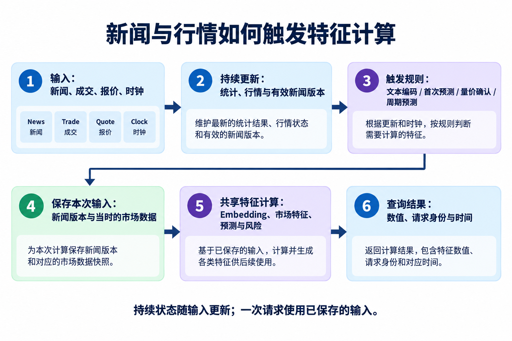
  </a>
</p>

需要查看 A/B/C/D、Clock、版本与输入之间的全部连线时，可打开[业务详细图](image/news_feature_trigger_graph.png)。概览用于建立阅读顺序，详细图保留完整依赖。

图中各条触发路径的职责如下：


| Trigger DAG | 主要驱动                   | 计算目标                | 文本模型是否通常重跑 | 预测模型是否运行 |
| ----------- | ---------------------- | ------------------- | ---------- | -------- |
| A：文本准备      | 新新闻、正文修订               | `DocumentEmbedding` | 是，新文本版本    | 否        |
| B：首次预测      | `EmbeddingReady` 与市场就绪 | `SignalFeatures`    | 复用 A 的结果   | 是        |
| C：市场确认      | 量价条件首次满足               | `SignalFeatures`    | 复用已有结果     | 是        |
| D：周期重估      | Clock 与有效候选            | `SignalFeatures`    | 复用已有结果     | 是        |

下面按同一条新闻 N1 的处理时间线说明四条路径怎样配合：

| 时刻           | 事件              | Trigger 与计算行为                        |
| ------------ | --------------- | ------------------------------------ |
| 10:00:00.000 | N1 新闻到达         | 保存 N1 的版本和参考价格，A 发出 EmbeddingTrigger |
| 10:00:00.020 | 新成交与报价到达        | 更新量价状态，不因每个 tick 都运行预测模型             |
| 10:00:00.080 | N1 Embedding 完成 | 产生 EmbeddingReady；B 检查市场就绪           |
| 10:00:00.080 | B 条件满足          | 捕获市场快照，运行首次预测                        |
| 10:00:05.000 | Clock           | D 使用同一 Embedding、新市场快照和新闻年龄重新预测      |
| 10:00:08.000 | 放量上涨，C 条件首次满足   | C 触发即时重估，更新收益与风险预测                   |
| 10:00:10.000 | Clock           | D 再次重估，C 不重复确认                       |
| 10:00:12.000 | N1 正文出现修订版本     | A 编码新版本；旧版本候选失效，新版本按规则重新激活           |
| 有效期结束        | 候选过期            | 停止该候选的周期重估                           |


| 名词                            | 回答的问题             | 示例                |
| ----------------------------- | ----------------- | -------------------- |
| Clock 周期 `trigger_interval`   | 多久发起一次定时检查？       | 每 5 秒                |
| Bar 宽度 `bar_width`            | 每份基础聚合数据覆盖多长时间？   | 1 秒 Bar              |
| 滚动窗口长度 `window_length`        | 计算特征时观察过去多长时间？    | 最近 10 秒成交量           |
| 新闻候选有效期 `candidate_ttl`       | 这条新闻可以参与重新预测多久？   | 5 分钟                 |
| 量价确认期限 `confirmation_timeout` | 允许在新闻之后多久观察到确认信号？ | 30 秒                 |
| 输入就绪等待时间 `ready_timeout`      | 缺少必要输入时最多等待多久？    | 2 秒                  |
| 预测区间 `forecast_horizon`       | 模型预测未来多远？         | 未来 5 分钟收益、未来 1 分钟波动率 |

例如，一项特征计算需求可以写成：**每 5 秒，使用最近 120 秒的量价历史，重新预测未来 5 分钟收益；这条新闻最多参与 5 分钟的重估。**

### 1.3 目标、范围与假设

首要目标是实现原始任务要求的两类依赖图、时钟事件、条件事件、状态管理和结果持久化，并让满足条件的触发规则能够启动特征计算。

具体场景进一步明确了输入、状态和触发之间的关系：

| 业务事实或设计需求                 | 对系统能力的要求                     |
| ------------------------- | ---------------------------- |
| 同一新闻文本在版本不变时保持稳定          | Embedding 按版本缓存              |
| 新闻影响需要结合不断变化的量价状态判断       | 文本向量与市场特征之间存在依赖关系            |
| 行情频率远高于希望执行重模型的频率         | 状态持续维护，模型按 Trigger 求值        |
| 新闻首次可用、市场显著变化、时间流逝是不同重估原因 | 多张 Trigger DAG 共享特征计算        |
| 推理完成顺序可能不同于请求顺序           | 结果携带输入快照与请求序号，防止旧结果覆盖新结果     |

这份表还没有展开故障恢复和窗口发布：前者需要 checkpoint（检查点）保存可恢复状态，后者需要 watermark（水位线）判断事件时间进度。下文先解释这些概念，再对照开源系统分析实现方式；Trigger DAG 中的跨事件匹配也会用 CEP（复杂事件处理）来讨论。

**我希望实现的是通用框架或数据库，因此不会把题目中的消息字段硬编码进系统，而会让用户定义数据结构和计算逻辑。**

项目时间有限，本次不展开高可用（HA）、高性能 Socket 通信、自研高性能存储引擎、存储文件合并（Compaction）分离、压缩率优化和分析型查询（OLAP）优化。这些工作留待后续演进；本文主要讨论上述计算、触发和状态管理问题。

存储等通用设施会适当采用成熟依赖，例如 RocksDB 状态后端，把开发精力集中在特征计算框架本身。

## 2. 名词解释与概念模型

熟悉流处理的读者可以直接跳到[第 3 章的能力分析](#3-从需求出发的系统能力分析)，遇到具体术语时再回查本章。


### 2.1 批处理、流处理与微批

先看一个答案会随输入不断变化的问题。

一个电商系统不断产生订单与支付记录。我们想知道：

- 最近一分钟支付了多少钱？
- 哪些订单创建十分钟后仍未支付？
- 哪些用户短时间内连续支付失败？
- 如果程序宕机，恢复后能否继续计算，既不漏算也不多算？

这些问题的共同点是：**输入不断到来，答案不断变化，而且当前事件的意义往往取决于过去的事件。**

流式计算系统持续接收数据记录，执行转换、关联、聚合和模式识别等逻辑，并随输入更新状态和结果。它可以处理没有预定结束点的无界流，也可以处理有明确结束点的有界流。

| 概念 | 典型含义 | 示例 |
|---|---|---|
| Batch Processing，批处理 | 对一份确定的有限输入执行任务 | 统计昨天的全部订单 |
| Stream Processing，流处理 | 随输入到来持续执行计算 | 持续更新今天的支付金额 |
| Micro-batch，微批 | 把短时间内的输入收成小批次处理 | 每几百毫秒处理一小批记录 |
| Bounded Stream，有界流 | 输入有明确的结束边界 | 一份历史日志文件 |
| Unbounded Stream，无界流 | 输入没有预先确定的结束点 | 持续产生的设备上报 |

### 2.2 流式计算框架与流数据库

一个接收消息、更新变量、输出结果的循环，就可以是简单的流式程序。业务简单时，这样做完全合理。

但需求增加后会反复遇到同类困难：不同对象的状态如何隔离；消息乱序时如何判断先后；没有新消息时如何执行超时；内存满了如何清理；处理不过来如何减速；宕机后从哪里恢复。

流式计算框架把这些共性能力做成运行时设施，让业务逻辑不必每次重新实现。

#### 2.2.1 流式计算框架

流式计算框架：为持续到达、可能无界的数据输入，提供计算程序的表达方式与执行机制，使程序能够在输入尚未结束时，持续更新状态或产生输出的软件基础设施。

这个定义包含三个关键条件：
1. 输入可以无界：程序运行时，不需要预先知道所有输入。
2. 计算持续进行：不要求等到输入结束才处理或输出。
3. 框架提供计算抽象与执行机制：用户定义算子、查询或状态转移，框架负责执行和连接这些计算。

其计算过程可以抽象为：
$$ (S_{n+1}, O_n)=F(S_n,I_n) $$
其中，**\(S_n\)** 是计算状态，**\(I_n\)** 是本次输入，**\(O_n\)** 是输出。一次输入可以是一条记录、一批记录，或定时器等控制事件。因此，逐条处理和 microbatch 都可以属于流式计算。

#### 2.2.2 流式数据库

流式数据库：将持续到达的数据及其变化作为主要输入，以持续查询和派生数据维护为核心能力，并将相关数据对象、计算结果及其查询访问统一纳入数据库管理体系的数据库管理系统。

这里需要同时具备两方面：
1. 持续计算能力：用户定义的派生计算随输入变化持续运行，典型形式是增量维护物化视图。
2. 数据库管理能力：维护具有名称、模式和生命周期的数据对象，并让应用通过数据库接口查询这些对象及其结果。

例如，[RisingWave](https://github.com/risingwavelabs/risingwave) 用 `CREATE MATERIALIZED VIEW` 注册持续维护的数据库对象，后续独立的 `SELECT` 可以读取其结果；系统统一管理对象元数据、计算任务和存储状态。记录对象名称、Schema、依赖等信息的目录称为 Catalog。
对于我们讨论的关系型流式数据库，可以进一步表达其逻辑语义：

$$ V_p = Q(D_p) $$

其中：

**\(D_p\)**：处理到输入进度 \(p\) 时，输入数据对应的逻辑关系集合。
**\(Q\)**：用户定义的派生查询。
**\(V_p\)**：同一进度下应当得到的派生关系。

持续维护的目标，是让派生结果符合这个查询定义。 实现可以使用增量计算、辅助状态和批量更新。这里的 \(p\) 是逻辑进度，不是物理时钟；**公式也不意味着新记录一到，所有视图就必须立即完成更新并对外可见。**

### 2.3 数据、算子、状态与结果

#### 2.3.1 Stream、Event、Record 与 Schema

**Stream(数据流)**：随时间陆续提供的一系列数据记录。逻辑上的一条流可能由多个物理分区构成，不一定存在全局总序。

**Event(事件)**：一次发生的事实或变化，例如订单创建、支付完成、温度变化。

**Record(记录)**：系统传递事件或数据变更的具体数据单元。业务事件与它的一次传输并不总是一一对应：同一事件可能重试发送，一条消息也可能打包多个事件。

**Schema(模式)**：记录的字段、类型及结构约定，例如：

~~~text
event_type: PaymentSucceeded
event_id: E101
order_id: O17
user_id: U3
event_time: 10:00:03
amount: 10
~~~

输入不一定自带 `event_id` 或 `event_time`。流处理系统通常允许用户指定提取方式：直接读取一个字段，或者组合多个字段计算事件标识与时间。

#### 2.3.2 Source、Sink、Connector 与 CDC

| 术语 | 含义 | 为什么需要 |
|---|---|---|
| Source | 把外部数据读入计算任务的输入端 | 管理读取、进度以及可能存在的 Crash Recovery |
| Sink | 把结果写出计算任务的输出端 | 管理写入、缓冲、重试 |
| Connector | 接入具体外部系统的适配组件 | 屏蔽协议、序列化和系统接口差异 |
| CDC | Change Data Capture，变更数据捕获 | 把数据库的插入、更新、删除转成可消费的变化记录 |

一个计算任务可以读取多条流，它们不必具有相同 Schema。例如订单流与支付流字段不同，但可以通过 order_id 关联。

CDC 让计算系统关注“数据库改了什么”，从而避免不断扫描整张表寻找变化。

#### 2.3.3 Operator：系统如何组织计算

**Operator(算子)**：执行某类数据处理逻辑的计算单元。

| 算子 | 做什么 | 是否必然需要跨事件状态 |
|---|---|---|
| Map | 把一条输入转换成一个输出 | 不必 |
| Filter | 保留满足条件的记录 | 不必 |
| FlatMap | 一条输入产生零到多个输出 | 不必 |
| Aggregate | 求和、计数、求平均等 | 持续聚合通常需要 |
| Join | 关联多个输入 | 流关联通常需要 |
| Window | 按窗口组织处理范围 | 通常需要 |
| Pattern/CEP | 识别跨多条事件的模式 | 通常需要 |

算子是逻辑计算单元，不等于线程、进程或机器等物理计算资源概念。一个算子可以有多个并行实例，多个算子也可以合并进同一个执行任务。

#### 2.3.4 State：为什么不能只看当前消息

“本次支付 10 元”无法单独回答“今天总共支付多少”；“本次登录失败”也无法单独回答“最近五分钟是否已经失败十次”。

**State(状态)**：一次输入处理结束后仍保留，影响后续输入处理或后续查询的信息。

| 状态类别 | 保存什么 |
|---|---|
| 最新值 | 最近一次温度、最新订单状态 |
| 累加器 | 金额总和、数量、sum 与 count |
| 窗口状态 | 仍在统计范围内的记录或摘要 |
| Join 状态 | 已到达、仍可能被另一侧匹配的记录 |
| CEP 状态 | 当前候选已匹配哪些事件(状态机所处的状态)、何时超时 |
| 去重状态 | 已经见过的业务事件标识 |
| Timer 状态 | 哪个对象在什么时间需要回调 |

State 是逻辑概念，可以放在内存、磁盘或远端存储中。

**Stateless（无状态）**：表示处理一条记录不需要依赖跨记录保存的计算状态。

#### 2.3.5 Key、Keyed State 与状态作用范围

如果系统只维护一个 payment_total，就无法分别统计每个用户。引入 Key 后：

~~~text
payment_total[U1] = 100
payment_total[U2] = 300
~~~

**Key** 是用于分组和定位状态的键，可以是一列，也可以是复合键。**Keyed State** 是按 Key 隔离的状态。其作用是明确“哪些事件共享同一份记忆”。

按 `user_id` 维护的是用户状态，按 `order_id` 维护的是订单状态；切换分组键时，可能需要重新分区（repartition），把共享状态的记录送到同一个执行位置。

状态作用范围也可以是算子实例、一个窗口，或广播给多个并行实例。

#### 2.3.6 State、Accumulator、Result 与 Materialization

**Accumulator(累加器)**，是保存中间聚合信息的状态。例如平均支付金额不宜只保存 average，通常保存：

~~~text
sum = 1000
count = 20
average = sum / count = 50
~~~

新来一笔 100 元支付，更新 sum=1100、count=21，再得到新的平均值。累加器让系统不必重读全部历史。

**Result(结果)**: 是某次计算或某次更新产生的输出。输出可以是数值、一行表记录、告警或变更消息。

**Materialization(物化)**: 是把派生结果保存下来，供之后直接读取。

**Materialized View(物化视图)**: 通常指保存查询结果的数据库对象。

物化通常提升查询速度和复用率，代价是额外存储与维护成本。

#### 2.3.7 UDF、UDTF、UDAF、SQL、物化视图和高度可编程性接口

用户能够表达哪些计算，取决于系统提供什么接口。可以按输入、输出和状态访问方式来比较：

| 需求 | 用户定义计算的接口 |
| ------------------------------- | ------------------------------------ |
| 自定义单条数据的计算                      | 标量 UDF                               |
| 一条输入产生多行结果                      | UDTF，表函数                             |
| 自定义分组聚合及聚合状态                    | UDAF，聚合函数                            |
| 多流关联、过滤、窗口计算                    | SQL 与物化视图                            |
| 任意按 Key 读写受管状态、注册定时器、自定义多输入事件回调 | 对标 Flink ProcessFunction 对等的通用高度可编程接口 |


### 2.4 数据流图、依赖、触发与执行方式

#### 2.4.1 Dataflow Graph 与 DAG

**Dataflow Graph(数据流图)**：用节点表示算子，用边表示记录从一个算子流向另一个算子的连接。

~~~mermaid
flowchart TD
  O["Order input"] --> C["Clean orders"]
  P["Payment input"] --> V["Validate payments"]
  C --> J["Join by order"]
  V --> J
  J --> A["Aggregate by user"]
  A --> R["Output results"]
~~~

用图表示计算，是为了明确输入输出依赖、连接分支、组织并行执行，并让系统做算子融合、重分区等优化。

DAG 是 Directed Acyclic Graph，即有向无环图。许多流式作业采用 DAG，但流式计算这个类别并不排除反馈、迭代或循环计算。

图上游表示数据来源，下游表示消费数据的一侧。边通常说明数据传递与依赖关系。

#### 2.4.2 Logical Plan、Physical Plan、Task 与 Subtask

| 术语 | 回答什么 |
|---|---|
| Logical Plan，逻辑计划 | 要执行哪些逻辑操作 |
| Physical Plan，物理计划 | 采用什么算法、分区和执行方式 |
| Job，作业 | 一次提交并运行的整体计算 |
| Task，任务 | 运行时调度和执行的工作单元，精确定义因框架而异 |
| Subtask，并行子任务 | 某个逻辑任务的一个并行实例 |
| Operator Chaining，算子链 | 把可连续执行的算子放进同一任务 |

例如清洗后立即过滤，两步之间不需要重分区时，可以直接传递记录，减少队列、线程交接和序列化开销。Flink 使用 operator chaining 做这类优化。[Flink Architecture](https://nightlies.apache.org/flink/flink-docs-stable/docs/concepts/flink-architecture/)

所以逻辑图有十个节点，并不意味着需要十个线程或十台机器。

#### 2.4.3 数据关联、事件顺序与触发

这三种关系经常被混淆：

| 关系 | 含义 | 示例 |
|---|---|---|
| 数据依赖 | 某个计算需要哪些输入值 | 平均值需要 sum 与 count |
| 事件模式 | 多条事件应满足什么先后与组合条件 | 先登录失败，随后异地登录成功 |
| 触发条件 | 何时执行计算或发出输出 | 每十秒、累计一百条、窗口时间结束 |

**Trigger，触发器**，是规定何时触发某种处理的规则。术语在不同 API 中含义不同，例如 Flink Window Trigger 主要决定窗口何时执行计算，不等同于所有业务告警规则。

#### 2.4.4 CEP：为什么单条 if 判断不够

**Complex Event Processing**：识别多条事件之间的时间、顺序和组合模式。

例如“一个用户在五分钟内连续三次登录失败，随后登录成功”。只看当前的成功事件无法知道前面是否有三次失败，因此运行时要保存部分匹配和候选。这类记忆可以用有限状态机（Finite State Machine，FSM）表示，保存在内存中，或通过持久化机制保存。

Flink CEP 提供这类模式定义与匹配机制，严格相邻和允许跳过事件等模式具有不同语义。[Flink CEP](https://nightlies.apache.org/flink/flink-docs-stable/docs/libs/cep/)

#### 2.4.5 Push、Pull 与增量计算

**Push**：输入或上游产生数据，推动下游处理。

**Pull**：消费者请求某个输出或下一批数据，由需求驱动相关计算。

**Incremental Computation**：利用旧状态和新增、修改、删除的差量，更新结果，避免重算全部输入。

~~~text
Add an amount x:    sum_new = sum_old + x
Expire an amount y: sum_new = sum_old - y
~~~

| 维度 | 讨论的问题 |
|---|---|
| Push / Pull | 什么推动执行 |
| 增量 / 重算 | 怎么得到新结果 |
| 每次更新 / 定时发布 | 何时向外提供结果 |

### 2.5 时间、窗口、进度与结果版本

#### 2.5.1 Event Time、Ingestion Time、Processing Time

| 概念 | 含义 | 同一支付事件的例子 |
|---|---|---|
| Event Time，事件时间 | 业务事件发生的时间 | 10:00:03 支付成功 |
| Ingestion Time，摄入时间 | 记录进入约定系统边界的时间 | 10:00:05 到达接入层 |
| Processing Time，处理时间 | 某个处理步骤执行时的系统时间 | 10:00:06 开始聚合 |

为什么需要区分？“十点之前发生的支付”与“十点之前收到的支付”可能不是同一批数据。

事件时间常用于统计业务时段、事件顺序和历史回放。处理时间常用于系统超时、周期执行和运维需求。不同算子对同一记录的处理时间可以不同，多台机器的机器时钟也不天然完全一致，时钟漂移是客观存在的现象。

#### 2.5.2 Arrival Order、Offset 与逻辑顺序

**Arrival Order**：是记录到达某个接收点的先后。

**Offset**：通常是某个日志分区内的位置，用于标识读取进度。

同一分区 offset 更大，通常表示在该分区日志中更靠后，但不保证事件时间更晚。不同分区的 offset 大小不能直接比较业务先后。

多分区合并后并不自动存在全局总序。如果算法需要顺序，应该定义按事件时间、某个源内序号还是调度器确定的次序执行。

#### 2.5.3 Out-of-order 与 Late Data

| 到达次序 | 事件时间 |
|---|---|
| 第一条 | 10:00:03 |
| 第二条 | 10:00:01 |
| 第三条 | 10:00:02 |

这是 **Out-of-order**：到达顺序与事件时间顺序不同。

**Late Data**：相对于系统已经推进到的事件时间边界或具体算子的接纳规则而言。乱序记录未必已经迟到；系统可能还在允许等待的范围内。

乱序影响取决于算法。累计求和未必关心更新顺序；“先失败、后成功”的模式匹配则关心顺序。

若“最新值”指事件时间最新，不能简单让最后到达的消息覆盖状态。收到较旧时间的记录时，需要时间比较或历史版本管理(**往往需要状态后端提供 test and set 的能力**)。

#### 2.5.4 Window：为什么无限流需要有限的统计范围

“求平均支付金额”不完整：是从系统启动以来，还是最近一分钟，还是最近一百笔？

**Window，窗口**，定义参与某次统计或处理的数据范围。

| 窗口 | 规则 | 示例 |
|---|---|---|
| Tumbling，滚动窗口 | 固定长度、互不重叠 | 每一分钟的支付额 |
| Sliding/Hopping，滑动窗口 | 固定长度、按固定步长移动，可重叠 | 每十秒统计最近一分钟 |
| Session，会话窗口 | 用一段无活动间隔划分活动段 | 连续三十分钟无操作则结束会话 |
| Count，计数窗口 | 以记录数量确定范围 | 最近一百次请求 |

窗口让业务范围明确，也常为状态清理提供依据。

**窗口长度不等于输出周期。** “最近一分钟，每十秒输出”中，一分钟规定使用哪些数据，十秒规定多久发布一次。

滑动窗口不只是加入新记录，还要去掉过期记录。若时间推进但没有新输入，窗口值是否需要主动更新或输出，取决于定时器和发布策略。

#### 2.5.5 Watermark：为什么机器时钟到点还不够

要统计事件时间窗口 [10:00:00, 10:01:00) 的支付总额。机器到了 10:01，是否可以确定所有支付记录已经收到？

不能。10:00:59 发生的支付可能因网络、上游重试或积压，到 10:01:10 才到达。

如果不对迟到做任何假设，下一秒永远可能再来一条昨天的事件。于是“任意迟到都纳入”与“有限时间内发布结果”之间存在冲突。

**Watermark，水位线，是对事件时间处理进度的声明，供算子判断何时结束正常等待。**

常见近似生成策略：

~~~text
watermark ~= max_observed_event_time - allowed_out_of_order_duration
~~~

看到最大事件时间 10:01:08，配置乱序跨度五秒，则进度约为 10:01:03。前述一分钟窗口便可按策略输出。实际 API 还需考虑时间戳精度和开闭区间。

这个五秒不是“每条记录固定等待五秒墙上时间”。它约束事件时间进度差；若最大事件时间不前进，仅重复执行周期回调也未必产生更大的 Watermark。

#### 2.5.6 多分区 Watermark、Idle 与 Alignment

两个相关输入的 Watermark 分别为 10:00:30 和 10:01:10，汇合算子通常只能推进到最小值 10:00:30。快输入不能代表慢输入的数据也已到齐。

它合并的是已接收的进度声明，不要求不同节点在同一物理时刻采样。支持分区感知的 Source 可先按分区生成 Watermark，再做合并；粒度取决于连接器与策略位置。

**Idleness，空闲检测**，允许把长期无数据的输入暂时排除，避免它永久卡住最小 Watermark。代价是恢复后到来的旧记录可能已经迟到。

**Watermark Alignment，水位线对齐**，限制快输入领先慢输入太多，以控制下游等待慢输入时的缓冲和状态增长。这与后文的 Checkpoint Barrier Alignment 是不同机制。[Generating Watermarks](https://nightlies.apache.org/flink/flink-docs-stable/docs/dev/datastream/event-time/generating_watermarks/)

Watermark 常作为执行数据流中的控制信息传播，不要求业务一定向 Kafka 写入一种特殊消息。它也不自动让所有普通算子排序，更不保证旧数据已经写入持久存储。

#### 2.5.7 Reorder Buffer、Timer 与迟到策略

**Reorder Buffer，重排序缓冲**，暂存乱序输入，在进度允许时按约定顺序释放。需要事件时间顺序的 CEP 或关联逻辑可以采用这种方式；Watermark 提供释放依据，缓冲结构完成排序。

**Timer，定时器**，让程序在没有新业务记录到来时，也能因时间推进执行处理。

如果只在新订单到来时检查旧订单是否超时，系统安静时超时逻辑就永远不会运行。Timer 解决这类活性问题。

Processing-time Timer 根据处理时钟到点调度；Event-time Timer 根据 Watermark 推进到目标事件时间调度。

迟到处理常见选项：

- 丢弃，并记录指标；
- 输出到单独通道，供检查或补算；
- 更新已输出的结果；
- 进入离线纠正流程。

#### 2.5.8 Early Result、Final Result 与 Changelog

低延迟需求可能希望窗口结束前就输出当前结果；后续记录到来后再修正。

**Early Result** 是提前输出的结果；**Final Result** 表示按既定策略不再修改。Watermark 越过窗口末尾，不一定意味着结果马上不可变，还要考虑允许迟到等策略。

例如：

~~~text
First output:        one-minute payment total = 100
After a late record: one-minute payment total = 120
~~~

下游必须知道 120 是旧结果的新值，不能把 100 与 120 当成独立新增金额相加。

| 术语 | 含义 |
|---|---|
| Append-only | 仅追加新逻辑记录 |
| Upsert | 按键插入或替换现有记录 |
| Retraction | 撤回旧记录对计算的贡献 |
| Changelog | 描述插入、更新、删除的变更流 |
| Dynamic Table | 随输入变化的逻辑表 |
| Continuous Query | 持续维护随输入变化的查询结果 |

一个下游聚合收到“撤回 100、加入 120”，就能把总量正确增加 20。撤回是有效的数据变更，不能当成传输重复随意去掉。


#### 2.5.9 Version、Snapshot 与时间完整性

**Version，版本**，用于区分数据、状态或输出的不同修订。不同系统使用版本号、事务号、日志位置等不同方法，并不存在跨框架统一的 Revision 字段。

**Read Snapshot，读取快照**，为一次读取或一组相关读取固定相容的数据视图。

例如支付成功同时把 paid_count 加一、unpaid_count 减一。若查询恰好读取一部分旧值和一部分新值，就可能看到本不应该出现的组合。快照或其他隔离手段用于控制这种读取。

快照可以通过 MVCC、不可变结构、复制、锁或串行执行阶段等方式实现；不要求复制全部内存，也不必持久化。

**读取一致性与事件时间完整性不同。** 一份一致快照可能还没有收到迟到支付；一份当前快照也可能包含晚于目标业务时间的事件。要回答“某个历史时刻的状态”，仍需历史版本与明确的 as-of 查询语义。

MVCC 是 Multi-Version Concurrency Control，即多版本并发控制。它通过保留数据版本支持合适的读取隔离，但不是所有流式引擎都必须使用的基础实现。

### 2.6 故障恢复与处理保证

#### 2.6.1 Checkpoint：为什么只保存变量不够

进程崩溃会丢失内存状态。从所有原始输入重算可以恢复，但长时间运行后可能要重放很久，原始日志也未必永久保留。

**Checkpoint，检查点**，保存一份可恢复的一致执行进度与状态，使任务能从较近的位置重新开始。

关键是：**输入读到哪里，与状态已经包含哪些输入效果，必须匹配。**

以单个输入分区为例：

~~~text
Processed through offset 100
Accumulated amount = 1000
~~~

只保存累计金额，恢复时不知道从哪条记录继续；只保存输入位置，又不知道以前累计多少。若累计金额已包含第 101 条，位置却停在 100，重放 101 可能多算；反过来可能漏算。

完整恢复通常需要输入位置、算子状态，以及实现所需的定时器、模式候选、提交信息和在途数据处理。

#### 2.6.2 Chandy-Lamport、Checkpoint Barrier 与数据一致性切面

上游处理一条输入并发出中间记录，下游还没收到。如果保存上游的新状态与下游的旧状态，却没有保留这条在途记录，恢复时它就可能消失。

**Checkpoint Barrier** 是检查点边界标记，帮助算子识别哪些处理位于检查点之前、哪些位于之后。

**Aligned Checkpoint** 在多输入处等待相应边界对齐，暂缓处理已经越过边界的输入。**Unaligned Checkpoint** 减少这类等待，但连同相应在途记录一起保存，恢复时补齐。两种方式都可以支持 Exactly-once，取舍主要在等待时间、额外数据量和 I/O。

Checkpoint Barrier 解决恢复边界的一致性；Watermark 解决事件时间进度。两者互相不能替代。一个检查点也不等于“某个事件时间之前的全部数据”。

这种基于异步 Barrier 做 checkpoint 的算法，实际上就是经典的 Chandy-Lamport 分布式快照算法

常见的工程术语解释如下：

| 概念         | 含义                         |
| ---------- | -------------------------- |
| Epoch      | 两个相邻 barrier 划分出的逻辑处理区间    |
| Barrier    | 在计算图里传播，协调各处到达一致进度的控制消息    |
| Checkpoint | 在这一边界上形成的、可以用于故障恢复的持久化一致状态 |

Epoch 需要结合语境理解。本表讨论的是检查点之间的处理区间；后文的 owner epoch 指执行者归属的代次，candidate epoch 指新闻候选的代次。它们用于区分不同范围内的新旧状态，不能把不同系统或不同对象的 epoch 当成同一个时间或版本号。


#### 2.6.3 Replay：为什么恢复需要重新执行

**Replay，重放**，重新读取历史输入并执行处理，可用于故障恢复、补算和问题复现。

| 步骤 | 输入位置 | 托管状态中的金额 |
|---|---:|---:|
| 检查点 C 完成 | 已处理至 100 | 1000 |
| 处理 101，金额增加 10 | 101 | 1010 |
| 程序崩溃 | — | 内存丢失 |
| 从 C 恢复 | 回到已处理至 100 | 回到 1000 |
| 重放 101 | 101 | 1010 |

检查点之后的工作可能重新执行，因为它尚未包含在所恢复的检查点里。重放成立的前提是输入可重读，且保留期足以覆盖恢复所需范围。

#### 2.6.4 At-most-once、At-least-once、Exactly-once

| 保证 | 在声明范围内的典型含义 |
|---|---|
| At-most-once | 可能遗漏效果，避免重试造成重复 |
| At-least-once | 通过重试避免遗漏，但可能重复生效 |
| Exactly-once | 每条逻辑输入的效果恰好一次 |

上例中第 101 条的处理函数运行两次，最终累计仍为 1010。这说明 **Exactly-once 讨论逻辑效果，不承诺函数只能运行一次**。

保证范围必须说清。如果处理 101 时调用外部数据库的 total += 10，第一次更新可能已经成功；恢复后框架无法只靠回退内部状态撤销它，第二次调用可能再加 10。

端到端保证需要可重放输入，以及能协调提交的事务输出，或满足业务效果要求的幂等输出。框架无法自动撤回外部已有的动作。

Exactly-once 也不会自动消除源头本来就写入的两条重复业务事件；它们在日志中可能是两条合法的独立输入。

#### 2.6.5 Transactional Sink 与 Idempotency

**Transactional Sink，事务输出端**，可暂存输出，结合恢复协议，在适当时机提交或放弃。这样内部恢复进度与输出效果能够协调。

**Idempotency，幂等性**，指同一逻辑操作重复执行，仍产生与执行一次相同的业务效果。

例如以稳定 event_id 作为唯一键插入“该笔支付已记录”，可以通过唯一性约束避免重复记录；直接 amount += 10 则不是天然幂等。

同样，写入绝对总额也不能一概视为完整解决方案：较旧结果的迟到重试可能覆盖新值，因此还可能需要版本检查或顺序约束。

多表或多系统的原子可见性又是另一层保证。Exactly-once 不意味着外部读者能同时看到所有结果的一致版本。如果要求一次读取多个相关特征时，不混入不相容的新旧值，就需要相应的读取隔离。快照读常用 MVCC 实现，会增加内存、存储 I/O 和工程成本。

#### 2.6.6 Read Snapshot、Watermark、Checkpoint 的对照

| 机制 | 回答的问题 | 本身不保证什么 |
|---|---|---|
| 读取快照 | 一次读取使用哪组相容版本 | 迟到数据已经到齐、进程崩溃可恢复 |
| Watermark | 哪个事件时间边界可以结束正常等待 | 状态已经持久化、结果已经提交 |
| Checkpoint | 从哪份一致状态和输入进度恢复 | 任意外部动作自动去重 |
| Exactly-once | 重试后逻辑效果是否重复或遗漏 | 函数只运行一次、事件按时间排序 |

Checkpoint 本身也可以被称为一种 Snapshot。这里区分的是面向读取的快照与面向恢复的检查点，不应把 Snapshot 一词限定为完全无关的另一种技术。

## 3. 从需求出发的系统能力分析

本章把前面的业务需求整理为设计目标和非目标，供后文比较开源系统使用；它是一份能力目标分析，不是已实现 API 的清单。

### 3.1 功能需求与能力映射

#### 3.1.1 目标

1. 持续处理流式数据，维护依赖图中的基础特征指标。
2. 按键（Key）或作用范围（Scope）隔离状态。例如，AAPL 的输入只更新其所属状态，不改变 MSFT 的状态。
3. 持续维护依赖历史输入的特征，例如某个标的的波动率。
4. 支持特征计算图定义，也可通过级联动态视图等机制表达等效依赖；只有所有前置依赖都 Ready，才执行依赖它们的计算。
5. 支持复杂触发规则的计算图，对应 Flink 等系统中的 CEP 模式匹配。模式尚未满足时，不触发相应特征计算，例如避免每条事件都执行昂贵的模型推理。
6. 支持用户定义复杂计算逻辑，不局限于系统提供的有限算子。
7. 支持字段不同的多流、多表输入，通过关联字段表达跨输入依赖。例如，模型同时使用新闻情绪指标和量价数据。
8. 复用已有计算结果。例如多个模型使用同一份 Embedding 时，不需要分别运行文本编码模型。
9. 支持工作集超过单机内存容量的计算（out-of-core），将部分状态保存在磁盘或远端存储；量价与新闻数据可能无法全部常驻内存。

#### 3.1.2 非目标

1. 不支持计算图（Topology）本身包含环（Cyclic Graph）
2. 暂不支持批式计算、批流一体的能力

### 3.2 执行语义与正确性

#### 3.2.1 目标
1. 至少支持数据最终能做到等价于exactly-once的语义（可以用at-least-once和test-and-set做到等价于exactly-once）
2. 支持checkpoint 以及 基于checkpoint的crash recovery，checkpoint需要保证各个逻辑计算节点的checkpoint是一致的，不能将每个节点处理进度不一致的checkpoint当成是一个严格的快照
3. 由于需要支持CEP、窗口聚合等常见计算能力，所以watermark机制也需要具备，这样才能确定结果发布时机


#### 3.2.2 非目标
1. 不支持快照读，不支持在同一严格快照中读取多个Feature。读取时，多个Feature所处的Generation/Epoch可能已经不同。**这个功能我认为是有必要的，只不过在有限的时间内确实无法做出来**，所以暂不支持
2. 特征维护不支持分布式事务，不支持跨多个特征的原子变更。通过Always Retry Process，确保多个特征最终能达到符合业务语义的一致性


### 3.3 可用性、可扩展性和易用性

#### 3.3.1 目标
1. 支持基于SQL、UDF、UDAF、Process Function等高度可编程方式让用户表达自己的计算需求
2. **支持动态注册UDF，不需要每次重新构建整个系统**
3. 给用户提供易用的SDK、屏蔽掉直接调用Server端Http/Rpc接口的细节


#### 3.3.2 非目标
1. 特征维护不支持分布式事务，不支持跨多个特征的原子变更。通过Always Retry Process，确保多个特征最终能达到符合业务语义的一致性
2. 不支持复杂高可用机制（例如引入Raft、Paxos等共识协议，或者引入etcd、zk等中心化决策者维护HA），**这个功能我认为是有必要的，只不过在有限的时间内确实无法做出来**，所以暂不支持

## 4. 流式计算系统与 Embedded Library 调研

本章围绕一个共同问题展开：**怎样持续维护轻量特征，在事件条件满足时才计算昂贵特征，并把这次结果解释清楚？** 六个项目分别展示了流式运行时、流式数据库和进程内计算库的做法。Embedded Library 指由应用直接调用的计算库，其事件接入和服务部署由宿主应用组织。

<p align="center">
  <a href="./image/stream_processing_components_overview.png">
    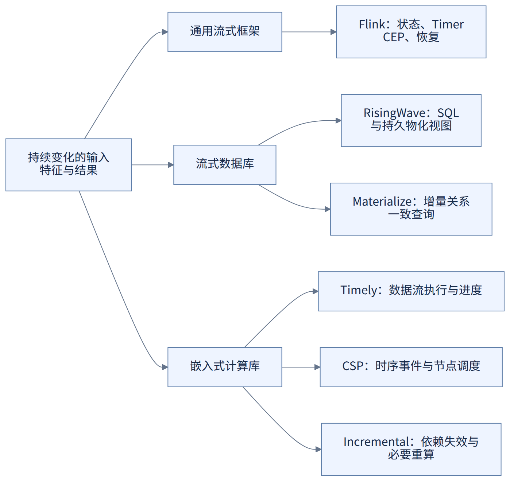
  </a>
</p>

| 组件 | 带着什么问题阅读 |
| --- | --- |
| [4.1 Flink](#41-apache-flink) | 怎样把状态、时间和跨事件条件放进同一套运行时？ |
| [4.2 RisingWave](#42-risingwave) | Feature DAG 能否表达成多层物化视图，Trigger 到来时怎样取值？ |
| [4.3 Timely Dataflow](#43-timely-dataflow) | 多个算子并行运行时，怎样知道某一轮数据已经处理完？ |
| [4.4 Materialize](#44-materialize) | 怎样增量维护关联结果，并提供一致的数据库查询？ |
| [4.5 Point72 CSP](#45-point72-csp) | 时序节点怎样接收更新、保留最新值并按事件激活？ |
| [4.6 Jane Street Incremental](#46-jane-street-incremental) | 输入变化后，怎样只重算需要的依赖，并复用共享节点？ |
| [4.7 横向比较](#47-横向比较) | 各组件在哪一层提供能力，哪些机制由应用负责？ |
| [4.8 调研结论](#48-对自研系统的启发与现有系统的不足) | 哪些机制值得借鉴，自研系统还需要补充哪些工作？ |

每节按“接口与流程 → 具体例子 → 能力边界”展开，结合架构图和代码解释核心机制。资料入口集中在附录。

比较时尤其区分以下三件事：

- **结果已被维护出来**，与 **请求到来时才计算结果**。
- **能够表达计算依赖**，与 **自动递归求值、判断 Ready 并复用模型缓存**。
- **内部状态可恢复**，与 **外部结果在重试后只生效一次**。

例子中的新闻字段沿用题面；涉及成交量和连续量价状态时，需要额外的 Trade/Quote 输入。原始新闻自带的价格只是新闻时刻的采样，不能直接当成完整行情。


### 4.1 [Apache Flink](https://github.com/apache/flink)

#### 4.1.1 API 设计

Flink 的 API 可以按“用户需要控制多少计算细节”来理解：**SQL / Table API 用关系表达式描述要计算什么；DataStream API 用流变换组织计算；Process Function 允许用户直接处理事件、状态与定时器。** SQL 与 Table API 共用关系查询体系，Process Function 则通过 DataStream 的 `.process(...)` 接入。

| 接口 | 用户主要定义什么 | Flink 主要负责什么 |
| --- | --- | --- |
| SQL | 表、查询、聚合、Join、窗口 | 查询优化、物理计划与算子执行 |
| Table API | 用宿主语言组合关系表达式 | 与 SQL 共用查询优化与执行体系 |
| DataStream API | Source、流变换、按 Key 分区、Sink | 将计算图部署并驱动执行，管理算子状态 |
| Process Function | 每条事件如何改变状态、何时输出、定时回调做什么 | 在正确的 Key 上下文中调用用户函数 |
| UDF | 查询中的自定义函数 | 类型推导、函数调用与查询集成 |
| ProcessTableFunction | Table 管线中的自定义有状态处理 | 表分区、托管状态、时间服务与输出表集成 |

下面分别给出最小示例。SQL 直接展示查询，其他接口使用 Java 核心代码片段，省略外层程序结构。

##### 1. SQL：声明每个用户的累计金额

SQL 可以通过 SQL Client 提交，也可以嵌入 Java 的 `TableEnvironment`。下面查询三条固定记录。

```sql
SET 'execution.runtime-mode' = 'batch';

SELECT user_id, SUM(amount) AS total
FROM (
    VALUES ('A', 10), ('A', 5), ('B', 7)
) AS orders(user_id, amount)
GROUP BY user_id;
```

**计算语义：** `VALUES` 构造包含三行的表；`GROUP BY` 按 `user_id` 分组，`SUM` 对组内金额求和。结果为 `(A, 15)` 和 `(B, 7)`。用户定义结果关系，分区、聚合算子与执行计划由 Flink 生成。

如果输入是持续追加的订单流，同一查询会持续维护每个用户的当前总额。例如先收到 `(A, 10)`，再收到 `(A, 5)`，结果表中 A 对应的那一行从 `10` 更新为 `15`。**输出表达的是当前累计结果的变化。**

##### 2. Table API：用 Java 表达同一个关系查询

```java
import org.apache.flink.table.api.*;
import static org.apache.flink.table.api.Expressions.*;

TableEnvironment tables = TableEnvironment.create(
    EnvironmentSettings.newInstance().inBatchMode().build());

Table orders = tables
    .fromValues(row("A", 10), row("A", 5), row("B", 7))
    .as("user_id", "amount");

Table totals = orders
    .groupBy($("user_id"))
    .select($("user_id"), $("amount").sum().as("total"));

totals.execute().print();
```

**计算语义：** 与前面的 SQL 相同，得到 `(A, 15)`、`(B, 7)`。`$("amount")` 引用表中的列，`.sum()` 构造聚合表达式，`.groupBy(...).select(...)` 构造关系查询。虽然代码写成 Java 方法链，但每次调用是在组合查询表达式，数据处理发生在作业执行期间。

`totals` 表示待执行的查询；`execute()` 提交执行，`print()` 展示结果。SQL 和 Table API 可以组合，例如把一个 `Table` 注册成临时视图，再通过 `tables.sqlQuery(...)` 查询。

##### 3. DataStream API：对到来的事件做滚动聚合

```java
import org.apache.flink.api.common.RuntimeExecutionMode;
import org.apache.flink.api.java.tuple.Tuple2;
import org.apache.flink.streaming.api.environment.StreamExecutionEnvironment;

StreamExecutionEnvironment env =
    StreamExecutionEnvironment.getExecutionEnvironment();
env.setRuntimeMode(RuntimeExecutionMode.STREAMING);
env.setParallelism(1);

var orders = env.fromData(
    Tuple2.of("A", 10), Tuple2.of("A", 5), Tuple2.of("B", 7));

orders
    .keyBy(order -> order.f0)
    .sum(1)
    .print();

env.execute("running-total");
```

**计算语义：** `fromData` 创建有限的输入流，`keyBy` 按元组的第一个字段分区，`.sum(1)` 对第二个字段做按 Key 的滚动求和，字段编号从 `0` 开始。Flink 保存每个 Key 的累计状态，每处理一条输入，就发出该 Key 更新后的累计值。

本例将并行度设为 `1`，按给定输入顺序，其输出记录为：

```text
(A,10)
(A,15)
(B,7)
```

**输出表达的是每条事件处理后的累计值。** `(A,10)` 和 `(A,15)` 都是已经发出的流记录；如果下游要保存“每个用户当前总额”，就按 Key 用新值覆盖旧值。

##### 4. Process Function：自己定义状态变化和输出条件

假设需求变成：**每个用户的累计金额首次达到 12 时，输出一次通知。** 输入金额均为非负整数。使用 `KeyedProcessFunction`，可以直接表达这条状态转移规则。它是 Process Function 家族中面向按 Key 处理的接口。

```java
import org.apache.flink.api.common.functions.OpenContext;
import org.apache.flink.api.common.state.ValueState;
import org.apache.flink.api.common.state.ValueStateDescriptor;
import org.apache.flink.api.java.tuple.Tuple2;
import org.apache.flink.streaming.api.functions.KeyedProcessFunction;
import org.apache.flink.util.Collector;

public static class FirstReach12 extends
        KeyedProcessFunction<String, Tuple2<String, Integer>,
                             Tuple2<String, Integer>> {
    private ValueState<Integer> total;

    @Override
    public void open(OpenContext context) {
        total = getRuntimeContext().getState(
            new ValueStateDescriptor<>("total", Integer.class));
    }

    @Override
    public void processElement(Tuple2<String, Integer> order,
                               Context context,
                               Collector<Tuple2<String, Integer>> out)
            throws Exception {
        Integer saved = total.value();
        int before = saved == null ? 0 : saved;
        int after = before + order.f1;
        total.update(after);

        if (before < 12 && after >= 12) {
            out.collect(Tuple2.of(context.getCurrentKey(), after));
        }
    }
}
```

沿用上一个 Demo 的 `env` 和 `orders` 创建部分，将求和、打印及执行部分替换为：

```java
orders
    .keyBy(order -> order.f0)
    .process(new FirstReach12())
    .print();

env.execute("first-reach-12");
```

**计算语义：** 每条输入触发一次 `processElement`，`ValueState` 读写的是当前 Key 对应的值。虽然代码只有一个 `total` 成员，但 A 和 B 的累计值分别存储，状态句柄会随当前 Key 切换上下文。

| 当前输入 | 当前 Key 的状态变化 | 是否输出 |
| --- | --- | --- |
| `(A, 10)` | A：`0 → 10` | 否 |
| `(A, 5)` | A：`10 → 15` | 输出 `(A, 15)` |
| `(B, 7)` | B：`0 → 7` | 否 |

在这个非负金额的例子中，A 后续继续增加时不再满足 `before < 12`，因此只输出一次。与前面的滚动聚合相比，这里由用户决定**状态怎样更新，以及哪次变化值得输出**。

Process Function 还提供 `onTimer`，用于表达超时、等待或定时输出：用户注册定时器，由 Flink 在对应时间条件满足时调用回调。

##### 5. UDF：给 SQL / Table API 增加自定义函数

UDF 是查询中的扩展点。最简单的是 `ScalarFunction`：给定标量参数，返回一个标量结果。下面定义一个加一函数。

```java
import org.apache.flink.table.functions.ScalarFunction;

public static class PlusOne extends ScalarFunction {
    public Integer eval(Integer value) {
        return value == null ? null : value + 1;
    }
}
```

沿用 Table API Demo 中创建的批模式 `tables`：

```java
tables.createTemporarySystemFunction("plus_one", PlusOne.class);
tables.executeSql(
    "SELECT plus_one(n) AS result " +
    "FROM (VALUES (1), (2)) AS numbers(n)"
).print();
```

**计算语义：** 输入 `1` 得到 `2`，输入 `2` 得到 `3`，一行输入映射为一行输出。用户实现 `eval` 定义函数逻辑，注册后就可以在 SQL 表达式中调用。

同一扩展体系还包括 `TableFunction`（通常称 UDTF，一次调用可以输出零到多行）、`AggregateFunction`（UDAF，用累加器把多行聚合为一个值）和 `TableAggregateFunction`（多行聚合为多行）。这些函数的输入输出形态不同；上面的最小 Demo 选用一进一出的标量函数。

##### 6. ProcessTableFunction：在 Table 管线中维护自定义状态

PTF 可以接收表参数，并访问托管状态、事件时间和定时器。下面统计每个用户已经出现了几次，每次输入都输出当前次数。`SET_SEMANTIC_TABLE` 配合 `partitionBy` 指定哪些行共享状态。

```java
import org.apache.flink.table.annotation.*;
import org.apache.flink.table.api.*;
import org.apache.flink.table.functions.ProcessTableFunction;
import org.apache.flink.types.Row;
import static org.apache.flink.table.api.Expressions.*;

public static class VisitCount extends ProcessTableFunction<Long> {
    public static class Counter {
        public long count = 0L;
    }

    public void eval(
            @StateHint Counter state,
            @ArgumentHint(ArgumentTrait.SET_SEMANTIC_TABLE) Row input) {
        state.count++;
        collect(state.count);
    }
}
```

在 Java 的执行入口中构造并调用：

```java
TableEnvironment tables = TableEnvironment.create(
    EnvironmentSettings.newInstance().inStreamingMode().build());

tables.fromValues("A", "A", "B")
    .as("user_id")
    .partitionBy($("user_id"))
    .process(VisitCount.class)
    .execute().print();
```

**计算语义：** `partitionBy` 让同一用户的记录共享一个 `Counter`；每条记录到来时，Flink 把相应状态交给 `eval`，函数将次数加一并通过 `collect` 输出。A 的状态依次变为 `1、2`，B 的状态变为 `1`。输出附带分区列，得到 `(A, 1)`、`(A, 2)`、`(B, 1)` 三条记录。

这个 Demo 每次都追加一条计数记录，而 SQL 的 `GROUP BY` 维护的是每个用户一行的当前计数。PTF 的价值在于：**用户可以在 Table 管线中自行定义状态变化和输出规则。**

##### 7. API 之间如何组合

SQL / Table API 与 DataStream 可以在同一作业中组合。通过 `StreamTableEnvironment.fromDataStream(...)` 可以把流映射为表，使用 SQL / Table API 完成关系计算，再把结果转回 DataStream 接入自定义处理。只追加的结果使用 `toDataStream(...)`，会更新已有行的结果使用 `toChangelogStream(...)` 保留变更语义。

#### 4.1.2 Flink 架构

Flink 的核心架构可以概括为：**将用户定义的数据流图编译为并行任务，由 JobManager 协调资源、调度和恢复，由 TaskManager 持续处理数据、维护状态，并通过数据通道连接上下游。** 理解这张图时，需要同时看清“谁安排任务”和“谁执行每一条记录”。

<p align="center">
  <a href="./image/flink_cluster_architecture.png">
    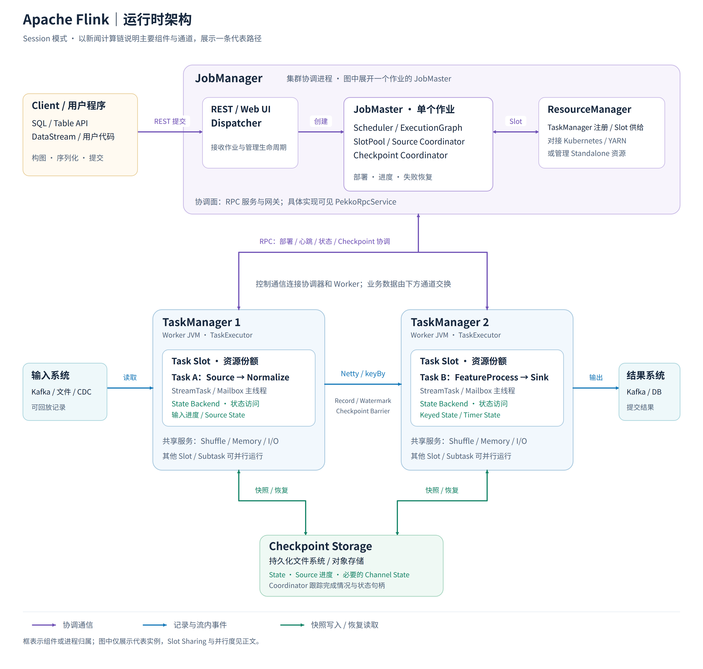
  </a>
</p>


**（1）组件分工：构图、协调、执行与通信**

| 图中组件 | 主要职责 | 与其他组件的关系 |
| --- | --- | --- |
| 用户程序 / Planner / Graph Builder | 将 SQL、Table API 或 DataStream 程序转换为可执行的数据流计划，携带算子逻辑、类型、分区方式和并行度等信息 | SQL / Table API 先经过 Planner 的关系计划优化与翻译；DataStream 从用户构造的 Transformation 图进入构图流程 |
| Client | 提交作业计划、用户代码及依赖，获取作业标识、状态或结果 | 提交完成后可以使用 detached 模式断开；持续计算由集群运行时承担 |
| JobMaster 中的 ExecutionGraph / Scheduler | 维护作业执行图及任务状态，申请资源、部署任务，并在失败后安排恢复 | Scheduler 调度的是任务执行实例；每条业务记录到来时的计算由 TaskManager 内的算子驱动 |
| Checkpoint Coordinator | 发起 Checkpoint，跟踪各参与者的确认，完成一致性快照并提供恢复依据 | 与 TaskManager 的快照逻辑、Source 进度及 Checkpoint Storage 协作 |
| TaskManager / Task / Task Slot | Worker 进程提供资源，Task 承载实际执行的算子或算子链，Slot 表达资源分配边界 | 一个 TaskManager 可以承载多个 Task；同一作业的多个 Task 可以按规则共享 Slot |
| Memory / I/O 共享服务 | 管理受控内存、临时文件和磁盘 I/O 等运行时资源 | Task 使用这些服务；算子状态的组织和读写另外由 State Backend 负责 |
| Shuffle / Netty 数据通道 | 为跨 Task 的数据交换提供分区、缓冲区、输入通道及网络传输 | 源码中对应 Shuffle / Network 子系统；远程数据交换使用 Netty |
| RPC 服务与网关 | 承担注册、心跳、任务部署、状态通知等协调通信 | 调用通过 `RpcService` / `RpcGateway` 抽象，底层可见 `PekkoRpcService`；业务数据流走独立的数据通道 |

图中的 JobManager 是一个总体角色，内部展开了三个子组件：

- **Dispatcher**：承接作业提交，为作业创建和管理 JobMaster 的运行生命周期；REST / Web UI 是集群对外的入口。
- **ResourceManager**：管理集群的 TaskManager 注册、Slot 供给与资源需求。在 Kubernetes / YARN 等部署下对接外部资源系统；Standalone 模式下使用已经启动的 TaskManager。
- **JobMaster**：管理单个作业，内部连接 Scheduler、SlotPool、执行图和 Checkpoint 协调逻辑。一个集群可以同时运行多个作业，每个作业有自己的 JobMaster。

这些是职责边界，并不意味着每个组件都必须独占一个进程。典型集群启动时，JobManager 侧装配 REST、Dispatcher 和 ResourceManager；TaskManager 侧通过 `TaskManagerRunner` 启动 `TaskExecutor`，注册并报告 Slot，随后接受作业部署。

还要区分 **Session 模式与 Application 模式**：前者通常由客户端执行用户 `main()` 并向已有集群提交作业，后者在集群侧执行 `main()`。

**（2）从用户程序到执行图，再到 Worker 上的任务**

<p align="center">
  <a href="./image/flink_job_execution_pipeline.png">
    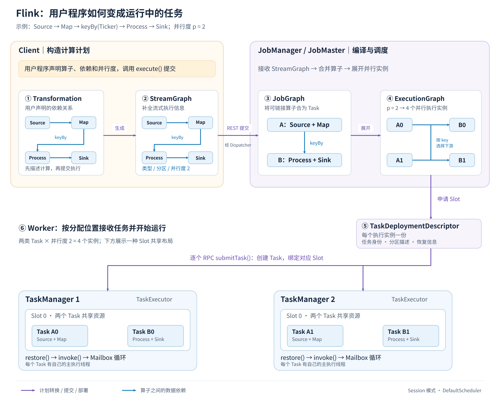
  </a>
</p>

**（3）Task、Operator Chain、Slot 与线程是什么关系**

一个 Operator 是一种计算逻辑，例如解析新闻、筛选记录或维护窗口；并行度为 2 时，这种逻辑有两个并行的 Operator Subtask。Flink 可以将满足链接条件的上下游 Operator Subtask 放入同一个 **Operator Chain**，由一个 Task 的主执行线程依次调用，从而减少序列化、缓冲和线程切换开销。

例如，考虑下面这条简化的 Ticker Message 计算链：

```text
NewsSource -> Normalize -> keyBy(Ticker) -> FeatureProcess -> ResultSink
```

假设所有算子并行度均为 2，且链接策略允许形成 `NewsSource → Normalize` 和 `FeatureProcess → ResultSink` 两条算子链，那么会有 **2 类 Task，每类 2 个并行实例，共 4 个 Task 主执行线程**。`keyBy(Ticker)` 改变数据分区，在这里形成两条链之间的数据交换边界，不需要再为它单独安排一个执行用户函数的线程。

**Slot 是资源分配单位。** 在同一 Slot Sharing Group、资源条件满足的前提下，上述两类 Task 可以共享 Slot，整个作业可以放入 2 个 Slot。因此：

- **Operator Chaining** 将多个算子合入一个 Task，链内共享主执行线程。
- **Slot Sharing** 让同一作业的多个 Task 共享物理 Slot；这些 Task 仍有各自的执行线程。
- Slot 不等于 CPU 核，也不提供 CPU 核独占保证；受管理内存的份额也不等于整个 JVM 堆都被严格隔离。图中每个 TaskManager 只展开一个代表性 Slot，实际算子数、Slot 数和线程数需要结合并行度、算子链及共享规则判断。

在 Task 内，`StreamTask` 使用 **Mailbox 执行模型**：循环交替处理输入和排队的协调动作，让普通记录处理、定时器回调及 Checkpoint 的同步操作在受控的执行上下文中推进。网络 I/O、异步状态访问或快照持久化仍可以使用其他线程；“一个 Task 一个主执行线程”并不意味着整个 Worker 只有这些线程。

**（4）数据怎样流动，慢下游怎样影响上游**

图中的三类连线承担不同工作：**紫色**表示部署、心跳和确认等协调通信；**蓝色**表示记录，以及随数据通道传播的 Watermark、Checkpoint Barrier 等事件；**绿色**表示快照写入和恢复读取。**普通算子之间的业务数据由 TaskManager 直接交换，无须经过 JobManager 中转。**

以一条 `Ticker=AAPL` 的新闻为例：

1. Source 读取记录，交给 Normalize；如果两者被链接，链内通过 `ChainingOutput` 调用下游的记录处理入口。
2. 经过 `keyBy(Ticker)` 时，`KeyGroupStreamPartitioner` 提取 key，并通过 Key Group 映射选择下游 Subtask。同一 keyed operator 的同一个 key 会路由到负责它的并行实例。
3. 跨 Task 时，上游写入 ResultPartition，下游通过 InputGate / InputChannel 消费。同一 TaskManager 内可以使用本地通道；跨 TaskManager 时通过远程网络通道传输。
4. FeatureProcess 的 Task 收到记录后，访问自己负责的 AAPL 状态，更新特征或触发条件，再向 ResultSink 输出。业务的条件触发发生在算子内部；JobManager 的 Scheduler 负责的是任务执行生命周期。
5. 如果算子注册了 Event-time Timer，则相应 Watermark 推进到时间阈值后，由算子侧的时间服务触发回调。Processing-time Timer 则由处理时间服务驱动，两者都不需要 JobManager 为每次触发重新部署任务。

如果 ResultSink 持续变慢，数据交换层的有限缓冲区会逐渐耗尽。远程接收端通过 **credit** 表达可接收数据的缓冲额度；额度不足时限制数据发送，压力通过输出可用性向上游传播，最终降低 Source 的读取速度。这是背压进入架构的具体位置。它约束传输中的积压；用户自己维护的无限集合或无界算子状态，仍需要单独的生命周期和容量管理。

**（5）状态、Checkpoint 与故障恢复怎样配合**

图中的 State Backend、Checkpoint Storage 和 Checkpoint Coordinator 分别承担以下职责：

| 对象 | 负责的问题 | 典型位置或实现 |
| --- | --- | --- |
| Working State | 当前处理到哪里、每个 key 的累计值、窗口内容、定时器和匹配进度是什么 | 由各算子实例及其状态后端管理；例如 TaskManager 内的 HashMapStateBackend 或 EmbeddedRocksDBStateBackend |
| Checkpoint Storage | 为恢复而产生的快照字节保存在哪里 | 可配置为持久化文件系统或对象存储；这与运行中使用堆内存还是 RocksDB 是两个配置维度 |
| Checkpoint 协调信息 | 哪次快照正在进行、哪些参与者已确认、最近可恢复的快照是什么 | JobManager 侧的 CheckpointCoordinator 及相关存储服务；Source Coordinator 自身的协调状态也可参与快照 |

State Backend 画在 Task 内表示状态访问与逻辑归属，并不限定状态文件必须留在该 Worker 的本地磁盘。例如 ForSt 可以将工作状态的 SST 文件保存在远程文件系统；工作状态的物理布局与用于一致恢复的 Checkpoint 仍需分别理解。

这里用常规 **Aligned Checkpoint** 说明完整协作过程：

1. Coordinator 为一次 Checkpoint 分配标识，触发 Source 等起点任务，并协调参与者保存状态。
2. Source 将输入进度纳入快照，并向下游发送 Barrier。多输入任务在各输入通道的同一轮 Barrier 之间建立一致的切面；已收到 Barrier 的通道暂缓消费后续普通记录，其他通道继续推进到相应 Barrier。
3. Task 在受控的同步阶段固定本次状态快照并传播 Barrier，然后可以异步完成快照持久化，再向 Coordinator 确认。**不必等待整个快照上传结束才向下游传播 Barrier**。
4. 必要参与者均确认且快照完成持久化后，Coordinator 完成本轮 Checkpoint，并发出完成通知。支持相应协议的 Sink 可据此推进对外提交。

若启用 **Unaligned Checkpoint**，还会保存恢复所需的 Channel State，以减少等待输入对齐的代价；保存范围不能只按“各算子的变量”理解。持久化状态通常由执行节点的快照逻辑写入配置的存储，Coordinator 负责协调和汇总状态句柄。

任务或 Worker 故障后，JobMaster / Scheduler 根据失败和数据依赖确定重启范围，重新分配资源，将最近一次成功 Checkpoint 中的状态装载到新的任务实例，再由可回放 Source 从对应进度继续读取。**失败的影响可能扩展到关联的上下游任务**，恢复范围取决于 failover 策略、拓扑和中间分区的可用性。

这里的 Exactly-once 首先约束恢复后的内部状态与输入进度。若要覆盖外部数据库或消息系统，还需要相应 Sink 的事务或幂等协议；普通外部副作用不会自动纳入这一保证。

#### 4.1.3 两类图怎样落到 Flink 上

**Flink 可以承载两类图，但需要由应用明确连接“持续更新状态”和“请求一次计算”。** DataStream 的边主要传递记录；一个下游算子不会因为需要某个值，就自动逆向调用整条上游链。

以“持续维护统计、条件成立时推理”为例，数据可以按下图组织。特征协调算子内部维护规则和特征状态。

<p align="center">
  <a href="./image/flink_trigger_inference_flow.png">
    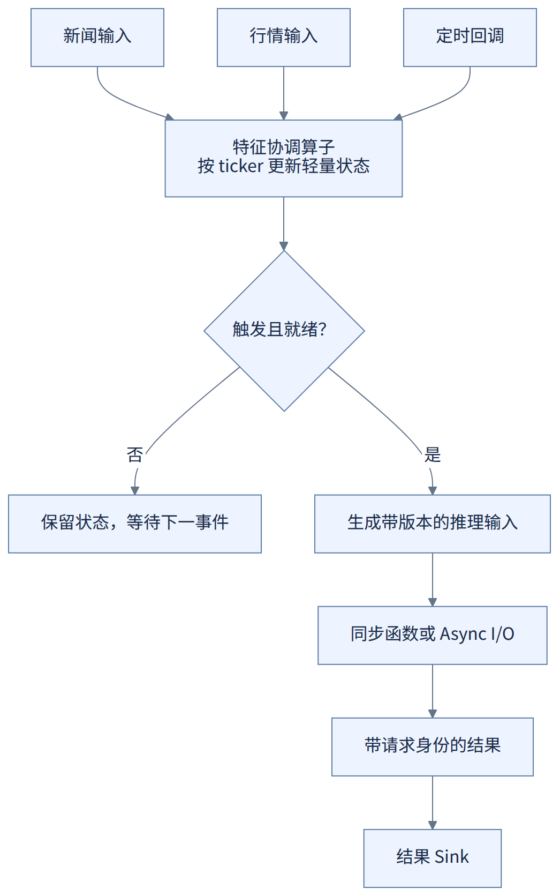
  </a>
</p>

`keyBy(ticker)` 确定状态归属；两种输入可用 `KeyedCoProcessFunction` 接入。将有关状态放进同一个协调算子，便于在处理当前事件后构造推理输入。如果拆成多个算子，则要通过记录显式传递值和版本；**相同 key 并不允许一个算子直接读取另一个算子的状态。**

共享计算也要在图里真实共享：先得到一条 Embedding 结果流，再分支给多个消费者；或由业务按新闻及模型版本保存结果。把相同函数写在两条分支里，不能据此承诺只执行一次。

#### 4.1.4 条件 Trigger：严格“下一条”要怎样表达

Flink 提供两种合适的入口：CEP 的 Pattern API，或者 Process Function 中的显式状态机。规则少且语义精确时，状态机通常更容易解释。

图中的 Waiting 表示等待累计量跨过阈值，Armed 表示等待下一条同标的新闻，Consumed 表示本轮机会已经用完。session 是应用定义的一轮业务处理，其开始时机需要由业务约定；这里不是在定义 Session Window。

<p align="center">
  <a href="./image/flink_next_news_state_machine.png">
    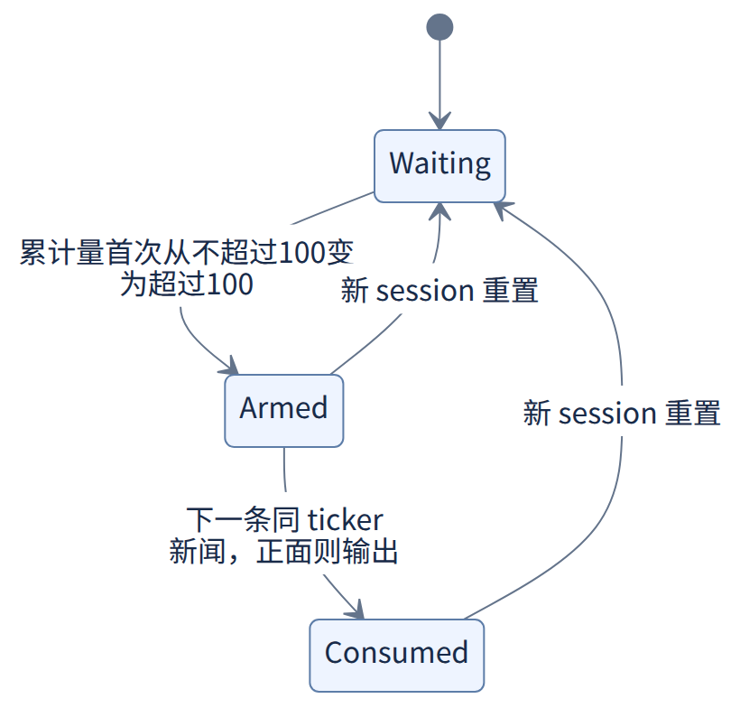
  </a>
</p>

新 session 开始时，从任意状态重置累计量与匹配进度。这里 `Consumed` 表示正面、负面和中性新闻都会消费机会。例如 `跨阈值 → 负面新闻 → 正面新闻` 的结果应当是零次触发；中间出现的 Trade 不消费“下一条新闻”的机会。这是应用规则，不能让输入过滤或模式匹配悄悄改变它。

CEP 中，`next` 要求在进入 CEP 的序列里严格相邻，`followedBy` 允许跳过不匹配事件。因此直接在混合 News/Trade 流上写 `next(positive_news)`，会把中间 Trade 也当成中断；写 `followedBy(positive_news)` 又可能跳过应当消费机会的负面新闻。可先构造只含阈值事实与全部新闻的序列，或使用上图状态机。**不能先过滤负面新闻，再声称匹配的是下一条新闻。**

两路输入即使按相同 ticker 分区，也没有自动获得业务所需的跨流总序。选择接纳顺序时，要记录实际处理位置；选择事件时间顺序时，需要缓冲、进度和同时间戳排序规则。CEP 的事件时间模式会结合 watermark 推进有序匹配，普通 `processElement` 则没有自动排序这一层。

#### 4.1.5 Clock、窗口、Ready 与模型调用

可以把三种“等待”分开理解：

| 等待什么 | 对应机制 | 行为与边界 |
| --- | --- | --- |
| 每隔 5 秒检查一次 | Processing-time Timer，回调后注册下一次 | 没有新新闻时仍能检查已激活的候选；算子繁忙时回调可能延后 |
| 某段事件时间已推进到边界 | Watermark 与 Event-time Timer | 适合窗口结束和事件时间超时；空闲输入需明确处理 |
| 推理所需的数据已经可用 | 应用的 Ready / revision 判断 | Watermark 不代表 Embedding 已完成，也不代表模型所需字段齐全 |

Timer 需要先为相应 key 注册；如果要求从未出现过输入的 ticker 也定时产生结果，应用还要提供 ticker 初始化或时钟输入。窗口统计同样要有过期逻辑，不能只在收到新行情时删除旧样本。

模型处理慢时，可在 Trigger 产生后使用 Async I/O 调用外部服务。并发容量、超时和有序/无序输出都是需要选择的执行策略。恢复时，在途请求可能重新发送，因此请求身份、模型版本和结果幂等不能省略；较旧结果晚返回时，也不能直接覆盖较新的 latest 结果。

这条链路的关键顺序是：**先构造稳定输入，再执行重计算，最后按请求身份发布。**

#### 4.1.6 恢复、持久化状态、查询与动态逻辑的实际边界

| 需求 | Flink 的机制 | 需要额外负责什么 |
| --- | --- | --- |
| 每个 ticker 独立状态 | Keyed State，按 Key Group 分布 | 状态清理、热点 ticker、状态 schema 演进 |
| 工作状态超过内存 | RocksDB 等状态后端 | 只有托管状态进入后端；用户自建的大集合、模型权重和在途请求仍占内存 |
| Crash Recovery | Source 进度与算子状态的一致 checkpoint | 启用 checkpoint、配置可靠存储和可回放输入 |
| 横向扩展 | 并行算子与重新分配 Key Group | 单热点 key 不能只靠增加并行度解决；迁移有状态任务有成本 |
| 应用查询最新特征 | 经 Sink 发布至外部表或结果服务 | 查询 schema、结果新鲜度及多特征读取约定 |

这里“超过内存”指 out-of-core：工作集的一部分由磁盘或远程存储承载。它不等于发生 OOM 后仍能继续执行。后端还需要缓存、序列化和 I/O 预算，不能把全部内存责任交给 RocksDB。
Checkpoint 需要显式启用。端到端 exactly-once 还取决于 connector：例如 JDBC 的事务写入需要相应的 XA 能力与配置；普通外部写操作不会因为 Flink 内部恢复正确就自动成为事务。结果表的唯一键还要对应稳定的逻辑输出身份。
“动态 UDF”也有两层意思：SQL Client 可通过 `ADD JAR` 等方式加载用户代码并注册函数，无需重编译 Flink；但这不承诺已经运行的作业会自动、安全地热替换函数实现及其状态。若仅调整阈值、规则参数，可以把规则作为 Broadcast State 输入，避免每次修改都更换代码。

### 4.2 [RisingWave](https://github.com/risingwavelabs/risingwave)

**RisingWave 将持续查询编译成有状态的数据流，增量维护物化视图，并通过 SQL 查询持久化的计算结果。** 理解它可以沿着两条路径展开：`CREATE MATERIALIZED VIEW` 注册长期运行的计算；`SELECT` 读取已有结果或执行一次派生查询。

#### 4.2.1 API：用多层视图表达计算依赖

用户通过 PostgreSQL 协议接入，可使用 `psql` 或常见 PostgreSQL 客户端。Source 和带 Connector 的 Table 对接外部数据，View 保存查询定义，Materialized View（MV）保存持续维护的结果，Sink 将变更发往外部系统。

下面用两层物化视图维护每个 ticker 的累计成交量，并筛选累计量超过 100 的标的：

```sql
CREATE TABLE trades (
    ticker VARCHAR,
    quantity BIGINT,
    price DOUBLE PRECISION
);

CREATE MATERIALIZED VIEW traded_volume AS
SELECT ticker, SUM(quantity) AS volume
FROM trades
GROUP BY ticker;

CREATE MATERIALIZED VIEW active_instruments AS
SELECT ticker, volume
FROM traded_volume
WHERE volume > 100;

INSERT INTO trades VALUES ('AAPL', 60, 150.0), ('AAPL', 50, 150.2);
SELECT * FROM active_instruments;
```

当输入已处理且结果可见时，AAPL 对应的累计量为 `110`。`traded_volume → active_instruments` 就是一条特征依赖链：前者维护状态，后者依赖其结果。

这里的结果是**当前关系**。AAPL 的量从 `60` 变成 `110`，在聚合结果中表现为旧行被更新；不能把普通 MV 中的一行自动理解成“已经执行过一次、永不撤回的通知”。后续修改或删除原始成交，也可能改变派生结果。

普通 `CREATE VIEW` 只保存查询定义。只有读取它，或其他持续查询引用它时，相应计算才进入执行计划。因而“SQL 可以按需查询”与“MV 默认持续维护”可以同时成立。

#### 4.2.2 顶层架构：服务、计算、协调与存储

<p align="center">
  <a href="./image/risingwave_top_level_architecture.png">
    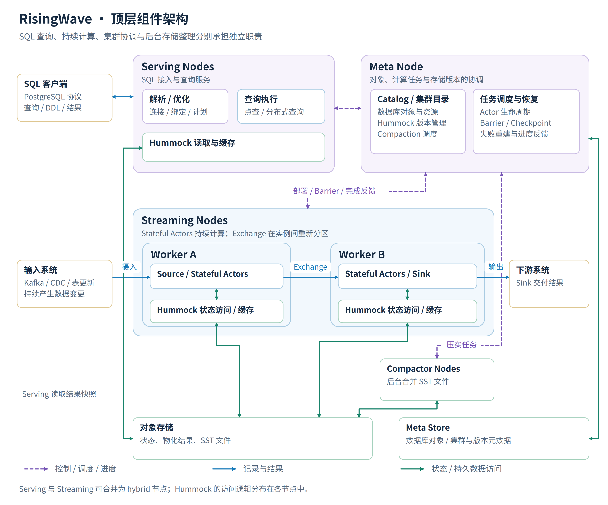
  </a>
</p>

RisingWave 的顶层分工是：Serving 接收 SQL 并提供查询，Streaming 长期运行有状态计算，Meta 负责对象目录、任务调度与一致恢复，Compactor 在后台整理存储。Serving 与 Streaming 可以使用独立资源，也可以由 hybrid 计算节点共同承担。

| 组件 | 主要职责 |
| --- | --- |
| Serving Nodes | 连接管理、SQL 解析与优化、查询执行及结果返回 |
| Meta Node | 管理 Catalog、Actor 生命周期、Barrier、恢复和存储版本 |
| Streaming Nodes | 执行 Source、状态算子与 Sink，通过 Exchange 交换分区数据 |
| Hummock 访问层 | 在相关节点中读写状态、缓存数据并读取结果快照 |
| Compactor Nodes | 后台读取和合并 SST 文件，整理对象存储 |
| 对象存储 / Meta Store | 分别保存状态与物化数据、数据库对象及集群元数据 |

两条数据路径在存储层汇合：外部变更进入 Streaming，由 Actor 增量维护状态和物化结果；查询进入 Serving，通过 Hummock 读取相应快照。Hummock 的访问逻辑分布在相关节点中，数据文件存入对象存储；Meta Store 单独保存元数据。Compactor 直接整理存储文件，无须经过每条业务记录的计算路径。

一条持续查询的主要步骤是：

1. SQL 经过解析、名称绑定和优化，形成过滤、聚合、Join、物化等执行节点。
2. 计划按数据分布切成 Fragment（执行计划片段）；每个片段可以有多个 Actor（并行执行实例）。
3. Meta 节点把 Actor 部署到 Streaming Workers；初始回填让新视图接上已有数据。
4. Source 的变更经 Actor 逐层传播；需要重新分区时，通过 Exchange 将同一分区键的数据发送给负责它的实例。
5. 算子更新状态与输出，物化节点保存结果；Meta 通过 Barrier 协调进度与恢复切面。

例如 `GROUP BY ticker` 让每个 ticker 的累计量由相应分区维护。普通跨流 Join 则需要保存可匹配的输入状态，任一侧变化都可能产生新的输出或撤回。

**SQL 对象依赖图与 Actor 执行图处在不同层次。** 一个 MV 往往包含多个算子和并行实例；共享一个上游 MV 能复用其已经物化的结果，但多处重复写同一表达式，不等于系统承诺全局只执行一次该表达式。

#### 4.2.3 时间与状态：窗口、Watermark、Key 和查询快照

时间至少要分清三种含义：记录里的事件时间、用于周期逻辑的当前时间，以及内部 Barrier/Epoch 所组织的处理进度。它们共同影响结果，却不能相互替代。

对事件时间可定义 `WATERMARK FOR event_time AS event_time - INTERVAL '5 seconds'`。Watermark 推进后，下游能够关闭相应窗口、回收适用的状态；早于允许范围的记录属于迟到输入。普通聚合可以持续更新窗口结果，而 `EMIT ON WINDOW CLOSE` 将输出推迟到窗口被判定关闭。

窗口宽度与 Watermark 容忍区间是不同参数。例如一分钟窗口、五秒乱序容忍，表示“每份结果覆盖一分钟，并等待进度越过关闭边界”，不表示每五秒运行一次计算。

Key 由分组、Join 条件、主键和分布键等 SQL 结构表达。按 ticker 聚合自然隔离不同标的；跨 ticker 的总体统计则可能需要额外的数据交换或汇总。这里没有让应用任意读取另一算子内存变量的 `getState()` 接口，可查询状态需要表现为表、MV 或索引等数据库对象。

查询一致性也有独立机制。`BEGIN READ ONLY` 可以让事务内多次读取使用同一个 Hummock 快照：

```sql
BEGIN READ ONLY;
SELECT * FROM traded_volume WHERE ticker = 'AAPL';
SELECT * FROM active_instruments WHERE ticker = 'AAPL';
COMMIT;
```

这解决的是**数据库内部读取同一可见快照**。它不保证某条尚未摄入的新闻已被处理，也不把两个独立外部输入中的相关记录自动变成一个跨源事务；需要特定源位置或业务版本时，仍要在数据中表达这些条件。

#### 4.2.4 Trigger：条件关系、时钟行与严格“下一条”

SQL 可以用筛选和关联产生满足条件的记录，但要先区分**条件现在为真**与**条件首次成立时产生一次事件**。`volume > 100` 对应一个关系谓词；每次累计量更新后，它仍可能产生结果变更。若要求一次性触发，就要有独立的事件标识、首次成立判定及消费/重置规则。

对于“达到阈值之后的下一条新闻必须为正面”，严格性取决于事件顺序：

```text
Processed in a deterministic order for one ticker:
40: Trade volume crosses the threshold -> Wait for the next news event
41: Regular quote update              -> Keep waiting if the rule counts only news
42: Negative news                     -> Consume this opportunity; the match fails
43: Positive news                     -> Cannot make the previous match succeed
```

在事件有稳定编号、输入只追加、排序规则明确时，可以用编号、窗口统计与 Join 表达这样的关系。允许迟到插入或历史更正后，谁是“下一条”可能变化，SQL 结果也可能撤回。单独写 `sentiment > 0` 或只寻找未来任意一条正面新闻，都没有表达严格下一条。

Clock 可以直接表现为一条持续增长的时间序列，每隔 5 秒新增一个时间点：

```sql
CREATE MATERIALIZED VIEW clock_ticks AS
SELECT tick_time
FROM generate_series(
    '2026-09-13 10:00:00+08'::timestamptz,
    now(),
    INTERVAL '5 seconds'
) AS ticks(tick_time);
```

随着 `now()` 推进，序列在跨过间隔边界后新增时间行，供下游关联使用。创建时会补齐起点到当前时间之间的行，因此起点应靠近实际启动时间；无限运行还要考虑时间行的保留范围。

这是一种关系中的周期事件。它不直接调度任意 DDL、存储过程或外部副作用，也不承诺每个 tick 都在对应墙钟时刻零延迟地送达。

#### 4.2.5 按 Trigger 读取特征：Temporal Join 与普通 Join 的区别

当市场特征持续更新，而预测只希望在 Trigger 到达时取值，可以将 Trigger 放在左侧，将可查询特征放在右侧，使用 **process-time temporal join**：

```sql
-- prediction_triggers stores trigger events; market_features stores queryable market features.
CREATE MATERIALIZED VIEW prediction_inputs AS
SELECT t.trigger_id, t.ticker, t.trigger_time,
       f.feature_revision, f.price, f.volume
FROM prediction_triggers AS t
JOIN market_features FOR SYSTEM_TIME AS OF PROCTIME() AS f
ON t.ticker = f.ticker;
```

上排维护市场特征，下排处理新增 Trigger。虚线表示在 Trigger 变化时读取特征；单独的市场更新不会沿下排发起推理。

<p align="center">
  <a href="./image/risingwave_temporal_join_readable.png">
    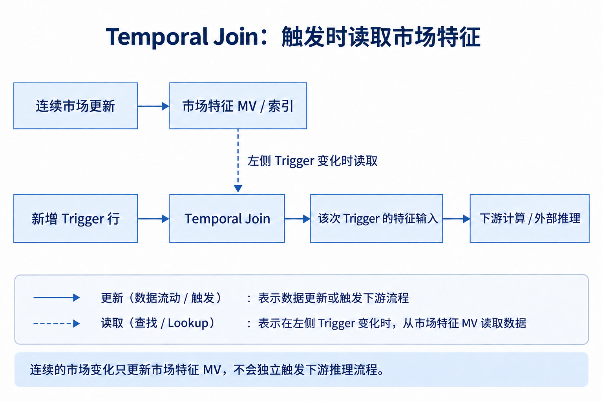
  </a>
</p>

**右侧后续变化只更新供未来 lookup 使用的数据，不会重新驱动历史左侧行。** 普通双侧 Join 则会在市场特征更新时重新关联仍存在的 Trigger，因而可能放大昂贵的下游计算。

Temporal Join 的关联条件需要覆盖右侧分布键；必要时可建立合适的索引。左侧只追加时不需要保存用于撤回历史左侧结果的 Join 状态；若左侧允许更新和删除，则需保存 lookup 结果，以便正确撤回，并在新的左侧更新时重新取值。

它读取的是当时处理可见的右侧状态，不是“指定新闻事件时间对应的历史市场快照”。按事件时间寻找最近历史记录属于 ASOF Join 等另一类语义。

Ready 同样需要明确：INNER JOIN 在缺少右侧行时没有输出，LEFT JOIN 则可能输出空值；右侧稍后就绪不会自行唤醒过去的 Trigger。若需要等到 `EmbeddingReady` 或某个 `feature_revision`，就要使就绪成为新的驱动记录，或在上游明确保留等待状态。Temporal Join 本身不递归补算尚未执行的 lazy 特征。

#### 4.2.6 UDF、结果复用与周期批刷新

RisingWave 可以通过 `CREATE FUNCTION` 注册外部 UDF、嵌入式 UDF 和 SQL UDF，无须重新构建数据库内核。外部函数可由 Python、Java 服务承载；嵌入式路径包括 Python、JavaScript 和编译为 WebAssembly 的 Rust；自定义聚合另有 `CREATE AGGREGATE` 接口。

函数服务在指定地址提供 score_feature 后，可以注册该函数并对已生成的特征输入评分：

```sql
CREATE FUNCTION score_feature(DOUBLE PRECISION, BIGINT)
RETURNS DOUBLE PRECISION
AS score_feature
USING LINK 'http://model-service:8815';

SELECT trigger_id, score_feature(price, volume) AS score
FROM prediction_inputs;
```

函数既可用于一次查询，也可出现在持续查询中。把重函数写进随行情更新的 MV，会把计算纳入持续维护路径；将输入先限制为 Trigger 产生的请求，或由调用方在 Trigger 时发起 `SELECT`，才表达了不同的执行频率。SQL 优化、回填与故障重放仍可能影响实际调用次数，不能把一个输出行当成一次外部调用的事务保证。

按 `(document_id, text_revision, model_version)` 保存 Embedding 结果，可以让多个查询复用同一个已完成的文本计算。这里缓存的是一个有身份、有版本的结果；数据库的块缓存或算子缓存负责减少存储访问，并不自动承担模型版本失效规则。

外部 UDF 适合访问独立模型服务，但网络错误、超时与重试仍存在。嵌入式 Rust/Wasm 路径受资源限制且不能访问外部网络；选择扩展方式时，要分清“允许自定义计算”和“允许任意副作用”。函数是否纯净、模型版本是否固定，会直接影响重放后结果能否一致。

还有一种独立机制是周期批刷新 MV：

```sql
CREATE MATERIALIZED VIEW volume_snapshot
WITH (refresh.interval.sec = 60)
AS SELECT * FROM traded_volume;
```

它按周期刷新结果，区别于每次上游变化都持续维护的普通 MV。其执行依赖 Snapshot Backfill，即读取上游的一份快照来批量刷新结果；不能直接依赖 Source，也不能作为下游 streaming job 的上游。**周期批刷新、产生 Clock 行、任意条件下发起一次异步推理，是三种不同的能力。**

#### 4.2.7 状态持久化、恢复与扩展边界

Hummock 将状态与结果组织为 LSM 存储，使用内存缓存并将数据放入对象存储；Compactor 在后台合并文件。运行所需的完整状态不必全部常驻内存，因此可以处理超过内存容量的状态，但缓存命中率、存储 I/O、Join 放大和回填峰值仍会影响性能与内存占用。

Checkpoint 的关键是把**输入进度、算子状态和物化结果**落在一致的恢复切面上。Meta 发起 Barrier，计算节点按协议推进并持久化状态，所需参与者完成后提交本轮 Checkpoint；故障后重建 Actor，从已提交状态恢复并重放后续输入。已经上传某个文件，不等于整个 Checkpoint 已经完成。

一致恢复不表示外部副作用也只发生一次。可回放输入与确定性计算支持恢复后的一致状态；Sink 的交付语义还取决于 Connector，例如 Kafka Sink 提供 at-least-once，外部模型调用或数据库写入仍需各自的去重或提交协议。Checkpoint 周期也不等于故障恢复耗时上限。

水平扩展通过将分区分配到更多 Actor/Worker，并结合 vnodes 管理状态归属；计算、对象存储和 Compactor 可以分别调整资源。热门 ticker、全局聚合、数据倾斜和跨分区 Join 仍可能形成瓶颈。动态创建视图或注册函数属于数据库对象管理；已有状态和依赖如何迁移，不能简单等同于任意热替换执行代码。

### 4.3 [Timely Dataflow](https://github.com/TimelyDataflow/timely-dataflow)

**Timely 是嵌入 Rust 程序的数据流运行时：用户构建算子图，worker 推进计算，运行时追踪“哪些逻辑时间仍可能产生数据”。** 它提供执行图、分区和进度管理；SQL、CEP、Feature Store、恢复协议等高层能力需要在它之上建设。

#### 4.3.1 顶层架构：应用进程与 Worker

应用通过 Cargo 引入 library，用 Rust API 定义输入、流变换与输出，再启动单个或多个 worker。它没有要求应用先连接独立的数据库服务；同一套数据流抽象也能跨线程、跨进程和跨机器执行。

先从左侧 Worker 的输入、算子和输出读起，再看紫色进度线。进度表示某个逻辑时间是否还可能出现数据。

<p align="center">
  <a href="./image/timely_architecture_overview.png">
    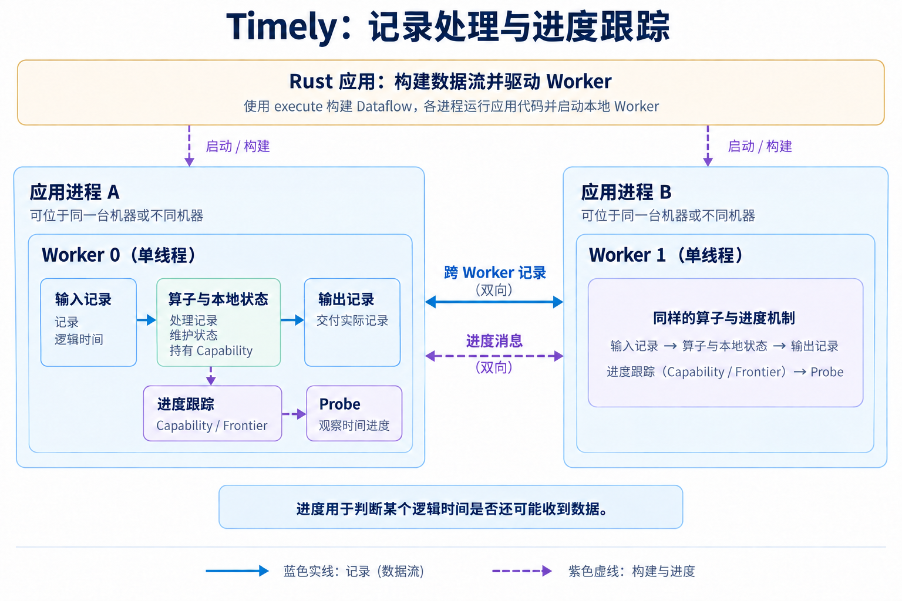
  </a>
</p>

完整调度器、通道和多 Worker 结构见[Timely 详细架构图](image/timely_top_level_architecture.png)。

概览在每个进程中只展开一个 worker，详细图再展示同一进程中的多个 worker。每个 worker 都有自己的算子实例、本地调度与进度跟踪逻辑；应用通过输入句柄写入记录，并驱动 worker 执行。

| 组件 | 主要职责 |
| --- | --- |
| Rust 应用与输入句柄 | 定义数据流、启动 worker、发送带逻辑时间的记录 |
| Worker / 本地调度器 | 在本线程内激活并执行算子 |
| Scope / 算子实例 | 组织子图，持有算子私有状态和 capability |
| Channel / Exchange | 连接本地或远程 worker，按路由规则传输数据 |
| 进度跟踪 | 综合 capability 与消息计数，协作推进 frontier |
| 输出算子 / Probe | 分别交付实际记录、观察指定流位置的进度 |

进程内 channel 连接本地 worker，网络 channel 将同一套数据流延伸到其他进程。进度消息也经通信层交换，由各 worker 中的运行时协作处理；图顶端的 Rust 应用表示在各进程运行的代码。记录通过 channel 传递。`exchange(|record| hash(key))` 用路由值决定接收 worker，使同一 key 的数据汇聚到相同执行位置。用户仍要在算子里维护 `HashMap<Key, State>` 等状态结构，设计清理、查询和持久化规则。

`worker.step()` 为算子提供执行机会，`step_or_park(...)` 可在无工作时等待唤醒。一个 worker 内的算子共享单线程调度，因此长时间阻塞的模型推理会拖住这个 worker 的其他计算和进度处理；接入异步推理时，应把完成消息送回原 worker，再更新状态和输出。

#### 4.3.2 最小 API 示例：发送数据，再等待这一轮完成

下面用逻辑时间 `10` 发送数字 `7`，计算平方，并等待所有小于 `11` 的数据通过输出位置。

```rust
use timely::dataflow::operators::{Input, Inspect, Probe};
use timely::dataflow::operators::vec::Map;

timely::execute_directly(|worker| {
    let (mut input, probe) = worker.dataflow::<u64, _, _>(|scope| {
        let (input, values) = scope.new_input::<Vec<u64>>();
        let (probe, _) = values
            .map(|value| value * value)
            .inspect(|value| println!("square = {value}"))
            .probe();
        (input, probe)
    });

    input.advance_to(10);
    input.send(7);
    input.advance_to(11);
    worker.step_while(|| probe.less_than(&11));
});
```

`send(7)` 发送的是数据值，`10` 是该输入当前的逻辑时间。`advance_to(11)` 声明该句柄以后不会再发送时间小于 `11` 的记录；它不会独自完成下游计算，所以还要驱动 worker，直到 probe 确认进度。输出值为 `49`；这个示例没有建立外部存储的提交保证。

#### 4.3.3 Scope、Capability、Frontier：怎样知道时间 10 完成了

先把几个容易混淆的概念放在同一张表中：

| 概念 | 含义 | 对应用的意义 |
| --- | --- | --- |
| Scope | 构建数据流及嵌套子图的上下文，关联时间类型 | 组织计算；嵌套 scope 可表达迭代等控制结构 |
| Timestamp | 记录在数据流中的逻辑时间，可采用偏序 | 可以表示轮次、业务时间或多维进度，取决于应用定义 |
| Capability | 某算子仍有权在某输出上以指定时间发送数据 | 异步工作未完成时保留发送权；结束后释放或向后推进 |
| Frontier | 仍可能出现数据的逻辑时间的最小边界，用 antichain（反链）表示 | 判断某时间是否已经不可能再收到数据 |
| Probe | 在选定流位置观察 frontier 的句柄 | 驱动等待、监控进度，或限制输入领先程度 |

对普通整数时间，frontier 通常只含一个元素；对偏序时间，它可能同时包含多个不可比较的元素。判断时间 `t` 完成的通用条件是：**frontier 中不存在任何 `f <= t`。** 因此不能把所有 frontier 都压成一个最小整数。

Antichain 是一组两两不可比较的最小时间。例如用 `(外层轮次, 内层迭代)` 表示时间，并逐维比较大小：`(1, 2)` 与 `(2, 1)` 各有一维更小，谁也不小于等于另一方，所以两者都可能需要留在 frontier 里。

沿着上面示例，假设计算中又增加一个异步算子：

| 步骤 | 发生的事 | 时间 10 是否完成 |
| --- | --- | --- |
| 1 | Source 在 `t=10` 发送数据 | 否，数据尚待处理 |
| 2 | 所有相关 Source 都推进到 `11` | 仍未必，下游还有在途消息和工作 |
| 3 | 异步算子保留 `capability(10)`，等待结果 | 否，仍有权发送时间 10 的结果 |
| 4 | 结果回来，算子发送输出并释放旧 capability | 仍需等待消息被消费、进度传播 |
| 5 | Probe 看到 frontier 为 `{11}` 或更后 | 是，该位置不会再出现时间 `<=10` 的数据 |

**保留 capability 是一种进度承诺。** 即使数据队列暂时为空，只要算子仍保留时间 `10` 的发送权，运行时就不能宣布 `10` 完成。`downgrade` 可以把发送权推进到不小于原时间的位置；不再需要时应释放，否则进度可能一直停住。

Frontier 可以作为事件时间完成判断的基础，但它本身不读取新闻的 `Timestamp` 字段，也不会自动推断最大乱序时间。应用必须先定义逻辑时间与事件时间的映射，并决定 Source 何时可以安全推进；已经放弃旧时间的输入句柄不能任意回退。仅有 frontier 也不会自动把到达乱序的记录排序。

#### 4.3.4 条件触发与按需求值

Timely 提供通用 `unary`、`binary`、frontier 感知算子及更底层 builder，可以接收不同类型的输入并执行任意 Rust 逻辑。一个典型用法是把“状态更新”和“查询请求”放在不同输入上，由一个算子决定何时输出。

图中的状态更新流修改本地状态，请求流要求读取或计算结果；虚线表示逻辑时间的完成通知。这个通知判断的是数据流进度，不是模型输入是否已满足业务要求。

<p align="center">
  <a href="./image/timely_dual_input_operator.png">
    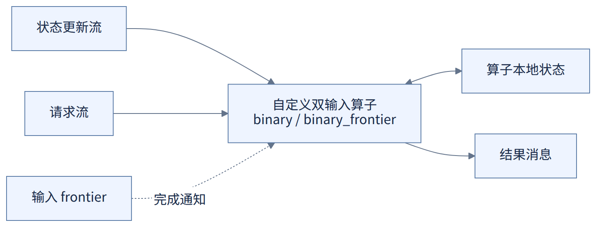
  </a>
</p>


**Clock 和窗口。** 实时时钟源可以通过 `Activator.activate_after(...)` 预约唤醒，再发送 timer 记录；回放时由外层循环生成计划时刻。窗口到期、无新闻时继续触发、积压 tick 如何补发，都属于时钟源与算子的策略。`FrontierNotificator` 则在相关输入进度越过目标时间后提供通知，适合“这个时间的数据已经收齐”再做结算；两者解决的问题不同。

**严格“下一条新闻”。** 可以在同 key 的自定义算子中维护 `Idle → Armed → Consumed`：阈值首次跨越后 armed，随后第一条新闻无论正负都消费机会，仅正面时输出 Trigger。Timely 的通用算子允许实现这套 FSM，但没有替应用定义 CEP 的相邻、跳过、重置与迟到语义。

| 进入 FSM 的记录 | 状态变化 | 是否触发 |
| --- | --- | --- |
| 成交使累计量从 `90` 到 `110` | `Idle → Armed` | 否 |
| 下一条新闻为负面 | `Armed → Consumed` | 否 |
| 再下一条新闻为正面 | 保持 `Consumed` | 否 |

必须先确定“下一条”使用哪种顺序。把新闻和成交按同一 key exchange，只解决位置归属；多输入的到达先后还需要应用约束。若选择事件时间顺序，应在 FSM 之前缓冲，等待相关输入的进度，再按 `(timestamp, stable_sequence)` 送入；同时间戳 timer 与新闻的顺序也应明确定义。

**Feature DAG 与按需求值。** 普通数据流变换由输入推动，连接了 `market.map(expensive_model)` 就会在行情记录经过时运行模型。要实现“行情只更新状态，Trigger 才请求模型”，需要显式传递 Trigger 请求，或者在自定义算子内部放置 Feature Evaluator。所有前置输入 Ready 的判断、菱形依赖去重和错误传播都需自行定义。

**共享计算。** 将同一算子的输出分给多个消费者，可以共享那次上游执行；跨 Trigger 复用历史结果还要建立缓存。例如按文本/模型版本缓存 Embedding，按依赖 revision 与实际读取的时间上下文缓存派生特征；只有 `ticker` 相同或逻辑时间相同，都不足以证明结果可复用。先确保依赖再验证缓存，避免用尚未更新的 revision 错判命中。

**异步 Ready 与多输入关联。** Trigger 需要明确引用新闻版本、市场观察位置和请求序号；结果返回后校验这些身份，防止旧版本推理覆盖新版本。若还要在原逻辑时间输出，等待期间需在原 worker 保留相应 capability；不能把它随意移交到推理线程，因为该类型不实现 `Send`。

#### 4.3.5 状态、恢复和扩展边界

| 调研维度 | Timely 提供什么 | 应用层负责什么 |
| --- | --- | --- |
| 状态维护与查询 | 用户算子可拥有状态，输出可被观察或捕获 | Feature Store、latest 查询、状态后端、TTL 与内存预算 |
| Checkpoint / Crash Recovery | Capture / Replay 可记录和重放流上的数据及进度 | 状态、源位置、Trigger FSM、timer 与输出提交的一致恢复协议 |
| Exactly-once | 运行时追踪计算进度 | 重试去重、稳定 occurrence ID，以及状态与 sink 的提交协调 |
| 一致性快照读 | Probe 可确认所观察流在某时间前完成 | 查询版本保留、跨对象读取隔离、对外发布协议 |
| 水平扩展 | 多 worker 与跨机器通信、Exchange 分区 | 启动编排、故障重建、状态迁移、在线扩缩容 |
| 超内存数据 | 可持续读入总量超过内存的数据，分区可使用更多机器的资源 | 大于可用内存的活跃状态仍需外部存储或显式 spill 算法 |
| 背压与资源控制 | Probe 可帮助限制尚未完成的逻辑轮次 | 有界队列、每轮大小、模型并发与外部 IO 积压控制 |
| 可编程接口与动态 UDF | Rust closure、自定义算子与 library API | SQL/SDK 服务封装，以及插件加载、注册与版本替换机制 |

`capture_into` 记录的是某条流可见的数据和进度，`replay_into` 将这些重新作为输入。由此可以构建重放方案，但它没有保存任意闭包中 `HashMap` 的完整状态，更没有自动协调外部数据库事务。

同样，probe 越过 `t` 只证明选定数据流位置的逻辑进度。若 sink 只是把写请求交给后台线程，probe 并不知道请求何时落盘；应用必须把持久化完成纳入确认协议。即使两个输出都完成了 `t`，直接读取当前值仍可能混入后续时间的更新，快照读还需要版本保留或受控发布。

对于超内存场景，要区分**输入总量**与**必须同时保留的状态量**：按条扫描大文件可以占用有限内存，无界 join 或无限保留历史则可能持续增长。Timely 的分布式执行和流式输入不会自动把用户状态转换成磁盘状态后端。

#### 4.3.6 Timely 与 Differential Dataflow 的分工

**Timely 负责让数据流运行并判断进度；Differential 在其上提供随集合变化而维护结果的增量计算。** Differential 用 `(data, time, diff)` 表达增加或删除，`join`、`reduce` 等算子把输入变化传播为结果变化。

| 问题 | 更直接对应的机制 |
| --- | --- |
| 如何连接算子、分区、判断某轮完成 | Timely 的 stream、exchange、capability、frontier |
| 一行新增或撤回后，如何更新关联和聚合 | Differential 的带权集合与增量算子 |
| 多个查询能否复用已经维护的索引 | Differential 的 arrangement / trace |
| 模型什么时候运行、Embedding 缓存何时失效 | 应用的 Trigger 与 Feature 求值约定 |

Arrangement 是按 key 分区、可被多个计算复用的索引化状态；“索引共享”和“任意模型函数自动缓存”是不同能力。把模型包装进增量计算也仍要定义输入变化怎样触发推理、旧输出怎样撤回，以及副作用如何处理。

### 4.4 [Materialize](https://github.com/MaterializeInc/materialize)

**Materialize 把 SQL 查询变成持续运行的增量计算，并用逻辑时间和进度跟踪保证读取到相互一致的结果。** 它建立在 Timely Dataflow 和 Differential Dataflow 之上，但对用户暴露的是数据库对象、SQL 和结果订阅接口。

#### 4.4.1 API：View、Index 和 Materialized View 分别保存什么

通过 PostgreSQL 协议连接后，可以建立 Source/Table 接入数据，用 SQL 定义派生关系，再以 `SELECT` 查询或 `SUBSCRIBE` 订阅变更。

这三个对象很容易混淆：

| 对象 | 保存什么 | 怎样得到结果 |
| --- | --- | --- |
| 普通 View | 命名的查询定义 | 读取时执行查询；也可作为其他查询的组成部分 |
| View 上的 Index | 某个 Cluster 内持续维护的索引/结果 | 在该 Cluster 内复用计算与索引访问 |
| Materialized View | 持续维护并写入持久存储的结果 | 可以跨 Cluster 读取，也可再建索引加速查询 |

下面通过 View 和 Index 持续维护累计成交量，再查询累计量超过 100 的标的：

```sql
CREATE TABLE trades (
    ticker TEXT,
    quantity BIGINT,
    price DOUBLE PRECISION
);

CREATE VIEW traded_volume AS
SELECT ticker, SUM(quantity) AS volume
FROM trades
GROUP BY ticker;

CREATE INDEX traded_volume_by_ticker ON traded_volume(ticker);

CREATE VIEW active_instruments AS
SELECT ticker, volume
FROM traded_volume
WHERE volume > 100;

INSERT INTO trades VALUES ('AAPL', 60, 150.0);
INSERT INTO trades VALUES ('AAPL', 50, 150.2);
SELECT * FROM active_instruments WHERE ticker = 'AAPL';
```

第一笔成交使累计量变为 `60`，第二笔使其变为 `110`；最终查询返回 `(AAPL, 110)`。`traded_volume` 一旦建立索引，其聚合就会持续维护；读取同一 Cluster 中的下游查询，可以利用已维护的结果。因此，**“只有 MV 才能增量计算”在 Materialize 中不成立**。

多层 View 能表达计算 DAG，但普通 View 名称本身不是缓存承诺。是否建立 Index、是否需要持久化和跨 Cluster 访问，决定了计算与结果在哪里保存。数据库内部的共享 Arrangement 可以复用已经按 Key 组织的数据，避免多个计算各建一份相同的索引状态。

#### 4.4.2 顶层架构：协调进程、Cluster 与持久存储

从上到下看查询协调、计算资源和持久化访问。Cluster 表示资源边界，Replica 表示执行同一工作的副本；各进程通过 Persist 客户端访问后端。

<p align="center">
  <a href="./image/materialize_architecture_overview.png">
    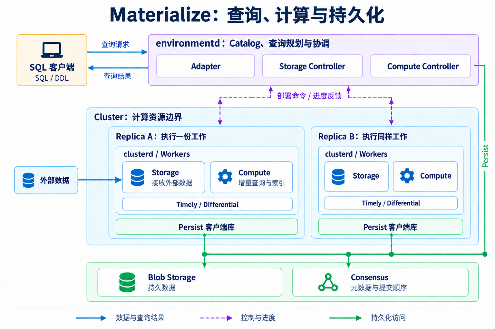
  </a>
</p>

Storage/Compute、Worker 和输出通道的展开见[Materialize 详细架构图](image/materialize_top_level_architecture.png)。

Materialize 把协调与数据处理分开。`environmentd` 内的 Adapter 接收 SQL、维护目录、规划查询并选择读取时间；同一进程中的 Storage Controller 和 Compute Controller 将任务交给 `clusterd`，并接收进度与结果。

| 组件 | 主要职责 |
| --- | --- |
| Adapter / environmentd | 管理会话、SQL、Catalog 与读取时间 |
| Storage / Compute Controller | 管理相应任务，并与执行进程交换命令和反馈 |
| Cluster / Replica | 组织工作负载与资源；Replica 执行完整的数据流工作 |
| clusterd 中的 Storage | 外部摄入、时间赋值与 Sink 输出 |
| clusterd 中的 Compute | 增量查询、Index、Arrangement 与 MV 维护 |
| Timely / Differential | 在执行进程内提供数据流运行时与增量关系算子 |
| Persist / 持久后端 | 通过进程内客户端库访问 Blob 数据与 Consensus 元数据 |

一个 Replica 可以包含多个 `clusterd` 进程，由内部 Worker 协作处理数据。多个 Replica 执行相同工作并处理完整输入，提供冗余；Storage 与 Compute 则是可以共用或分开使用 Cluster 的逻辑职责。

Persist 是各进程使用的库。Blob Storage 保存输入和 MV 的持久数据，Consensus 后端协调分片元数据与提交顺序。Index 和算子 Arrangement 属于计算中的工作状态；其他 Cluster 可以通过持久 MV 共享结果，分别组织自己的计算资源。

以 AAPL 的累计量从 `60` 变为 `110` 为例，内部传播的概念形式是：

```text
(AAPL, 60,  logical_time = t, diff = -1)
(AAPL, 110, logical_time = t, diff = +1)
```

`diff` 表示该行在多重集合中的份数变化：`+1` 增加一份，`-1` 撤回一份；它不是业务成交量。两个差分合起来表示该时间的结果从旧值换成新值。Join、聚合等算子继续将输入差分转换成输出差分，避免每次都重算整张表。

Timely 负责数据流执行和进度通知；Differential 提供关系增量维护。查询成本仍与变化的传播范围有关：一行维表更新如果关联大量事实行，可能引起大量输出变化，“增量计算”不表示每条输入都只花常数时间。

#### 4.4.3 Frontier 与一致读取：怎样知道结果已经算完

维护了最新值还不够，系统还需要知道：**某个逻辑时间之前的输入和衍生计算是否已经全部完成？** Timely 的 Frontier 用来描述尚可能出现更新的时间边界，Materialize 将这一机制用于读取时间选择和结果完成判断。

在 Materialize 常见的全序逻辑时间中，如果某个输出的进度已经越过 `t`，就可以确认不会再有时间不大于 `t` 的更新。多个输入都参与同一个查询时，需要相应依赖共同达到可读进度，不能仅因最快的输入已推进就发布混合结果。

查询希望读取逻辑时间 `t = 100`：

| 依赖结果 | 已完成的逻辑时间 | 能否读取时间 100 的结果 |
| --- | ---: | --- |
| 价格 | 100 | 已就绪 |
| 成交量 | 97 | 仍需等待 |
| 情绪 | 100 | 已就绪 |

等成交量的计算也完成到时间 `100`，查询再组合读取三者在时间 `100` 的结果。

默认的 Strict Serializable 隔离级别兼顾事务串行化与实时先后关系，可能等待较慢的索引/MV 追上。Serializable 仍保持一致快照，但可读取更旧的状态；Bounded Staleness 则要求快照足够新，否则返回错误。这些模式在一致性、数据新鲜度和等待时间之间作出不同取舍。

这里有两条明确边界：

- 逻辑时间不是新闻正文里的 `Timestamp` 字段。后到的旧新闻可以在较新的内部时间被摄入，导致当前结果更新。
- 内部一致读取不自动证明外部系统的某次写入已经摄入。Real-time recency 提供进一步等待外部源可见进度的能力，但属于需要启用的能力，也会增加延迟；多个外部系统之间本来不存在的业务原子性，不能由读取时间凭空补出。

因此，Frontier 证明的是执行进度，不是“某条未来不会再来的新闻”的业务假设，也不是等待队列里每个模型请求的 Ready 标志。

#### 4.4.4 时间过滤与条件事件：变化不一定来自新输入

Materialize 的 `mz_now()` 表达当前查询/数据流对应的逻辑时间，`now()` 则用于当前事务的墙钟时间。持续维护中可使用 Temporal Filter，让记录随时间进入或退出关系，即使没有新的业务记录到达。

对于包含 `event_time` 的 `timestamped_trades`，可以持续维护最近两分钟的成交量：

```sql
CREATE MATERIALIZED VIEW recent_volume AS
SELECT ticker, SUM(quantity) AS volume
FROM timestamped_trades
WHERE mz_now() >= event_time
  AND mz_now() < event_time + INTERVAL '2 minutes'
GROUP BY ticker;
```

一笔成交满两分钟后被过滤掉，累计量随之降低。这种结果撤回来自时间推进，而非新的成交；它既能表达滚动范围，也能表达候选 TTL。`mz_now()` 在可物化表达式中有受支持的比较形态，应把时间加减写在另一侧，不能按任意墙钟函数使用。

这里由逻辑时间上的 Temporal Filter 决定记录是否参与计算，不自动建立基于事件时间 Watermark 的窗口关闭协议。Temporal Filter 控制记录在某段逻辑时间是否参与计算；迟到记录若仍落在保留范围内，可以更新结果，已经过期则不会重新参与。允许多少迟到、何时将结果认定为业务最终值，需要另外定义。

周期逻辑可由外部 Clock 源产生行，再进入相同的 SQL 管线。Temporal Filter 也能在指定时刻让已有记录生效或到期，但它不是通用 `onTimer()` 回调；内部的周期刷新调度也不能直接当作公开、任意条件可用的业务 Timer 接口。

SQL 可以从条件关系中得到 Trigger 候选，但当前满足条件不等于首次跨阈值事件。对于严格“下一条新闻”，需要先规定 ticker 内的顺序及事件编号，并让第一条符合新闻类型的后续记录消耗等待：

```text
Accumulated volume crosses the threshold -> Wait for the next news event
The next news event is negative          -> This match fails and the wait ends
A later news event is positive          -> Cannot make the previous match succeed
```

对顺序稳定的追加事件，可以用关系查询实现部分模式；允许迟到插入和历史修订时，匹配关系也可能撤回。通用 CEP 的候选消费、重叠匹配、超时与重置，不是建立一个 `WHERE` 谓词就自动获得的行为。

#### 4.4.5 订阅、Ready 与按事件执行外部模型

`SUBSCRIBE` 将关系的变更送给调用方。一次 `SELECT` 返回一个时间点上的结果；一次订阅则持续返回结果怎样变化：

```sql
COPY (
    SUBSCRIBE active_instruments
    WITH (SNAPSHOT = false, PROGRESS = true)
) TO STDOUT;
```

默认差分输出中，`mz_timestamp` 是内部逻辑时间，`mz_diff` 表示插入或撤回的次数，`mz_progressed = true` 表示更早时间的更新已经完成。进度行并不是一个业务事件。

消费端要区分“已有数据的初始快照”“新增业务事实”“同一事实的修订”和“仅通知进度”。关闭初始快照可以避免把当前所有候选都当成新 Trigger，但它不提供断线期间的自动补发；断点恢复还取决于保存的消费进度、`AS OF` 和上游历史保留范围。

<p align="center">
  <a href="./image/materialize_external_inference_flow.png">
    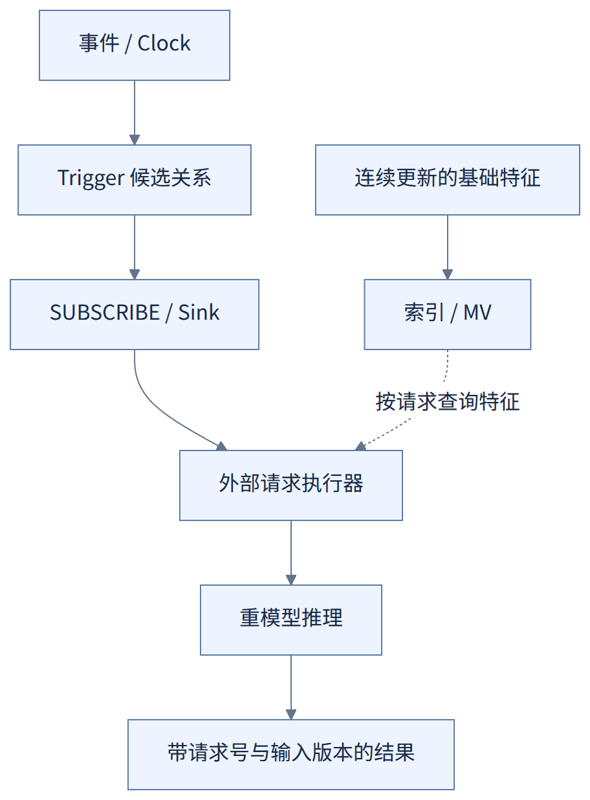
  </a>
</p>

这张图展示一种由外部执行器组织的调用路径。数据库提供结果维护、查询和变更交付；模型调用、请求去重和重试由执行器承担。公开 SQL 接口不提供通用 Python/C++ UDF 动态注册与任意有状态回调，因此不能把一个 Python 模型直接视为 Materialize 内部的用户算子。

如果把 Trigger 和不断更新的特征直接写成普通持续 Join，历史 Trigger 仍会受右侧特征变更影响。只希望每次事件执行一次模型时，必须区分持续派生关系与已经受理的请求；`trigger_id`、输入版本及已处理记录用于表达请求身份和重复消费规则。

Ready 也至少有两层：计算进度已完成，不代表某条新闻的 Embedding 已存在。关系中缺少关联行可能只是当前无匹配；数据库不会自动运行一个外部模型来补齐它。模型结果可由外部系统写入输入关系，再驱动下游匹配。

外部执行器在收到通知后发起的新查询，通常读取的是**查询选定的时间**，不自动等于 Trigger 发生的时间。若业务需要固定输入，应在请求中携带数据或明确版本；需要历史读取时，还受对象的历史保留与可读时间范围限制。

#### 4.4.6 结果复用、持久化与故障恢复

共享 Index/Arrangement 复用的是关系查询中已经维护的数据结构；持久 MV 则把结果提供给其他 Cluster。外部生成的 Embedding 同样可以存成带 `text_revision`、`model_version` 的关系，供多个下游查询读取；数据库不会自行识别“模型换版本后旧 Embedding 已过期”。

Persist 保存带时间的关系变化，并管理写入完成边界及历史压缩边界。它允许计算节点从持久数据恢复，而不依赖某个 Worker 一直存活。历史压缩可以减少旧版本的区分能力，但不是把当前关系中仍存在的旧记录全部删除。

Cluster 或 Replica 重启时，需要通过 Hydration 从持久数据重建计算状态，再追赶积压。这个恢复模型不能简单描述为“周期序列化所有算子的内存，再从一份 Flink 式 Checkpoint 整体还原”。持久化输入、确定的时间赋值、确定性计算和输出提交，共同保持恢复后的结果一致。

Kafka Sink 可以利用事务和专用 Progress Topic 实现输出层的 exactly-once。相应 Topic 的配置和保留规则必须满足协议；下游还需读取已提交数据并正确提交消费进度。仅通过普通 `SUBSCRIBE` 调用一个外部 HTTP 模型，不会自动继承这套外部副作用保证。

#### 4.4.7 状态持久化与水平扩展

Materialize 的输入与 MV 结果有持久存储，Index 和算子 Arrangement 则属于计算中的工作状态。它也支持相应部署下的 spill-to-disk / 本地 NVMe swap，以承载超过物理内存的工作集；不能把它概括为“所有数据必须放得进内存”。

落盘会把部分压力转到磁盘容量、随机 I/O 和访问局部性。复杂 Join、无界事件历史、结果膨胀以及恢复时的 Hydration，仍可能导致资源不足。持久存储容量充足，与某个计算任务在给定内存和磁盘下能否高效运行，是两个问题。

Cluster 是一组计算资源与工作负载的隔离边界。可以把摄入、变换和查询服务放在不同 Cluster，通过持久 MV 共享结果；也可以调整 Cluster 规模，让一个 Replica 在更多 Worker 或进程上分担数据流工作。

**Replica 数量增加的是冗余能力。** 同一 Cluster 的各 Replica 执行相同工作、处理完整数据，并非将输入分成互不重叠的几份。因此，增加副本数不能直接等同于提高单个工作负载的处理容量；容量增长依赖计算规模、计划分区以及负载如何在 Cluster 之间拆分。

### 4.5 [Point72 CSP](https://github.com/Point72/csp)

**CSP 可以理解为嵌在应用进程里的事件驱动计算图：用 Python 连接节点，由 C++ 引擎按依赖顺序执行，同一套计算可以接历史数据，也可以接实时数据。** 它将事件处理、节点状态、时钟与输入输出适配器组合在同一套运行时中。

#### 4.5.1 用户怎样表达计算

| API | 用户表达什么 | 典型用途 |
| --- | --- | --- |
| `@csp.graph` | 在构图阶段连接节点与输入输出 | Feature DAG、可复用子图 |
| `@csp.node`、`ts[T]` | 定义收到时间序列更新后怎样计算 | 用户自定义特征与 Trigger 节点 |
| `csp.state()` | 节点实例跨调用保留的状态 | EMA（指数移动平均）、窗口统计、顺序条件状态机 |
| `csp.timer()`、alarm | 周期事件与节点内部定时事件 | 周期重估、候选过期 |
| `csp.run()`、adapter | 启动引擎、接入来源与输出目的地 | 回放运行时、在线输入、结果 sink |

`@csp.graph` 里的函数调用主要是在连接边，`@csp.node` 的运行逻辑才在输入 tick 时反复执行。`ts[T]` 同时代表一条可更新的边和它当前的值，用户不需要手工查找上游节点。

下面每隔 5 秒读取当前情绪指标与价格指标，并将二者相乘作为评分：

```python
import csp
from csp import ts
from datetime import datetime, timedelta

@csp.node
def score_on(trigger: ts[bool], sentiment: ts[float],
             price: ts[float]) -> ts[float]:
    with csp.start():
        csp.make_passive(sentiment)
        csp.make_passive(price)
    if csp.ticked(trigger) and csp.valid(sentiment, price):
        return sentiment * price

@csp.graph
def demo() -> ts[float]:
    sentiment = csp.const(0.8)
    price = csp.const(100.0)
    clock = csp.timer(timedelta(seconds=5))
    return score_on(clock, sentiment, price)

results = csp.run(demo, starttime=datetime(2023, 1, 1),
                  endtime=timedelta(seconds=11))
```

这里 `passive` 表示情绪指标或价格指标变化时不唤醒这个评分节点；clock 到来时仍可读取其最新值。

#### 4.5.2 顶层架构：构图层与执行引擎

<p align="center">
  <a href="./image/csp_top_level_architecture.png">
    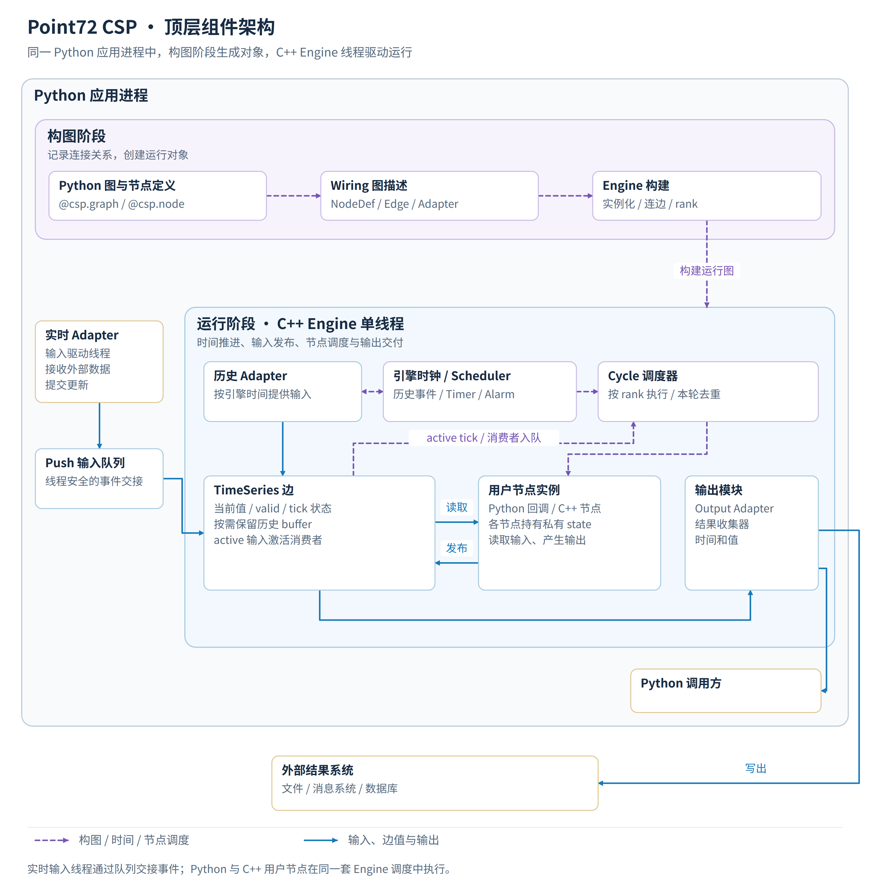
  </a>
</p>

CSP 在同一个应用进程中完成构图和执行。Python 构图层先记录节点、时间序列边与适配器的连接关系，再创建实际运行对象；运行阶段由 C++ Engine 线程推进。

| 组件 | 主要职责 |
| --- | --- |
| Python 图定义 / Wiring | 保存用户节点、边与适配器的连接描述 |
| Engine 构建 | 从输出遍历依赖，实例化、连边并分配 rank |
| 历史 / 实时 Adapter | 按时间提供历史输入，或从外部接收实时更新 |
| Push 输入队列 | 将输入线程收到的事件安全交给引擎 |
| Scheduler / Cycle 调度器 | 推进时间、处理 timer 与 alarm、按 rank 执行节点 |
| 节点实例 / TimeSeries 边 | 分别保存私有 state，以及当前值、tick 状态和历史 buffer |
| 输出模块 | 将结果交付外部系统，或收集时间和值返回调用方 |

实时适配器可以在独立线程接收数据，通过队列交给引擎；历史适配器和 alarm 则由引擎时间调度。上游节点输出更新 TimeSeries 边，再激活相应消费者，Python 与 C++ 用户节点参与同一套执行顺序。

引擎先给节点分配 `rank`，可以理解为从输入沿最长依赖路径到达节点的层数。某次输入使一组节点需要执行时，引擎按 rank 从小到大推进，同一层的独立节点不承诺先后顺序；没有连接到输出的节点会被裁剪。

例如一次行情更新：先推进价格与窗口状态，再让依赖这些状态的条件节点判断是否确认，最后才计算被该 Trigger 激活的模型。若模型同时依赖一个更新后的特征节点，依赖边会让模型排在其后面。引擎的待执行队列会避免一个节点因为多个上游同时 tick 而重复入队。

这里的“一次”是 **engine cycle**，同一个时间戳可以有多次 cycle。一次 tick 也不意味着数值一定发生变化；节点可以再次发出与之前相同的值。因此，时间戳、事件身份、值变化应分别理解。

#### 4.5.3 Feature DAG、共享依赖与按 Trigger 求值

共享特征可以直接建成一个节点，再把同一条输出边交给多个下游模型。图中连向模型的实线是 passive 数据输入，虚线是会激活模型的 Trigger 输入：

passive 输入提供当前值，变化时不唤醒该模型；Trigger 输入决定何时让模型读取这些值并计算。图中的“首次可用”“确认”和“Clock”对应第 1 章的首次预测、市场确认和周期重估。

<p align="center">
  <a href="./image/csp_shared_feature_dependencies.png">
    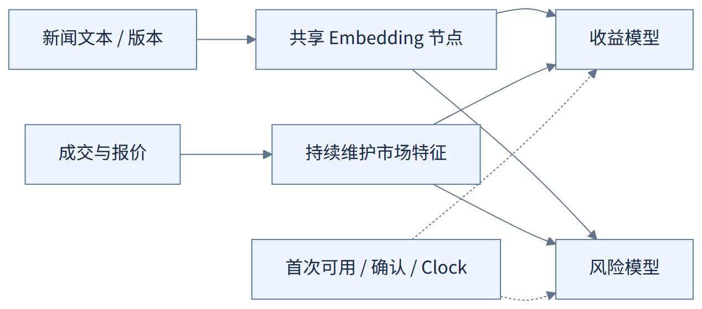
  </a>
</p>

三种复用分别作用于不同层次：

| 复用机制 | 能节省什么 | 仍要解决什么 |
| --- | --- | --- |
| 同一节点向多个下游提供输出 | 共享一次计算产生的 Embedding | 输出到底对应哪个文本与模型版本 |
| 构图 memoization | 相同构图函数与可缓存参数复用图对象，减少重复节点 | 不能据此推断每次运行输入相同就自动跳过模型 |
| 用户定义的运行结果缓存 | 按文本版本、模型版本等复用已有值 | 缓存键、淘汰、错误、就绪和失效传播 |

CSP 的图对象缓存位于构图层，键由函数及参数构成；把它称为“自动按新闻内容缓存推理结果”会混淆构图与执行。Embedding 的业务缓存可以使用 `news_id + text_version + encoder_version` 等标识。

**`passive` 不会把整条上游链变成 lazy。** 它只控制这条输入是否唤醒当前消费者，上游节点可能仍在每次行情到来时计算。反过来，若上游根本没计算出新值，clock 读取 passive 输入也不会自动向上递归补算。需要按 Trigger 运行的昂贵节点，应把 Trigger 本身接到该节点；若接口要求 `ensure(target)` 递归补齐依赖，则需要另外实现求值与版本检查。

#### 4.5.4 顺序 Trigger、多输入与按标的状态

“累计量首次超过 100，随后严格下一条新闻为正”适合写成有状态节点；CSP 提供状态、事件检测与边，但这条业务规则的消费和重置语义仍由用户定义：

```text
WaitingThreshold -- First crossing above 100 --> Armed
Armed -- Next news event for the same ticker --> Consumed
        +-- Positive: emit one Trigger
        +-- Negative / neutral: consume the opportunity without output
Any state -- Session reset; clear accumulated volume --> WaitingThreshold
```

如果先过滤负面新闻再进入等待节点，就变成“下一条正面新闻”，不再是严格下一条。若 trade 与 news 来自两个输入，在同一 cycle 都 tick，两个 `if` 的书写顺序也不足以证明源事件的严格先后。若业务要求严格接纳顺序，可先将输入规范为带单调序号的统一事件流，再逐事件推进状态机。

多标的可用 dict basket 表达 `ticker → ts[T]`，为各 ticker 实例化子图，使窗口、累计量与 Trigger FSM 分别拥有状态；跨 ticker 计算则把相关边显式交给同一节点。对于运行中新增标的，`csp.dynamic` 能随 dynamic basket 中 key 的加入创建子图，随移除关闭子图。

**保留逐条语义时，要检查输入是否合并。** `LAST_VALUE` 可能将多次更新压成最后一条，`NON_COLLAPSING` 将它们逐 cycle 展开，`BURST` 则把它们作为列表交付；累计量、EMA、严格下一条规则不能随意使用只保留最后值的模式。`NON_COLLAPSING` 也不替独立数据源定义全局总序。

#### 4.5.5 时间、Ready 与可见状态

| 问题 | CSP 的机制 | 仍需明确的应用约定 |
| --- | --- | --- |
| 没有新消息时怎样触发 | timer 和 alarm 由引擎时钟驱动 | 周期、起点、结束点、积压与补发规则 |
| 回放与实时怎样统一 | 节点使用 `csp.now()`，仿真推进输入时间，实时由墙钟推进 | 输入时间与 payload 中市场时间的区别 |
| 迟到和乱序怎样处理 | 历史适配器按时间提供记录 | 接入层排序、拒绝或缓冲策略；不能把引擎时钟当 watermark |
| 多路输入是否都可用 | `csp.valid(a, b)` 检查各边是否至少 tick 过 | 样本数、最大年龄、新闻版本等业务 Ready |
| 多路值是否属于同一观察位置 | 图依赖保证 cycle 内的先后关系；同适配器可用 PushGroup 协调输入 | 独立源的 as-of、输入进度和所需版本 |

历史数据有序输入、实时输入分组同步分别由适配器与执行模式约束；它们不直接提供跨源事件时间最终性，也不等于数据库事务快照。

`valid` 只证明“已有当前值”，不能证明“窗口已积累足够样本（warmup）”或“Embedding 对应当前候选”。前面的示例在缺输入时直接不输出；若调用方要求每次 Trigger 都有响应，可以显式输出 `NotReady` 并携带请求身份。类似地，多个 Trigger 是否各保存一条记录，是应用的输出约定，不由 CSP 的节点调度自动决定。

#### 4.5.6 查询、持久化与资源边界

`csp.run()` 可收集输出的 `(time, value)` 历史，`add_graph_output` 可以限制保留条数；长期在线运行更适合通过输出适配器持续写结果，调用方再维护 `latest/history` 查询。CSP 本身没有为业务状态提供 SQL 查询目录、事务或索引管理。

| 能力 | 核心运行时的边界 | 扩展需要承担的工作 |
| --- | --- | --- |
| Checkpoint / crash recovery | 图内状态与历史输入回放不构成一致恢复协议 | 同时保存输入位置、FSM、timer、配置和输出提交位置 |
| Exactly-once | 一次 cycle 的去重调度不等于外部结果恰好一次 | 可重读输入、幂等输出及协调提交 |
| 超内存数据 | 可以逐条读取远大于内存的历史输入；历史 buffer 仍占内存 | 窗口界限、结果外写、磁盘状态后端与恢复机制 |
| 水平扩展 | 一个引擎处理本进程计算图 | 按 ticker 分片、跨进程传输、背压、迁移与一致恢复 |
| 动态逻辑 | 支持动态 key 子图与 Python/C++ 自定义节点 | 在线换模型和规则仍需版本、状态迁移与切换边界 |

表中的恢复与分布式工作是应用侧扩展设计，不能由“支持 Kafka/文件 Adapter”自动推出。CSP 的节点内状态、适配器生命周期与引擎执行构成了集成基础，但并未给出整图一致 checkpoint 协议。

历史 buffer 默认只保留最新值，可以按 tick 数或时间申请更多历史；多个消费者共享一条边时，要满足其中最大的历史要求。按时间保留并不是固定字节上限，事件密度升高仍会使内存增加。

### 4.6 [Jane Street Incremental](https://github.com/janestreet/incremental)

**Incremental 是一个 OCaml 增量计算库：把值之间的依赖连接成图，输入改变后，只更新当前有人观察、且确实需要重算的部分。** 可以把它想成能动态改变公式和引用关系的电子表格；应用自己接收事件、决定何时刷新，再读取刷新完成的结果。

#### 4.6.1 用户 API：先定义关系，再明确要求刷新

| API | 含义 |
| --- | --- |
| `Var.create`、`Var.set` | 创建和修改输入变量 |
| `Var.watch` | 将变量接入增量计算图 |
| `map`、`map2` 等 | 定义一个或多个依赖值到派生值的计算 |
| `observe` | 声明调用方需要哪个节点的结果 |
| `stabilize` | 将被观察结果所需的计算推进到稳定状态 |
| `Observer.value_exn` | 读取已得到的结果；读取本身不执行刷新 |
| `bind`、`if_` | 根据输入动态选择依赖或创建子图 |

下面让两个输出共享同一个 `max` 节点；输入变化后，一次稳定化同时更新两个结果：

```ocaml
module Incr = Incremental.Make ()

let x = Incr.Var.create 10
let y = Incr.Var.create 4
let peak =
  Incr.map2 (Incr.Var.watch x) (Incr.Var.watch y)
    ~f:(fun x y -> if x > y then x else y)
let doubled = Incr.map peak ~f:(fun p -> p * 2)
let plus_one = Incr.map peak ~f:(fun p -> p + 1)
let a = Incr.observe doubled
let b = Incr.observe plus_one

let () =
  Incr.stabilize ();
  assert (Incr.Observer.value_exn a = 20);
  assert (Incr.Observer.value_exn b = 11);
  Incr.Var.set y 12;
  Incr.stabilize ();
  assert (Incr.Observer.value_exn a = 24);
  assert (Incr.Observer.value_exn b = 13)
```

`Var.set y 12` 只修改输入和待处理状态；计算发生在随后的 `stabilize`。这让调用方可以先一起修改多路输入，再统一刷新结果。若中间连续设置同一个变量多次，派生计算关注下一次刷新时的值，并不自动保存每次赋值形成的事件序列。

#### 4.6.2 顶层架构与稳定化调度

<p align="center">
  <a href="./image/incremental_top_level_architecture.png">
    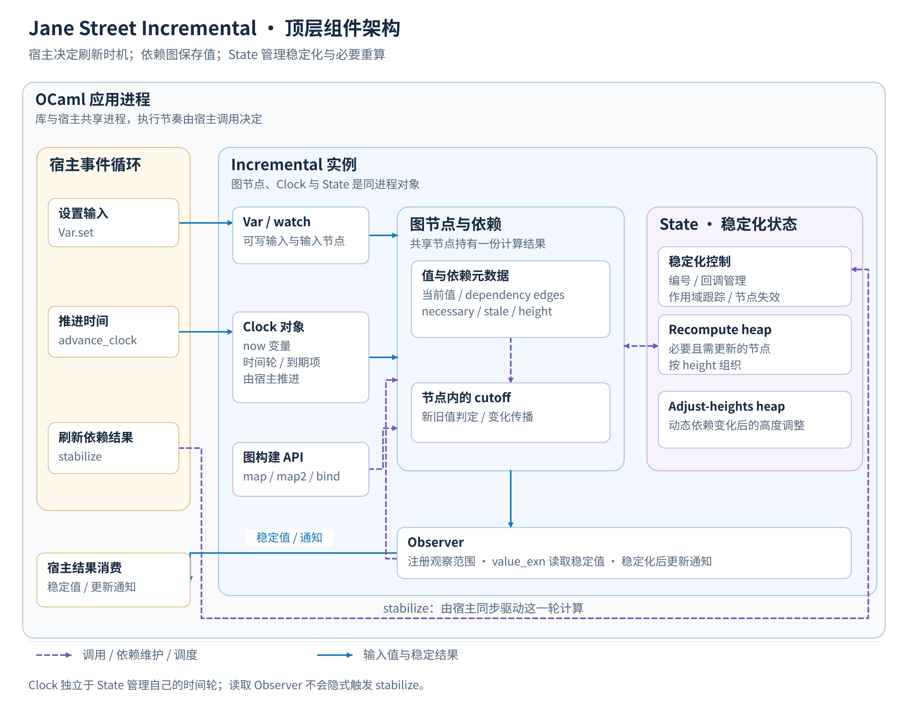
  </a>
</p>

Incremental 与宿主 OCaml 程序共享同一进程。宿主接收事件、设置 Var、推进 Clock，并选择何时调用 `stabilize`；图节点保存当前值和依赖关系，State 管理稳定化所需的调度状态。

| 组件 | 主要职责 |
| --- | --- |
| 宿主事件循环 | 控制输入更新、时间推进和稳定化的调用顺序 |
| Var / watch | 将可写输入接入依赖图 |
| Clock | 保存 now 变量、时间轮和到期项，由宿主推进 |
| 图节点与 cutoff | 保存值、依赖和必要性；重算后判断是否继续传播变化 |
| State / 两类 heap | 管理稳定化，按 height 调度重算，并在动态改图时调整高度 |
| Observer | 声明关心的输出，读取稳定值，接收稳定化后的更新通知 |

Clock 是独立的库对象，拥有自己的时间轮；State 负责稳定化编号、重算队列、高度维护和观察者管理。它们与图节点都位于应用进程内。读取 Observer 只获取已经稳定的值，新的计算由宿主调用 `stabilize` 发起。

将前面的 `max` 例子放进这套运行时，两个输出会共享同一个 `peak` 图节点：

两个观察结果都需要 peak，因此它即使没有直接 Observer，也属于必须计算的依赖。下方灰色节点不被任何观察结果依赖，本例无需计算。

<p align="center">
  <a href="./image/incremental_shared_computation_readable.png">
    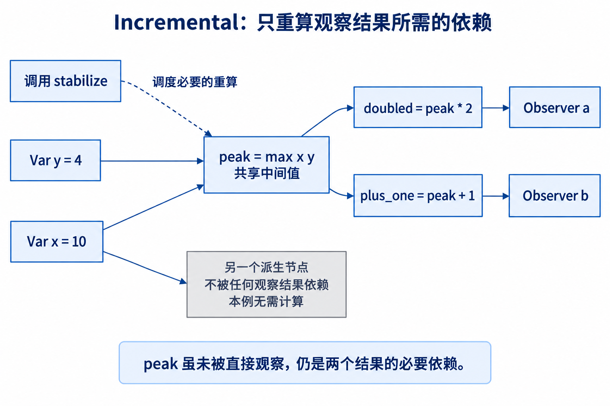
  </a>
</p>

应用持有的是图节点和变量；Incremental 的 `State` 持有当前稳定化编号、待重算队列、观察者等运行状态。调度使用按 `height` 排列的 recompute heap，使依赖节点先于使用它的节点完成。共享的 `peak` 是同一个图节点，因此两个输出使用同一份中间结果。

正常刷新过程可以概括为：

```text
Var.set updates inputs
    -> Add variable nodes requiring work to the recompute set
stabilize
    -> Take the necessary node with the lowest height
    -> Recompute from updated dependencies
    -> Compare old and new values; propagate only if cutoff does not stop the change
    -> Repeat until no necessary node needs recomputation
    -> Run the applicable observer update callbacks
```

它不是每次刷新扫描并重算整张图，也不是每次读结果时递归执行一个普通函数。**观察关系限制工作范围，输入变化决定传播路径，`stabilize` 决定何时完成这批工作。**

#### 4.6.3 necessary、stale 与 cutoff：用一次变化说明

| 概念 | 精确含义 | 不代表什么 |
| --- | --- | --- |
| `observed` | 这个节点有观察者 | 单纯持有节点变量就会观察它 |
| `necessary` | 普通依赖图中，被观察节点或其所需依赖 | 图里存在的每个节点都要计算 |
| `stale` | 从未计算，或依赖已经发生需要处理的变化 | 重算后结果一定变化 |
| `cutoff` | 重算后判断新旧值是否可视为相同，从而停止继续传播 | 在完全不知道新结果时就跳过当前节点计算 |

沿用 `x=10、y=4、peak=max(x,y)`，并假设没有其他输入变化：

| 操作 | `peak` 怎样处理 | 两个下游怎样处理 | 可读取的结果 |
| --- | --- | --- | --- |
| 创建观察者，首次 `stabilize` | 首次算出 10 | 首次算出 20 和 11 | `(20, 11)` |
| `Var.set y 7`，尚未刷新 | 还未重算 | 还未重算 | 仍是上一次的 `(20, 11)` |
| 执行 `stabilize` | 重算仍得 10，cutoff 成立 | 没有其他变化，跳过重算 | `(20, 11)` |
| `Var.set y 12`，再刷新 | 重算得到 12，继续传播 | 分别重算 | `(24, 13)` |
| 再刷新，但没有任何修改 | 无须重算 | 无须重算 | `(24, 13)` |

这里 `y:4→7` 确实修改了输入，`peak` 也确实重算过，但 `peak` 的有效值没有变化。这是“输入改变”“节点需要重算”“结果改变”三件不同的事。实现分别记录 `recomputed_at` 和 `changed_at`，避免把它们压成一个模糊的 dirty 标记。

默认 cutoff 使用 **physical equality**：立即值比较其表示，堆对象通常比较是否同一对象。两个内容相同但分别分配的对象可能继续传播；原地修改同一个可变对象，则可能使变化检测失去预期效果。用户可以通过 `set_cutoff` 指定合适的相等语义；浮点容差 cutoff 会让下游复用旧值，属于计算语义的选择。

`necessary` 也不总需要直接 `observe`。例如 `Clock.snapshot`、尚未冻结的 `freeze` 有特殊保活/求值规则；理解普通特征 DAG 时可以先使用上表的观察者模型，使用这些特殊算子时再检查其约定。

#### 4.6.4 共享依赖、按需计算与状态维护

同一个 Embedding 节点可供多个模型共同依赖，稳定化时共享其中间值。若分别调用两次“创建 Embedding 子图”的函数，通常会得到两套节点；自动增量更新不等于自动识别任意函数调用的公共子表达式。共享可以显式传递节点，也可以使用库的 weak memoization（弱引用记忆化）复用仍被使用的子计算。

| 场景 | 表达方式 | 行为 |
| --- | --- | --- |
| 多路输入共同决定模型值 | `map2`、`map3` 或结构化输入 | 在一次稳定化中使用对应的已更新依赖 |
| 只需要某个输出 | 只观察该输出 | 普通图中只保留该输出所需计算的必要性 |
| 条件选择不同模型 | `if_` / `bind` | 只让被选中的分支成为必要依赖，除非另一分支另有用途 |
| 共享 Embedding | 创建一次节点并传给多个下游 | 同一必要依赖的变化被统一处理 |
| 每条新闻都必须更新 EMA | 外层逐条维护状态，再更新输入变量；或确保逐条刷新相应状态计算 | 不能把多条新闻覆盖进一个 latest 变量后期待恢复全部历史 |

因此，它兼有 demand-driven（需求驱动）与 change-driven（变化驱动）的特点：未被需要的部分可以延迟计算，必要且受影响的部分在稳定化阶段主动向下传播。若一个昂贵模型始终被观察，而且调用方每次行情更新都 `stabilize`，模型仍可能随相关输入频繁重算。

按 Trigger 运行模型需要调用方明确稳定化节奏、观察范围或门控分支。把 `model` 和 `trigger` 都传给普通 `map2`，并不自动表示“只有 trigger 改变才能运行 model”。

#### 4.6.5 Clock、严格下一条与业务 NotReady

Incremental 有 `Clock`，但需要宿主显式调用 `advance_clock`，再 `stabilize`；它不会自行启动线程推动墙钟。`Clock.at` 在越过指定时刻时由 `Before` 变为 `After`，内部通过时间轮安排变化，可以避免让每个节点依赖不断变化的 `now`。

`Clock.at_intervals` 提供周期变化，虽然值一直是 `()`，仍通过 `Cutoff.never` 传播更新。它是增量值更新机制，不能直接当成保存了每一个错过周期的事件日志；调用方若要求每个计划时刻各产生一条记录，就必须逐次推进时钟与稳定化，或独立保存每次待执行的定时触发记录。

“累计量跨过阈值后，严格下一条新闻为正”还需要真正的事件记忆：

下图沿用三个业务状态：Waiting（等待阈值）、Armed（等待下一条新闻）和 Consumed（本轮机会已用完）。正面新闻会产生 Trigger，负面或中性新闻不会；两种情况都会结束本轮等待。

<p align="center">
  <a href="./image/incremental_next_news_state_machine.png">
    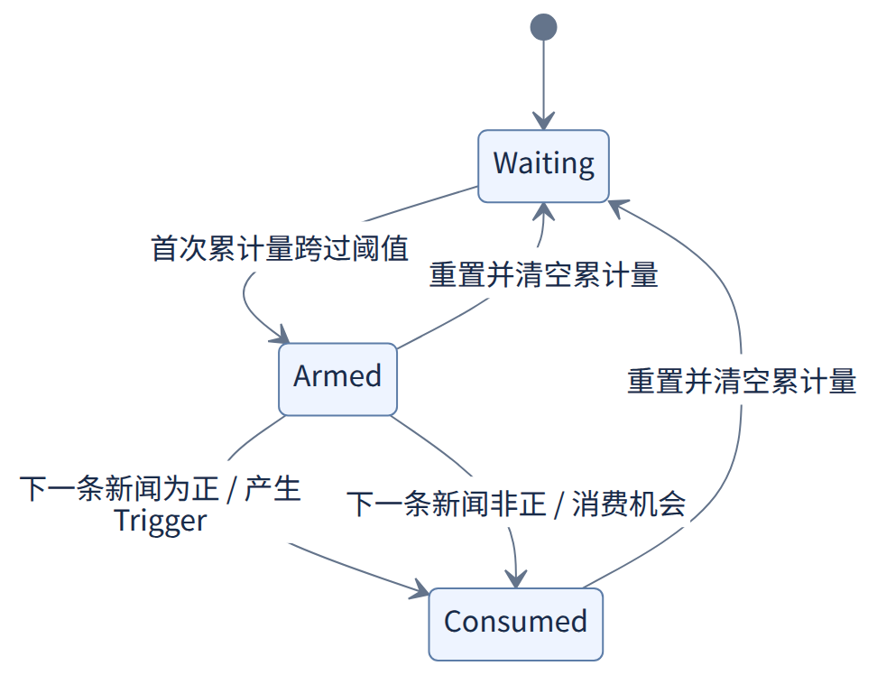
  </a>
</p>

重置对任意状态生效，并清空相应 session 的累计量。此类 FSM 可以由宿主按 ticker 保存，再把状态或 Trigger 请求接入计算图。若把负面新闻和后续正面新闻连续覆盖进一个 `Var` 后才稳定化，图只能看到最后的正面新闻，严格下一条语义就已经丢失。按 key 的窗口、EMA 和事件顺序也应拥有明确的状态更新入口；库本身不是 CEP 模式匹配器。

业务 `NotReady` 应表示为 `option`、`result` 或自定义 `Ready | NotReady` 值，并由依赖计算显式处理。它与内部 `stale` 不同：stale 表示需要更新，NotReady 表示当前输入不足。也不同于 **invalid**：`bind` 旧作用域中的节点可能因结构切换被永久失效，不能期待再稳定化就将那个旧节点“补算回来”。

#### 4.6.6 查询、一致性、恢复与扩展边界

| 能力 | Incremental 提供什么 | 不自动提供什么 |
| --- | --- | --- |
| 查询 | Observer 读取最近一次稳定化结果 | SQL、历史版本目录、查询事务 |
| 一致读取 | 稳定化后必要节点满足当前依赖关系与 cutoff 语义 | 不同数据源同一事件时间的快照；跨进程一致性 |
| 顺序与乱序 | 按调用方设置变量、推进时钟与稳定化的顺序计算 | 源 offset、watermark、迟到缓冲、撤回规则 |
| Clock snapshot | 在指定时刻对应的首次稳定化中冻结一个派生值 | 整个运行时可用于崩溃恢复的 checkpoint |
| Checkpoint / exactly-once | 可让宿主持久化输入模型后重建派生计算 | 状态、输入位置与外部 sink 的一致提交协议 |
| 超内存运算 | 可以只让需要的子图参与计算，无用对象可回收 | 持久状态后端、自动 spill、外存 Join 与排序 |
| 水平扩展 | 可以在不同宿主实例中维护独立计算图 | 自动分区、远程依赖调度、状态迁移与分布式恢复 |
| 按 key 处理 | 用每 key 输入/子图表达；配套 `Incr_map` 可增量处理 map | 类似分布式框架的 keyed state 分区与恢复管理 |

稳定化是计算阶段的完成边界，不是数据库提交。若调用方在两次稳定化之间更新了变量，再读取 Observer，得到的仍可能是上一轮值；若想对外同时发布一组结果，应在稳定化成功后由宿主形成不可变结果批次。

观察者的更新回调通常只在初始化或值改变时运行。两个独立 Trigger 即使得到相同特征值，也可能需要保存两条发生记录；不能只依靠“结果改变”回调充当 Trigger 日志。

动态计算方面，`bind` 可以根据配置切换依赖并创建子图；当控制值改变，旧作用域创建的节点会失效。动态结构会带来节点分配、依赖调整和回收成本；普通值变换用 `map` 即可。运行中切换配置不等于已经解决模型版本兼容、外部状态迁移或持久化恢复。

性能收益取决于变化范围、共享程度和节点粒度。若一次变化影响几乎全图，或每个节点只是极小的算术操作，图管理与调度开销可能抵消重算节省；可通过节点创建数、重算数和值变化数观察真实工作量。用户计算函数也不应随意抛异常：稳定化异常可能使该 Incremental 实例后续稳定化继续失败，业务错误更适合显式返回错误值。

### 4.7 横向比较

#### 4.7.1 接口、图与 Trigger

前面六个组件都能参与特征计算，差异在于它们已经替应用管理了多少工作。

| 组件 | 用户主要入口 | 特征依赖与执行 | 条件 / 时钟 Trigger | 重模型按需与缓存 |
| --- | --- | --- | --- | --- |
| Flink | SQL / Table / DataStream / Process Function | 记录推动算子图，托管连续状态 | CEP、状态机、Timer | Trigger 后接计算；版本缓存与输入绑定由应用定义 |
| RisingWave | PostgreSQL 协议、SQL、UDF | 多层 MV 持续维护关系结果 | 条件关系、周期行；复杂顺序需专门建模 | Temporal join / 按需查询；推理请求与缓存另建 |
| Timely | Rust 数据流与自定义 operator | 消息驱动图，跟踪逻辑进度 | 应用编写规则与时钟输入 | 请求消息、缓存和 Ready 协议由应用实现 |
| Materialize | PostgreSQL 协议、SQL、SUBSCRIBE | 增量维护关系及可复用索引 | 时间过滤；复杂 CEP / 周期事件由应用组织 | Trigger 请求结合一致查询；外部推理独立管理 |
| CSP | Python 构图 / 节点，C++ 引擎 | 活跃输入 tick 激活节点；被动输入供读取 | Alarm、Timer、有状态节点 | passive 输入控制唤醒；模型版本缓存由应用定义 |
| Incremental | OCaml Var / map / bind / observe | stabilize 重算必要且陈旧的节点 | Clock 由宿主推进；条件 FSM 由应用表达 | 依赖复用和 cutoff；业务 Trigger / 状态更新另建 |

#### 4.7.2 状态、恢复与查询

| 组件 | 状态与恢复 | 查询与一致性 | 持久化状态及扩展 |
| --- | --- | --- | --- |
| Flink | 托管状态 + checkpoint；端到端保证依赖 source/sink | 结果通常发布至外部存储；特征读取需要业务层定义契约 | RocksDB / ForSt 等后端、并行任务；热点 key 仍有限制 |
| RisingWave | 内部状态一致恢复；sink 交付语义取决于 connector | 只读事务使用同一快照；外部摄入进度另行判断 | 状态存储与计算分离、分布式执行；仍需管理无界状态 |
| Timely | 用户 operator 状态；通用持久恢复另建 | Probe / frontier 给出进度，结果接口自建 | 多 worker / 多进程；无通用自动 spill 或状态迁移保证 |
| Materialize | 持久输入 / MV 与重建；外部消费另定协议 | 数据库逻辑时间与事务隔离 | Cluster 资源、可复用索引及相应磁盘机制；需区分工作状态和持久存储 |
| CSP | 进程内节点状态；恢复与输出提交由应用补充 | 节点值、输出适配器；无通用数据库事务读 | 不把 graph partition / adapter 等同于托管分布式状态后端 |
| Incremental | 进程内值与依赖元数据；事件日志和恢复另建 | stabilize 后观察结果；无数据库事务 / 历史查询服务 | 主体为进程内依赖维护；持久化状态和分片由宿主负责 |


### 4.8 对自研系统的启发与现有系统的不足

本章调研的核心结论是：**自研系统需要统一管理持续更新的状态、事件触发规则、按需计算和结果记录。** 一条结果应能说明由什么事件触发、使用了哪些版本的输入。六个系统提供了不同部分的机制，下面讨论怎样把它们组合起来。

以下结论会用到几个运行时术语：

| 用语 | 在下文中表示什么 |
| --- | --- |
| shard / owner | shard 是状态分片；owner 是负责按顺序处理该分片状态的执行者 |
| 受理 / 完成 | 受理时保存请求及其固定输入；完成时保存经校验的计算结果，两者表示不同事实 |
| 请求身份 / attempt | 请求身份用于识别同一次逻辑计算；attempt 区分这次计算的不同执行尝试 |
| 已确认状态 / `UNKNOWN` | 已确认状态是已知成功提交的数据状态；`UNKNOWN` 表示暂时无法确定写入是否成功，需确认原提交的结果 |
| Source positions | 各输入分区已处理到的位置，用于确认消息和故障恢复 |

#### 4.8.1 对系统实现的六点启发

**1. 用统一的关系与依赖模型组织计算。**

[RisingWave](#42-risingwave) 和 [Materialize](#44-materialize) 说明，Feature DAG 可以表达为命名关系、视图及其依赖。自研系统可以让 SQL、C++ 接口、连续特征和请求派生特征进入同一个 Catalog，统一管理 Schema、依赖和版本。Trigger 保留自己的状态转移语义，同时参与这套对象模型。

这意味着同一套业务依赖应只有一份权威定义，查询、执行、版本校验和后续扩展都围绕它工作；数据依赖、事件顺序和激活关系则需要明确区分。

**2. 持续维护与昂贵计算应采用不同的驱动方式。**

[CSP](#45-point72-csp) 的 passive 输入、[Incremental](#46-jane-street-incremental) 的必要节点求值，以及 RisingWave 的 temporal join，都在帮助控制计算时机。对我们而言，窗口、累计量等历史状态需要持续更新；Embedding 按文本与模型版本复用；预测模型由 Trigger 发起请求。passive 只控制当前消费者的唤醒，读取当前值也不会自动补算尚未就绪的上游依赖。

**按需计算不能省掉必要的历史维护。** 把多条成交压成一个最新值，再在触发时计算，可能已经无法恢复正确的窗口或 EMA。我们需要分别定义持续维护的状态、可以复用的结果，以及这次请求实际需要执行的依赖。

**3. Trigger 必须有事件记忆，不能只看当前条件。**

[Flink](#41-apache-flink) 的 Process Function / CEP，以及 CSP 和 Timely 的自定义节点，展示了状态、时间与事件处理的组合方式。`volume > 100` 表示当前状态；“首次超过 100，随后第一条新闻为正”还需要消费、超时和重置规则。

例如 `跨阈值 → 负面新闻 → 正面新闻` 应当零次触发。先过滤负面新闻，或者只保存最新新闻，都会改变语义。这启发我们把 Trigger 实现为按 key、有明确输入顺序的有限状态机。相同 key 的路由只确定执行归属，跨源顺序仍需约定；这里由 owner 按已接纳顺序处理，并在事件进入状态机前去除消息重传造成的重复。Clock 和 Ready 变化也应能够推动状态转移。

**4. 一次计算需要固定输入，并明确不同的“完成”。**

[Timely](#43-timely-dataflow)、Materialize 提醒我们区分：数据流进度完成、业务输入 Ready、状态已经持久提交。Watermark 越过某个时间，不代表 Embedding 已经生成；一个节点已有值，也不代表它对应当前新闻版本或满足窗口样本数要求。

请求一旦受理，应冻结所需输入。例如 R42 捕获价格 100 后，行情变成 101，R42 仍使用 100；它晚返回时，也不能覆盖更新请求的结果。同 key 的串行捕获可以满足这一要求，不必立即引入通用 MVCC。这里的一致性限于 owner 对同 shard 所需输入的受控捕获，不承诺跨 key 快照或外部多源业务原子性；这也是对第三章早期“不支持快照读”表述的进一步收敛。

实现时，需要先更新本轮连续依赖，再检查 Trigger / Ready 并捕获输入；捕获结果及请求状态与本轮状态同 shard 原子提交，成功后才派发异步计算。处理时间 Timer 与 Watermark 分别表达时间驱动和事件时间进度，不能互相代替。

第三章关于“不支持跨多个特征的原子变更”和“Always Retry Process”的早期表述，也应按当前边界理解：不提供跨 key / 跨 shard 事务，但同 shard 的关系、FSM、Timer、请求及进度必须同批提交；重试须遵循稳定身份与 `UNKNOWN` 协议，不能替代原子提交。

**5. 共享计算、模型缓存、存储缓存需要分别设计。**

Materialize / Differential 的共享索引、CSP 的节点复用和 Incremental 的稳定化机制，说明复用可以发生在不同层次。共享一个 DAG 节点，可以避免正常执行时一次请求内的重复计算；按文本与模型版本保存 Embedding，可以跨请求复用；KV 缓存则减少状态访问。三者的身份和失效规则不同。

对自研系统而言，模型结果缓存应绑定业务输入与函数版本，状态缓存则必须服从 owner / epoch、已确认状态和 `UNKNOWN` 提交处理规则。Incremental 的 cutoff 还说明，“值没变化”可以减少下游计算，但两次独立 Trigger 即使结果相同，也可能必须保存两条发生记录。

**6. 恢复和资源控制必须覆盖整条链路。**

Flink、RisingWave、Materialize 的恢复实现不同，但都说明恢复需要协调输入进度、状态和结果边界。我们不能只保存 KV，而遗漏 FSM、Timer、请求及 Catalog 版本。一致 checkpoint 必须绑定这些状态与 Source positions；单独 flush KV 只完成存储边界。可靠消息重放可以承担应用 redo 的角色，仍需明确时钟、跨源顺序、异步完成和外部副作用的恢复约定，当前 RocksDB WAL 保留。

输入应在计算持久提交后按源分区已完成的连续前缀确认。提交返回 `UNKNOWN` 时，保留原身份与完整批次，先确认结果再推进。模型调用可以因故障重试，逻辑结果则需要按请求、attempt 和版本校验后只接纳一次；这一保证不自动覆盖任意外部副作用。

“连续前缀”表示不能越过未完成的消息确认后续进度。例如，同一分区先交付 A、再交付 B，即使 B 先完成，也要等 A 完成后才能一起确认到 B。

同样，状态能够落盘，也不代表请求队列、窗口索引和模型并发可以无限增长；这些都需要预算与背压。完成、超时和取消还需要保留处理容量，避免请求占满后无法释放资源。

#### 4.8.2 各系统相对自研系统目标的主要缺口

以下比较关注的是能否直接提供“C++20 特征数据库、持续状态与有状态触发、固定输入的按需计算、可查询结果及一致恢复”这一组合，而不是比较通用能力的数量。

| 系统 | 对我们最有价值的部分 | 相对目标仍需补齐的工作 |
| --- | --- | --- |
| [Flink](#41-apache-flink) | 状态、CEP、Timer、背压、checkpoint，流运行时能力完整 | 特征查询服务仍需应用组织；其 Java / JVM Runtime 也不符合我们未来做性能优化的目标。 |
| [RisingWave](#42-risingwave) | 与目标数据库形态接近：SQL、级联 MV、持久化、temporal lookup | 表达复杂 CEP Trigger 的能力稍显不足，依赖复杂 Temporal Join |
| [Timely Dataflow](#43-timely-dataflow) | 执行图、分区、进度跟踪，运行时原理值得借鉴 | 抽象层次较低，Catalog、SQL、状态后端、业务 Trigger、请求管理及完整恢复都需要继续建设；还有 Rust 集成成本。Differential 可以补充关系增量计算，业务生命周期仍需定义。 |
| [Materialize](#44-materialize) | 关系增量维护、共享索引、一致查询 | 与 RisingWave 类似，表达复杂 CEP Trigger 的能力稍显不足，依赖复杂 Temporal Join  |
| [Point72 CSP](#45-point72-csp) | 与金融时序场景贴近，节点、时钟、active / passive 输入直观，底层是 C++ | 定位是单机进程内计算库；故障恢复、分布式扩展、领域语言（DSL）、状态持久化和管理需要另行实现 |
| [Jane Street Incremental](#46-jane-street-incremental) | 必要依赖、共享计算、稳定化和变化截断 | 定位是单机进程内计算库；故障恢复、分布式扩展、DSL、状态持久化和管理需要另行实现，还需处理 OCaml 与 C++20 的集成 |

这些缺口分别体现为业务语义需要额外定义、系统设施需要额外建设，以及语言或部署形态需要额外集成。Embedded Library 提供了直接的计算抽象，但宿主要承担更多系统责任；成熟流系统已经解决大量分布式问题，特征产品的业务协议仍需组织。

#### 4.8.3 自研系统的合理定位

结合业务需求，可以采用以下设计思路：**借鉴 RisingWave 的数据库组织方式、Flink 的状态与时间语义、CSP / Incremental 的计算激活与复用方式，形成范围有限但连接完整的 C++ 特征数据库。** Timely / Materialize 则为计算进度、结果一致性和共享关系状态提供参照。

研发工作应集中在关系与物化视图、触发状态机、输入捕获和请求的受理到结束过程；关系计算先支持有限范围，存储与通信复用成熟组件。

自研的目标是让用户在同一个系统中定义特征状态、触发规则和按需计算，并查询结果；前面的比较说明了实现这条完整流程时可以借鉴什么。

## 附录：参考资料

### 参考资料与研究记录

各组件的资料入口集中放在这里，正文按机制和例子展开。

| 组件 | 资料入口 |
| --- | --- |
| Flink | [状态与时间接口](https://nightlies.apache.org/flink/flink-docs-release-2.3/docs/dev/datastream/operators/process_function/)、[CEP](https://nightlies.apache.org/flink/flink-docs-release-2.3/docs/libs/cep/)、[状态后端](https://nightlies.apache.org/flink/flink-docs-release-2.3/docs/ops/state/state_backends/) |
| RisingWave | [物化视图](https://docs.risingwave.com/sql/commands/sql-create-mv)、[Join](https://docs.risingwave.com/processing/sql/joins) |
| Timely / Differential | [Timely 教程](https://timelydataflow.github.io/timely-dataflow/)、[API](https://docs.rs/timely/latest/timely/)、[Differential API](https://docs.rs/differential-dataflow/latest/differential_dataflow/) |
| Materialize | [架构](https://materialize.com/blog/materialize-architecture/)、[View 与 MV](https://materialize.com/docs/fundamentals/concepts/views/)、[查询隔离](https://materialize.com/docs/reference/isolation-level/) |
| Point72 CSP | [Graph](https://github.com/Point72/csp/wiki/CSP-Graph)、[Node](https://github.com/Point72/csp/wiki/CSP-Node) |
| Jane Street Incremental | [官方教程](https://github.com/janestreet/incremental/tree/v0.17.0/doc)、[概念介绍](https://blog.janestreet.com/introducing-incremental/) |
